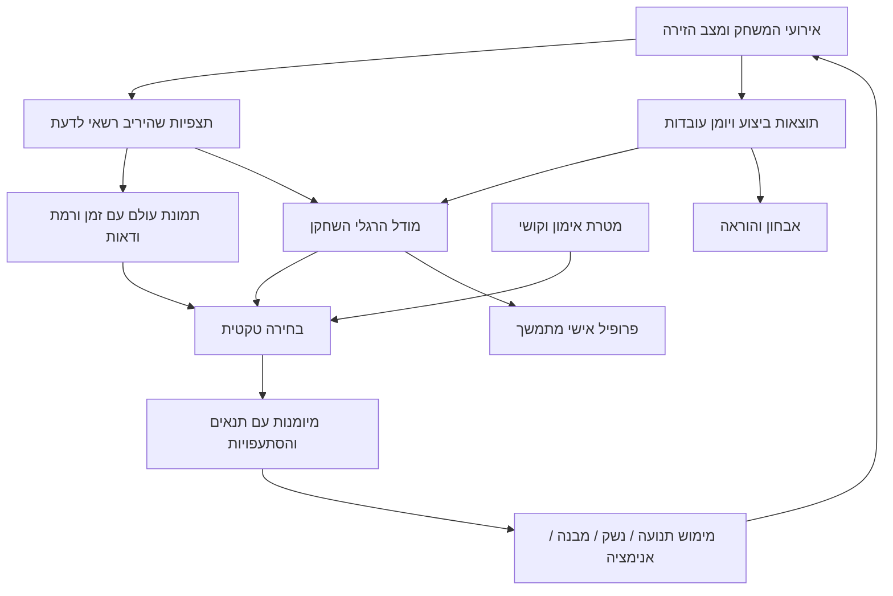

# לב הפרויקט: יריב שבונה, עורך, נלחם ולומד

## עדכון תוצאת ניווט — 8 בנובמבר, הכנת175

נפתחו מחדש [NavigateTo](https://dev.epicgames.com/documentation/en-us/fortnite/verse-api/fortnitedotcom/ai/npc_actions_component/navigateto), [תוצאות הצלחה](https://dev.epicgames.com/documentation/en-us/fortnite/verse-api/fortnitedotcom/ai/navigation_action_success_type) ו־[תוצאות שגיאה](https://dev.epicgames.com/documentation/en-us/fortnite/verse-api/fortnitedotcom/ai/navigation_action_error_type), ונבדקו מול digest43.00 המקומי. החוזה מבדיל בין Reached לבין PartiallyReached, ובין Blocked/Unreachable/Invalid לבין Interrupted. הגעה חלקית אינה הוכחת הגעה ליעד שביקש הבקר. אלו תוצאות API, לא מדידה של איכות ניווט הפרויקט.

175 מכין ב־ExecuteGroundTactic זיכרון זמני של בקשה שנדחתה/הגיעה חלקית או גוף שכמעט לא התקדם, כאשר הוא עדיין רחוק מהיעד. הניסיון הבא מחליף צד כל עוד הגוף, התצפית והדור נשארים באותו מצב מקומי; הזיכרון מוגבל6שניות. נמדדים מיקום הגוף והעמדה הנראית של המתאמן בלבד, ללא הפקת סוג מבנה/בעלים או עריכה מתוך כישלון. הפרעה, אובדן ראייה או ביטול אינם כישלון שנלמד. התקדמות והגעה מנקות את המצב. מקור אחד התקמפל ונשמר לאחר תיקון מחזור החלופות; הספים, תועלת העקיפה ותוצאות בשינוי גאומטריה עדיין לא נבדקו במשחק. אין מסקנת איכות פרו או שינוי בשערי הבנייה. רשומה: `.local/ground-recovery175-authoring.json`.

## עדכון תנועה וירי — 8 בנובמבר, הכנת172

נבדקו מחדש [Attack](https://dev.epicgames.com/documentation/en-us/fortnite/verse-api/fortnitedotcom/ai/guard_actions_component/attack), [NavigateTo](https://dev.epicgames.com/documentation/en-us/fortnite/verse-api/fortnitedotcom/ai/npc_actions_component/navigateto), [Tether](https://dev.epicgames.com/documentation/en-us/fortnite/verse-api/fortnitedotcom/ai/guard_actions_component/tether), [תשובת צוות Epic על Focus ו־Attack](https://forums.unrealengine.com/t/using-getfocusinterface-maintain-focus-on-guards-guards-no-longer-shoot/2626611) והערות43.00. החתימות נבדקו גם ב־digest43.00 המקומי. Attack דורש יעד שזוהה; Tether מגדיר הצמדה למיקום ברדיוס בס״מ. תשובת הצוות מדגימה בקשות Focus ו־Attack במקביל, בנפרד מפעולת התקרבות. אלו חוזי פעולות והדגמה מטעם הצוות, לא הוכחה מקומית לירי מדויק בזמן תנועת צד.

במוצר כל חלון ירי השתמש בהצמדה75ס״מ, אחרי שלב תנועה.172 מכין חלון קרקע לרובה שבו Focus, Attack ו־NavigateTo פועלים באותו תחום חיים, עם יעד צד100–160ס״מ לפי קושי והטיית נסיגה בטקטיקתDisengage. תנאי הכניסה: טקטיקת קרקע שאינהHoldAngle, רובה שבבעלות הבקר, גוף שאינו באוויר, טווח600–2200ס״מ וללאShortOpening. היעד נגזר מהתצפית העדכנית ונחתך לגבולות הזירה; בחירת הצד משותפת להתאוששות ולהרגלים. שוטגאן, הצצה ומצבים אחרים נשארים במסלול העמידה. חזרת בקשת ניווט אוAttack אינה מסיימת את חלון הירי לבדה. תוקף ראייה/דור/נשק ומשוב הירי ממשיכים להישמר בבקר החיצוני, עם ניקוי ניווט וירי.

מקור אחד התקמפל ונשמר לפי `.local/ground-fire172-authoring.json`. לא הופעל משחק, לא נצפתה עדיין תנועה תוך ירי ולא נמדדו ניווט/דיוק/חסימה או רמת פרו. ארבעת שערי הבנייה נשארוFalse. האימות נוסף למסלול הקרב הסופי הקיים, ללא סבב נוסף כעת.

## עדכון תגובה למכשול — 8 בנובמבר, הכנת164

נבדקו שוב השאלה של מיפוי בנייה מקורית, ממשקי הבנייה ב־digest43.00 המקומי, ונתיב חלופי של תגובה למכשול מזוהה. [Guard awareness](https://dev.epicgames.com/documentation/fortnite/verse-api/fortnitedotcom/ai/guard_awareness_component) מתעד `DetectedObstacle` ואירועי זיהוי ושכחה; [Guard actions](https://dev.epicgames.com/documentation/en-us/fortnite/verse-api/fortnitedotcom/ai/guard_actions_component) מתעד `Attack` למטרה שנמצאה. אלה תומכים בכתיבת בקשת פעולה על ישות שה־Guard דיווח עליה, לא בהוכחת בעלות קיר, זיהוי עריכה או הרס בעקבות הבקשה. השאלה של קבלת מבנה מקורי כיעד ונזק אליו עדיין דורשת ראיית משחק; לא הופעל משחק במחקר הזה.

נמצא פער במימוש המועמד: חלון תקיפת מכשול לא עקב אחר שינוי/שכחת אותה ישות או חזרת השחקן לראייה, ודחייתAttackעדיין החזירה סימון שטופלה פעולה.164מוסיף מעקב אחר זהות הדיווח, טווח, מצב ודור, הפסקה בחזרת ראייה, ניקוי ירי/ניווט והחזרתFalseלאחר דחייה מפורשת כדי לאפשר תנועה/חיפוש. אין הפקת בעלות לפי הדיווח, אין אירוע עריכת שחקן חדש ואין פתיחת שער בנייה. נתיב הלחץ כולו ממשיך להיות מותנה בארבעת השערים; תוצאת הקומפילציה והשמירה, בנפרד מהמחקר, רשומה ב־BUILD_STATE.

## עדכון תצפית ממוקד — 8 בנובמבר, הכנת151

השאלה שנבדקה: זיהוי החלק, בעליו והעריכה שביצע שחקן בבנייה המקורית במהלך קרב חופשי, לצורך תגובת היריב ואבחון של רגע מסוים. נבדקו תיעוד/API, היסטוריית43.00, דיווחי יוצרים ונתיב חלופי של שאילתות פיזיות; לא הופעלו משחק או ניסוי מנוע, לפי הוראת המשתמש.

ב־digestהמקומי של43.00,CL59596594, חיפוש שמות הקשורים לבנייה/עריכה הצביע על `fort_inventory_build_hotbar_component`. [התיעוד שנקרא](https://dev.epicgames.com/documentation/en-us/fortnite/verse-api/fortnitedotcom/itemization/fort_inventory_build_hotbar_component) מתאר מלאי ואירועי ציוד/פריטים; קריאה זו אינה הוכחת זהות או בעלות של מבנה שנוצר. [תיעוד Scene Graph](https://dev.epicgames.com/documentation/fortnite/creating-your-own-component-using-verse-in-unreal-editor-for-fortnite) מתאר שאילתותSweep/Overlapורכיב פגיעה; גם הוא אינו מוכיח כיסוי לכל בנייה מקורית או בעלות שחקן. [הערות43.00](https://dev.epicgames.com/documentation/fortnite/43-00-fortnite-ecosystem-updates-and-release-notes) מתעדות עדכוני שאילתות; אין להסיק מכך שאירוע עריכת שחקן אומת בפרויקט.

[שאלת יוצרים על הבחנה בין מבנה שחקן למבנה שהוצב מראש](https://forums.unrealengine.com/t/distinguish-player-created-structure-from-structure-placed-by-the-game-creator/2717500) מציעה תיוג של מה שהיוצר הציב, ואינה מדגימה זיהוי בעלות של בנייה חדשה. [דיווח43.00על כלי בנייה בידיNPC](https://forums.unrealengine.com/t/uefn-43-00-can-npcs-use-native-building-wall-replacement-edits-and-resets/2850177) מתאר ניסיונות בתצורה מסוימת, לא מגבלה כללית. אין לשנות את ארבעת שערי הבנייה על סמך מקורות אלה.

מסקנת הסבב המוגבל: נתיב תצפית מדויק לבנייה חופשית **טרם אומת**; אין כאן מסקנה כללית של חוסר אפשרות. החיפושים הבאים חזרו לממשקים ולדיווחים שכבר נמצאו, ולכן נעצרה הרחבת המחקר. הראיה החסרה היא מיפוי של פגיעה פיזית לחלק מקורי ולבעלות/שינוי שלו בתצורה הזו. אימות כזה נשאר בסבב הקבלה המרוכז; אין לחדש כעת ניסויים היסטוריים. במקביל,151משפר מדידות מעבר במסלול הידוע; זמני המקטעים אינם תחליף לדרישת זיהוי העריכות בקרב.

תאריך: **6 בנובמבר 2026**. מחקר ותכנון ראשוני, גרסה 0.1.

## ההחלטה המוצעת

לבנות קודם זירת ניסוי של **שחקן אחד מול יריב אחד**, ולהוכיח בה רצף קרב שלם. ההמלצה היא מוח טקטי מקומי, ספריית מיומנויות תגובתיות ומנגנון ביצוע שניתן להחליף. נבדוק בנייה מקורית לצד מערכת מבנים משלנו; נבחר לפי ההתנהגות שהשחקן חווה בפועל.

המשתמש אישר במפורש חלופות ושיטות מימוש יצירתיות. לכן החלפת מנגנון פנימי אינה דורשת עצירה לאישור נוסף. תנאי המוצר נשארים מחייבים: בנייה, עריכה, לחימה והסתגלות שמרגישות אמיתיות. קיר שנראה נכון אך מאפשר ירי דרכו, או רצף שממשיך כשהשחקן שבר אותו, נכשל בדרישה.

**יש בסיס מתועד לחלקים רבים. עדיין לא הוכח כאן בוט שמבצע קרב בנייה ועריכה מלא ברמת פרו בתוך אי שניתן לפרסום.** אין במחקר הזה תוצאת קומפילציה, משחק או פרסום מקומית. ההתאמה לשחקני עילית היא יעד שצריך למדוד מול שחקנים כאלה.

## מה נמצא ומה נשאר להוכיח

| תחום | הראיות שנבדקו | המשמעות לפרויקט |
|---|---|---|
| גוף, תפיסה ולחימה | פעולות Guard, התראות תפיסה, תנועת NPC והפעלת נשק מתועדות. [1–4] | להתחיל ב־NPC אמיתי ובנזק אמיתי. דיוק בתזמון, בכיוון ובתנועה דורש ניסוי. |
| בנייה מקורית בידי NPC | קיים מלאי ייעודי לכלי בנייה; בדיקת יוצר עדכנית הצליחה לצייד Guard בכלים אך לא הדגימה הצבה/עריכה/איפוס. [5–6] | המסלול עדיין פתוח למחקר וניסוי. החזקת Blueprint אינה הוכחת בנייה. |
| מבנים שנשלטים בקוד | תבנית Procedural Building רשמית מדגימה רשת לוגית והצבת חלקים דרך Verse. [7] | בסיס שימושי לחלופה; התבנית אינה בוט בנייה או תחליף מוכח למערכת הבנייה התחרותית. |
| גאומטריה ותנועה | Mesh ב־Scene Graph מציע collision, שאילתות ותרומה לניווט; קיימות שאילתות Sweep. [8–9] | לבדוק ירי, מעבר, תפיסה וניווט בנפרד. |
| מבנים שנשברים | Prop Manipulator מאפשר בריאות ואירועי פגיעה/הריסה עבור Props. [10] | מועמד לניסוי עם חלקים שהוכנו מראש; התאמה לחלקים שנוצרים/זזים דורשת בדיקה. |
| נזק ישיר לישויות | 43.00 מוסיף Health/Damage Pipeline כ־Experimental ומציין שפרסום ייפתח כשייצא מהשלב הזה. [11] | מועמד למחקר נפרד; לא להפוך אותו לתלות של גרסת הפרסום כעת. |
| למידה בתוך הקרב | אפשר לתכנן מודל הרגלים ועדכון בחירת מהלכים; קיימים מחקרים על התאמת יריב לשחקן. [12–13] | המנגנון המוצע שלנו אינו תוצאת Fortnite מוכחת. איכות תלויה במידע שנצליח למדוד וביכולת לבצע. |
| זיכרון בין ביקורים | Verse מתעד שמירת פרופיל לפי שחקן וטעינתו בביקור הבא. [14] | לשמור מודל קטן, מדדים ושיעורים; לבדוק בפועל חזרה, עדכון סכימה וגבולות גודל. |
| מנוע למידה חיצוני | WebAPI מתועד בהקשר של גישה ברישוי; הזכאות של החשבון לא אומתה. [15] | לתכנן ליבה שפועלת מקומית באי, ולהוסיף הרחבות חיצוניות אם תימצא גישה מתאימה. |

## שלוש אי־הוודאויות שמכריעות את הארכיטקטורה

1. **ביצוע:** האם NPC יכול להציב, לערוך ולאפס חלקי בנייה מקוריים באמצעות מסלול ציבורי שניתן לפרסום? אם כן, זה המועמד הראשון לנאמנות למקור.
2. **תצפית:** האם ניתן לזהות בזמן ובדיוק את הבנייה המקורית של השחקן, כולל מיקום, צורה ובעלות? זיהוי מכשול אינו בהכרח גישה לזהות בעל הקיר או לתאים שנערכו בו.
3. **שיתוף מקום:** אם הבוט בונה חלק חלופי והשחקן משתמש בבנייה המקורית, האם הם מתחרים נכון על אותו שטח? חייבים למנוע כפל קירות, השתלטות שגויה וקיר בלתי נראה.

בנייה מותאמת פותרת שליטה במבנים שלנו. היא משאירה עבודה משמעותית במפגש עם המבנים המקוריים. זוהי בדיקת הליבה הראשונה, לפני הרחבת הזירה או מספר המהלכים.

## החלופות שנבדקו והמסלול המועדף

| מסלול | איך הוא פועל | מה מושך בו | מה חייבים להוכיח |
|---|---|---|---|
| A — בנייה מקורית | NPC מפעיל את כלי הבנייה ואת פעולות העריכה המקוריים. | הסיכוי הגבוה ביותר להתאמה לבעלות, עריכות, משאבים וחוקי Fortnite. | פעולת הפעלה ציבורית, הצבה אמיתית, בחירת מבנה, עריכה ואיפוס. עדיין לא אומת. |
| B — שחקן מקורי + מבני בוט משלנו | השחקן משתמש בכפתורים ובבנייה הרגילים; הבוט יוצר/מחליף מבנים שנשלטים בקוד. | שומר על תחושת השליטה של השחקן ונותן שליטה מלאה בצד הבוט. | זיהוי בניית השחקן, התנגשות בין המערכות, שבירה, החלפת בעלות והתנהגות הנשק. זה מועמד הניסוי המוביל לצד A. |
| C — מערכת בנייה משותפת לשני הצדדים | השחקן והבוט משתמשים באותו מודל חלקים, בעלות ועריכות שנכתוב. | כל פעולה ואירוע ידועים; קל יותר לקיים חוקי בעלות ושחזור עקביים. | קליטת קלט, תחושת עריכה, קיצורי מקשים, בקר/מגע, חיזוי וזמן תגובה שמספקים שחקנים מתקדמים. |
| D — זירות מקומיות שהוכנו מראש | אוסף חלקים ותצורות קרב, שמופעלים ומוחלפים בתגובה לשחקן. | ניסוי קטן ומהיר של קרב קיר, פתיחה וירי; חוסך יצירת תוכן בלתי מוגבל. | הסתעפות, ביטול, המשכיות מרחבית וחופש פעולה. התחלה טובה לניסוי B ולשיעורים; אינה מוכיחה קרב בנייה פתוח. |
| E — הפעלה ממחשב חיצוני | מודל רואה מסך ומפעיל דמות שחקן דרך לקוח נפרד. | השראה לחקר חיקוי ולמידה. | לא נמצא במסגרת המחקר מסלול מוכח להפוך זאת ל־NPC עצמאי לכל שחקן באי ציבורי. אינו תלות מומלצת למוצר. |

ההעדפה ל־B מותנית בתוצאות. נתחיל בגרסה קטנה שלו, עם חלקים שהוכנו מראש ו־NPC מקורי, בזמן שנבדוק את A. אם B נכשל בתפיסת קיר או בהשתלבות עם בנייה מקורית, נבדוק את C מול מבחן קלט מחמיר. מעבר ל־C שומר על יעד החוויה, אך דורש עבודה נרחבת מאוד כדי להתקרב לתחושת Fortnite.

אפשר להשתמש ב־Props עבור חלקים מסוימים ובישויות עבור אחרים. אין להחליף את התשתית בכל הפרויקט בגלל API יחיד שנראה מבטיח. בפרט, מעטפת Scene Graph במצב Beta אינה קובעת את מצב הפרסום של כל רכיב בתוכה. [11, 16]

### ממצאים שמחייבים ניסוי נקי

נמצא דיווח מספטמבר 2026 על קיר Prop שחסם גוף אך לא מנע הצבת קיר שחקן באותו מקום. היוצר הציע מעקף, וב־8 באוקטובר חזר בו: מצב שנשאר מהגדרת עורך יצר מראית עין של הצלחה. [26] לכן נבדוק אחרי הפעלה חדשה ובניית מפה נקייה, מעבר ל־Live Edit. הדיווח אינו קובע שכל נכס או מסלול ב־43.00 ייכשל.

נמצא גם רצף דיווחים, כולל מ־2026, על Prop Manipulator שלא שולח אירועים עבור Props שנוצרו בזמן ריצה. [27] לכן pool שהוכן מראש, יצירה דינמית ונזק ל־Scene Graph הם שלושה ניסויים נפרדים. חלק שנהרס דורש מדיניות חידוש: מלאי חלופי מוגבל, יצירה מחדש עם מסלול אירועים מאומת, או מנגנון נזק אחר. אין להניח שאפשר לרפא אובייקט שכבר הוסר.

חלופות ממוקדות לפערים האלה:

- לבדוק נכס עם הגדרות grid/attachment/block-building מתאימות, ומעטפת מקורית מאחורי חלק חזותי בזירה מוכנה. יש לבדוק שהמעטפת אינה משאירה חסימת ירי בפתח ושהחלפתה ניתנת לביצוע בזמן הקרב. הדיווח [26] אינו מוכיח מסלול מלא כזה.
- לבדוק רכיבי בנייה רשומים לרשת בנפרד מחלקים נעים: תיעוד animation_controller מציין רישום לרשת כסיבה אפשרית לחלק שאינו מתאים לאנימציה. [28] לא כל דרך תנועה/החלפה הוכרעה מכך.
- לבדוק חסימה אזורית באמצעות Mutator Zone רק אם היא שומרת על חופש הבנייה. התיעוד מתאר איסור בנייה עבור שחקנים בתוך האזור; אין בכך הוכחה לנעילת קצה קיר מסוים. [29]
- אם השליטה המשותפת המקורית/חלופית אינה אמינה, לבדוק מערכת משותפת C עם Player Input API ויכולות בעלות timeline חזוי. [19, 30] אלו מועמדים למדידה; תגובת קלט זהה לבנייה המקורית טרם הוכחה. ההשהיה המתועדת של Input Trigger [25] אינה חלה אוטומטית על כל API קלט.

### מסלולים שנראים מבטיחים בשם בלבד

- ב־NPC Character Definitions מופיע גם `Participant`, עם תיאור ריק בעמוד שנבדק. תיעוד Test Players מקשר התנהגות מותאמת לדמויות בדיקה. זה ניסוי רלוונטי, ולא הוכחה ל־NPC בעל קלט שחקן או לפרסום יריב כזה. [17–18]
- Custom Abilities מציעות תיאום פעולות על ציר זמן. הן מועמדות לתיאום מחוות/אפקטים/מהלכים, אך לא נמצאה בהן הוכחה להפעלת עריכת קיר מקורית. [19]
- MCP ו־Python של העורך מועילים להכנת נכסים, ניסויים ועריכת הפרויקט. תוצאת פעולה בעורך אינה פעולה של בוט בקרב באי שפורסם. [20]
- נבדק README של BuildBot: הפרויקט מתאר צילום מסך, פעולות בדמות דרך לקוח ואימון PPO/חיקוי, ומציין שחלק מאימות האימון עדיין בפיתוח. הוא אינו מציג ב־README ראיה ל־NPC שפורסם ובונה כמו פרו. לא הורץ ולא הועתק קוד ממנו. [21]

## ארכיטקטורת הבוט המוצעת



זה תכנון של הפרויקט, לא תרשים של מערכת קיימת ב־UEFN. שמות הפעולות בהמשך הם חוזה תכנוני שלנו, ולא שמות של פונקציות Verse קיימות.

### 1. תפיסה: לדעת מספיק, ולשמור על קרב הוגן

להפריד שלושה סוגי מידע:

- מידע סמכותי למנהל הזירה: נזק, מוות, הפסקה, משאבים ומבנים שבשליטתנו.
- מידע שהיריב רשאי לדעת: שחקן שנראה/נשמע, מיקום אחרון שנצפה, מכשול שנמדד ופעולה גלויה.
- מידע לאבחון אחרי הקרב: אירועים שנמדדו, עם מקור ורמת ודאות.

`npc_target_info` מתעד בין השאר `HasLineOfSight` ו־`LastKnownPosition`; רכיבי התפיסה מספקים אירועים. [3] נשתמש בהם כבסיס ולא נעביר אוטומטית למוח היריב כל Transform שהשרת יכול לקרוא.

כל תצפית תכלול זמן, שחקן/זירה, מקור ורמת ודאות. מיקום אחרון יתיישן; בעלות שלא נמדדה תישאר Unknown. לא נהפוך היעדר פגיעת Sweep להוכחה שהמקום פנוי לפני שאומת שהשאילתה מזהה גם את סוג המבנה הרלוונטי.

### 2. תמונת עולם מקומית

למפות את האזור סביב הקרב לרשת חלקים: קיר על גבול תא, רצפה, מדרגה וגג, עם צורה, חומר, בעלות, בריאות, תמיכה, מקור המידע וגרסת מצב. רשת קירות דורשת זיהוי קצה קנוני: אותו קיר שנצפה משני תאים חייב לקבל מזהה אחד.

הנחיות המידול הרשמיות נותנות בסיס של 512 ס״מ במישור ו־384 ס״מ לגובה קיר. [22] אלה מידות התחלה לאימות, לא הוכחה שכל Pivot או חלק ערוך מתאים אוטומטית. בכל נקודת חיבור נבדוק יחידות ואת מעבר XYZ/LUF.

מפת הניווט לטקטיקה תכלול עמידות וזוויות ירי, ולא רק נקודת יעד במרכז תא. ניווט רגיל ישמש לתנועה כללית; קפיצה לרמפה, מעבר בחלון ו־peek דורשים ניסויים נפרדים ותנאי כישלון.

### 3. בחירה טקטית

לכל מצב ניצור כמה אפשרויות חוקיות ונדרג אותן לפי יתרון צפוי, חשיפה, משאבים, זמן, הרגלי השחקן ומטרת האימון. דוגמאות: לשמור זווית, להחליף קיר, לסגור יציאה, לסגת לתא בטוח, להעניש פתיחה חוזרת, לשנות צד או לנסות עלייה.

הבחירה תכלול אי־ודאות ומעט גיוון בין אפשרויות סבירות. תנאי בטיחות וחוקיות יקודמו לדירוג: אין עריכה של קיר שאינו בבעלות הבוט, ירי ללא תנאים תקינים או בנייה במקום תפוס.

לבקר אחד תהיה הבעלות על תנועה, כיוון ופעולת נשק בכל רגע. עדיפות לדוגמה: סיום/מוות → יציאה ממצב תקול → הגנה דחופה → המהלך הנוכחי → בחירה חדשה. ריבוי משימות אינו סיבה לשני בקרים שמושכים את הדמות לשני כיוונים.

### 4. מיומנויות תגובתיות

ספריית ההתחלה המוצעת:

| משפחה | יכולת רצויה | תגובה להפרעה |
|---|---|---|
| זוויות ירי | פתיחת זווית ימנית, ירי וחזרה למחסה. | סגירה או החלפת זווית אם השחקן מכוון/מתקדם. |
| עריכה | פתיחה, חצייה או ירי, ואיפוס בזמן מתאים. | ביטול אם הבעלות אבדה או הפתח נחסם. |
| לחץ על קיר | פגיעה במבנה, ניסיון החלפה ותפיסת הזדמנות. | מעבר צד או נסיגה אם ההחלפה נכשלה. |
| שליטה בשטח | הצבת גג/רצפה/קיר כדי לצמצם יציאה. | תגובה ליציאה אחרת של השחקן. |
| הגנה | יצירת מחסה, התרחבות לתא סמוך והחלפת מיקום. | שינוי מסלול כשנפגע חלק חיוני. |
| גובה | עלייה מוגנת ושמירת אפשרות ירידה. | עצירה/מסלול אחר אם התמיכה נשברת. |
| רצפי עריכה | double/triple edit כחלק ממסלול שימושי. | מעבר לפעולה מקומית אם השחקן שינה את השטח. |

לכל מיומנות: תנאי כניסה, דרישות מידע, חלקים ומשאבים, שלבי ביצוע, נקודות בדיקה, חלון תגובה, תנאי ביטול ופעולת התאוששות. סדרות ארוכות יפורקו לצעדים. תנועה ואנימציה יידרשו להתאים למקום שבו הגוף והנשק פועלים בפועל.

**התחלה צרה אינה שינוי יעד:** קודם נוכיח קרב קיר ועריכה ברמה גבוהה; לאחר מכן נרחיב ל־piece control, כמה תאים וקרבות גובה. רשימה גדולה של שמות מהלכים אינה תחליף למהלך אחד שעובד מול הפרעה חופשית.

## איך המערכת החלופית יכולה להיראות אמיתית

### מצב מבנה אחד לכל המערכות

כל מבנה שלנו יקבל רשומת מצב אחת. הצבה/עריכה/איפוס תיבדק מול גרסת המצב, הבעלות, השטח הפנוי והתמיכה. השינוי הגרפי וההתנגשות יתואמו עם ההתחייבות הלוגית. פעולה שקיבלה תשובה מאוחרת אחרי ביטול/מוות תידחה באמצעות מזהה ניסיון וגרסת קרב.

אלה תנאי התכנון, לא הבטחת החלפה אטומית בין לקוחות. בניסוי נמדוד אם מופיע פריים שבו יש חור גרפי עם קיר פיזי, פתח שאפשר לירות דרכו מוקדם מדי, או גוף שנתקע במעבר. עריכה שצריכה כמה חלקים לא תיצור רגע זמני שאפשר לנצל.

### חומר, חיים ותחושת בנייה

לבנות ערכת חלקים תואמת לרשת, עם צורות עריכה, collision נכון, שלבי הקמה, אפקטי פגיעה, קול ומראה חומר. בריאות שנצברה בבנייה, נזק קיים, עלות משאבים ותמיכה יישמרו לפי הכללים שנבחר לאימון. נמדוד אותם מול בנייה מקורית במקום להמציא התאמה מספרית.

יד עם Blueprint יכולה לחזק את האמינות, אך תזמון ההופעה, תנועת המבט והמצב של הנשק חייבים להתאים לפעולה. אנימציות מותאמות ו־Animation Presets מתועדות; התאמתן ל־Guard חמוש ולמעברים מהירים היא בדיקת שילוב. [23–24]

### נשק וגוף

ההעדפה היא נשק ודמות שמערכת המשחק מטפלת בפגיעותיהם. `fort_trace_weapon_component.BeginFire` מתועד עבור נשקים מהסוג הזה. [4] הוא אינו מבטיח שליטה מדויקת בכיוון NPC או הפעלה של כלי בנייה; את שניהם נבדוק.

אם נידרש לירי מותאם, נעביר בדיקה ממקור הירי ועד הפגיעה הראשונה, עם הטווח, החסימה, קצב הירי, התחמושת והייחוס המתאימים. לא נאשר ירייה רק משום שנבחרה פעולת Attack. לא נציג כדור שעובר בצד וגורם נזק ישיר ללא פגיעה תואמת.

### תנועה אמינה

נעדיף תנועה רציפה של הגוף המקורי. אפשרויות מתועדות נוספות כוללות `SetLinearVelocity` ו־`ApplyLinearImpulse`, עם תנאי physics ויחידות SI. [2] קיומן אינו מוכיח שהן מתאימות לשליטה תחרותית ב־NPC. Teleport ישמש לאתחול וניסויים; שימוש בו בתוך מהלך יידרש לעבור את אותו מבחן חזותי ופיזי.

יש להפריד בדיקות של capsule, פגיעות, מיקום המודל, כיוון הנשק והאנימציה. דמות חזותית שמתרחקת מהגוף שניתן לפגוע בו תיכשל במבחן.

## למידה תוך כדי קרב

מוצעים שלושה מנגנונים משלימים:

### א. מודל הרגלים מהיר בתוך המפגש

נמדוד דפוסים מותנים בהקשר: מאיזה צד השחקן מציץ אחרי פתיחה מסוימת, האם הוא יורה מיד, כמה הוא מתרחב תחת לחץ, האם הוא חוזר על מסלול ואיך הוא מגיב לניסיון החלפת קיר. תחילה נשתמש רק באירועים שמקורם אומת.

למודל פשוט וניתן לבדיקה אפשר לשמור ספירות דועכות לכל בחירה והקשר. בעדכון עם משקל תצפית `w` וגורם שכחה `lambda`:

```text
counts = lambda * counts
counts[observed_choice] += w
P(choice | context) = (counts[choice] + alpha) / (sum(counts) + K*alpha)
```

`K` הוא מספר הבחירות ו־`alpha` מחליק מצבים חדשים. השכחה תחושב לפי החלטות רלוונטיות או זמן מוגדר, לא לפי FPS. תצפיות כפולות לא ייספרו שוב; סיכום הסתברויות אינו רמת ביטחון בפני עצמו. יש לשמור גם כמות ראיות אפקטיבית ואיכות מדידה.

דוגמה רצויה: שחקן מציץ שוב ושוב מצד מסוים בהקשר דומה. הבוט מעלה את ההעדפה להחזיק זווית נגדית כשהראיות מספיקות. כשהשחקן משנה הרגל, המדידות החדשות מפחיתות את ההעדפה הישנה. אין צורך להמציא פעולת קוד חדשה במהלך הקרב כדי שתתרחש למידה שימושית.

נפריד בין ההרגל שהשחקן מראה לבין התוצאה מול הבוט: בחירה בתגובה מסוימת עשויה לשנות את התנהגות השחקן בעצמה. לכן נבדוק מודל קפוא מול אדפטיבי, עם סדר יריבים משתנה וזרעי ניסוי שמורים, ולא נסיק הצלחה רק מעלייה בניצחונות.

### ב. פרופיל אישי בין ביקורים

לשמור גרסת סכימה, אומדני יכולת לפי תחום, דפוסים עם אמינות, מטרות, שיעורים ותוצאות תרגול. זיכרון ארוך טווח ייתן התחלה טובה; מדידות המפגש יקבלו מקום לשנות אותו אם השחקן השתפר או החליף סגנון.

לשמור סיכומים חסומים בגודל במקום זרם בלתי מוגבל של כל פריים. לשמור בנקודות מוגדרות, לבדוק `FitsInPlayerMap`, ולאמת כתיבה/קריאה מחדש עם אותו שחקן. מספר מפות הזיכרון דורש בדיקת גרסה: בתיעוד הכללי מופיע ארבע, ובהערות 43.00 מופיע שינוי של מגבלת `weak_map` לכל מודול מארבע לשש. אין לבסס כרגע את התכנון על שימוש בכל המכסה. [11, 14]

### ג. שיפור מספריית דוגמאות אנושיות

כדי להרחיב את רמת המשחק, נבנה מאגר של מצבי קרב ומהלכים מדוגמאות שנאסוף במכוון: הקשר, מידע זמין, כוונה, פעולות, תזמון, תוצאה ומה קרה כשהמהלך הופרע. נתחיל בעריכה מקצועית של מיומנויות ובהמשך נבחן חיקוי/אימון מחוץ לאי או בחירת מדיניות שנלמדה.

מחקר על DDA מציע מודל שמחקה את השחקן ויריב שלומד לנצח אותו; מחקר היררכי אחר מפריד בחירת תגובה אסטרטגית מביצוע פעולות. [12–13] זו השראה למנגנון, לא תוצאה מוכחת בפורטנייט. סימולציה חיצונית תזדקק לאימות פערים מול המשחק האמיתי; סרטון של פרו לבדו אינו מספק תיעוד מלא של קלט, מצב ובעלות.

נשמור ממשק פעולה קטן ותכונות מדודות, כדי שאפשר יהיה לשפר מאוחר יותר את מודל הבחירה בלי לשכתב את המגע עם המשחק. לא נניח שמנוע אימון של Unreal Engine, Python או קובץ מודל חיצוני זמינים אוטומטית בזמן ריצה ב־UEFN.

## איך שומרים אותו מעט מעל השחקן

להפריד **תקרת יכולת** מ־**כיוון הקושי**. כדי לאמן פרו, מנגנון הביצוע חייב קודם להראות יכולת כזאת מול פרו. מתג קושי אינו יוצר אותה.

ההתאמה המוצעת תהיה לפי תחום: איכות זוויות, לחץ, רוחב ספריית מהלכים, זמן תגובה, עקביות וסובלנות לטעויות. לצד זה נשמור גבולות אנושיים ועקביים: השתהות תפיסה, זמן החלטה/ביצוע, זמני החלפת כלי, התחייבות למהלך ואפשרות לפספס.

לשנות עוצמה בעדינות ובנקודות מתאימות, למשל בין חילופי אש או סיבובים. שינוי טקטיקה בעקבות ראיה יכול לקרות בזמן הקרב; שינוי קושי כולל לא יהפוך כל הצלחה של השחקן לעונש מיידי. מדדי לחץ, הזדמנויות שנוצלו ואיכות יישום חשובים לצד ניצחונות. יעד שיעור הניצחון המדויק ייקבע בניסוי, ולא יהיה הבטחת מוצר מוקדמת.

אין צורך להגדיל בריאות או נזק כדי להעלות רמה. שינוי כזה גם יקשה להבין אם השחקן למד להתמודד עם טקטיקה טובה יותר. סגנונות היריב יוכלו להתחלף — אגרסיבי, סבלני, שולט שטח — בנפרד מאופי הדיבור של המאמן.

## עובדות למאמן ולשיעור שאחרי הקרב

אותו יומן יתעד: מה נצפה, מה הבוט החליט, מה ניסה, האם הצליח בפועל ומה קרה לשחקן. כך אפשר לקשור עצה לרגע מסוים.

יש להבחין בין עובדה כמו ״נפגעת לאחר הפתיחה״ לבין פרשנות כמו ״זווית אחרת הייתה בטוחה יותר״. המלצה ל־triple edit תופיע כאשר התרגיל והמצב מצדיקים זאת, לא משום שהשחקן הפסיד. כדי לטעון שמהלך חלופי היה עדיף נזדקק לבדיקה של האפשרות, הטווח והחסימות; אחרת נציג אותו כהצעה לבדיקה.

השיחה תשתמש בעובדות ובאוצר המיומנויות. החלטות הירי והתנועה יישארו אצל בקר מקומי עם תזמון ידוע; זוהי בחירת תכנון לטובת תגובתיות ובדיקה, ולא טענה גורפת על מגבלות שיחה.

## סדר ניסויי הליבה

כל הניסויים להלן **מתוכננים, טרם הורצו במנוע**. הוראות והרשמה לתוצאות נמצאות ב־[חבילת ניסויי הליבה](BOT_CORE_PROBES_HE.md).

1. **P01 — פעולות וגוף:** NPC רואה, נע, יורה, מפסיק ומגיב למות/איפוס. לבדוק נשק, כיוון ומעבר חלון.
2. **P02 — בנייה מקורית:** שליטה חיובית של שחקן; השוואת Guard/Custom ו־Participant אם זמין; מלאי, משאבים, הפעלה ובעלות, בלי להסתפק בהחזקת כלי.
3. **P03 — תצפית על בנייה מקורית:** למדוד קיר סגור/ערוך/מאופס/הרוס; לזהות בנפרד collision, צורה, בעלות ואירועים. לסמן נתון שאינו זמין כלא מאומת.
4. **P04 — מבנה חלופי אחד:** הצבה, פתיחה, ירי, איפוס, פגיעות ושבירה. גרסת פרסום וגרסת מחקר עם Experimental יופרדו.
5. **P05 — החלפת קיר בין שתי המערכות:** השחקן והבוט מתחרים על אותו גבול תא, לשני כיווני ההחלפה. זו בדיקת ההכרעה של B.
6. **P06 — קרב תגובתי קצר:** הבוט בוחר בין כמה מהלכים, השחקן רשאי לשבש אותם; לבדוק תגובה לשבירת רצפה, החלפת צד ואובדן בעלות.
7. **P07 — שינוי הרגל:** תיעוד הסתגלות להרגל, שינוי ההרגל ובדיקה שהמודל משתנה שוב; להשוות למודל קפוא.
8. **P08 — אימות חוויה:** שחקנים בכמה רמות, שני לקוחות, השהיות רשת שונות ובדיקה שפורסמה בתצורה המותרת. להעביר גם שחקן מתקדם שאינו מכיר את מסלולי הבוט.

## מבחן ״מרגיש אמיתי״

| בדיקה | תנאי קבלה מוצע |
|---|---|
| ירי סביב פתיחה | קיר סגור חוסם; הפתח הנראה מאפשר את הירי בהתאם לגאומטריה; אין ירי מוקדם דרך קיר. |
| גוף במעבר | המקום שרואים את הגוף בו תואם את המקום שאפשר לפגוע בו; אין החלקה דרך חלק מוצק. |
| עריכה ואיפוס | חור גרפי ופיזי תואמים; reset אינו מוחק נזק/משאבים באופן בלתי מתוכנן. |
| בעלות | שני צדדים אינם מחזיקים באותו מקום; קיר של השחקן לא נהפך לעריכת בוט שרירותית. |
| התמודדות עם שיבוש | מהלך שנפגע נעצר או מסתעף, והבוט ממשיך ממצב תקין. |
| חוקי מידע | הבוט אינו מכוון לתנועה חדשה שלא ראה מאחורי מחסה אטום. |
| גבולות אנושיים | פעולות מראות תזמון עקבי, תגובה מוגבלת והזדמנות עניינית לנצח. |
| למידה | הבחירות משתנות בעקבות ראיות ומסתגלות שוב כשההרגל משתנה; ההסבר תואם לנתונים. |
| המשכיות | פרופיל השחקן חוזר כראוי ואינו מתערבב עם שחקן אחר. |
| עומס ורשת | מה שנראה וניתן לפגיעה תואם גם בלקוח השני; מודדים זמני תגובה ושינוי collision תחת עומס. |
| רמה מתקדמת | הערכה של שחקנים חזקים על זוויות, החלטות ותגובות; הגדרת תנאי הצלחה מראש. |

מדדי תזמון, עומס ואיכות ייקבעו עם מדידת בסיס מול קרב אנושי באותם תנאים. אין כאן מספרי ביצועים שהושגו. מעבר חלון מוצלח או ניצחון בודד אינם מספיקים לכותרת ״פרו״.

## גבולות המחקר הנוכחי

במאגר המקומי נמצאים קוד ומסמכים מהפרויקט הישן; לא נמצא בו פרויקט `.uefnproject` או נכסי מפה. במניפסטי Epic Launcher שנבדקו הופיעה Fortnite, ובנתיבים הנפוצים שנבדקו לא נמצא עורך UEFN או digest מקומי. זו בדיקת נתיבים מוגדרת, לא קביעה לגבי כל קובץ במחשב. כלי UEFN MCP לא נמצא בין הכלים המחוברים לשיחה.

לכן הושלמו מחקר הרשת, השוואת החלופות, תכנון הבוט והגדרת ניסויים. לא הורצו קוד חיצוני, הפעלת לקוח אוטומטית, קומפילציית Verse או משחק. הצעד שמכריע את בחירת התשתית הוא ניסוי מנוע P01–P05 בפרויקט זירה חדש.

### יומן חיפוש והחלטה

כיווני חיפוש שבוצעו בפועל: API נוכחי, הערות 43.00, רכיבי מלאי/כלי בנייה, Participant/Test Players, קלט ויכולות, יצירה פרוצדורלית, collision/ניווט, נזק למבנים, דיווחי יוצרים, פרויקטים ציבוריים ולמידה אדפטיבית. בין השאילתות המדויקות:

```text
site:dev.epicgames.com/documentation/fortnite "building" "component" "Verse" native
site:dev.epicgames.com "Building_building_component"
site:forums.unrealengine.com UEFN native building editing bot NPC 43
site:dev.epicgames.com/documentation/fortnite "test players" behavior
site:forums.unrealengine.com UEFN SpawnProp "editable" wall
UEFN Verse detect player build wall edit ownership event 2026
UEFN Scene Graph raycast world actors player built walls hit entity
site:dev.epicgames.com/documentation/fortnite "fort_weapon_component" "BeginFire"
site:dev.epicgames.com/documentation/fortnite "damageable_component"
site:dev.epicgames.com/documentation/fortnite "512" "384"
site:dev.epicgames.com/documentation/fortnite "input" "latency" "second"
site:dev.epicgames.com/documentation "Learning Agents" "UEFN"
site:arxiv.org dynamic difficulty adjustment imitation learning fighting game player modeling
Fortnite UEFN bot builds edits AI training map creator Verse source
```

סיבת עצירת הרחבת החיפוש בסבב הזה: נבדקו משטחי הפעולה הציבוריים הרלוונטיים, חלופות ושינויי גרסה; התוצאות החוזרות אינן מספקות דוגמת NPC מקורית מלאה. השאלות שנותרו דורשות ניסוי בדמות/מלאי/בנייה ובמגע בין מערכות. זו אינה הוכחת אי־אפשרות. API חדש, דוגמה עובדת, תשובת Epic או תוצאה מקומית יפתחו את הבחירה מחדש. לפני קביעה שלילית עתידית יבוצע שוב חיפוש ממוקד, כפי שביקש המשתמש.

## מקורות ראשוניים שנבדקו

כל המקורות נבדקו ב־6.11.2026. דפי API ותיעוד נקראו בקטעים רלוונטיים; מאמרים — תקציר/עמוד המחבר. דיווח יוצר מוכיח את תוצאות הניסוי המדווח שלו בלבד. רישום מקורות נוסף נשמר בסקיל המקומי.

1. [Guard actions](https://dev.epicgames.com/documentation/fortnite/verse-api/fortnitedotcom/ai/guard_actions_component).
2. [fort_character](https://dev.epicgames.com/documentation/fortnite/verse-api/fortnitedotcom/characters/fort_character).
3. [npc_target_info](https://dev.epicgames.com/documentation/fortnite/verse-api/fortnitedotcom/ai/npc_target_info), [Guard awareness](https://dev.epicgames.com/documentation/fortnite/verse-api/fortnitedotcom/ai/guard_awareness_component).
4. [fort_trace_weapon_component](https://dev.epicgames.com/documentation/fortnite/verse-api/fortnitedotcom/armory/fort_trace_weapon_component).
5. [Build hotbar inventory](https://dev.epicgames.com/documentation/fortnite/verse-api/fortnitedotcom/itemization/fort_inventory_build_hotbar_component).
6. [דיווח ניסוי NPC building ב־43.00](https://forums.unrealengine.com/t/uefn-43-00-can-npcs-use-native-building-wall-replacement-edits-and-resets/2850177).
7. [Procedural Building Template](https://dev.epicgames.com/documentation/fortnite/procedural-building-template-in-unreal-editor-for-fortnite).
8. [mesh_component](https://dev.epicgames.com/documentation/fortnite/verse-api/versedotorg/scenegraph/mesh_component).
9. [FindSweepHits עם נפח שאילתה](https://dev.epicgames.com/documentation/fortnite/verse-api/versedotorg/scenegraph/findsweephits-2).
10. [Prop Manipulator API](https://dev.epicgames.com/documentation/fortnite/verse-api/fortnitedotcom/devices/prop_manipulator_device), [הגדרות המכשיר](https://dev.epicgames.com/documentation/fortnite/using-prop-manipulator-devices-in-fortnite-creative).
11. [43.00 release notes](https://dev.epicgames.com/documentation/en-us/fortnite/43-00-fortnite-ecosystem-updates-and-release-notes).
12. [Personalized Dynamic Difficulty Adjustment](https://arxiv.org/abs/2408.06818).
13. [Options as Responses](https://proceedings.mlr.press/v119/vezhnevets20a.html).
14. [Using Persistable Data](https://dev.epicgames.com/documentation/fortnite/using-persistable-data-in-verse).
15. [WebAPI client_id](https://dev.epicgames.com/documentation/en-us/fortnite/verse-api/unrealenginedotcom/webapi/client_id).
16. [Scene Graph Known Issues — העמוד מציין עדכון 42.00](https://dev.epicgames.com/documentation/fortnite/scene-graph-known-issues-in-fortnite).
17. [NPC Character Definitions](https://dev.epicgames.com/documentation/fortnite/using-npc-character-definitions-in-unreal-editor-for-fortnite?lang=en-US).
18. [Multiplayer Previewing](https://dev.epicgames.com/documentation/fortnite/multiplayer-previewing-in-unreal-editor-for-fortnite?lang=en-US), [36.00 test-player behaviors](https://dev.epicgames.com/documentation/fortnite/36-00-fortnite-ecosystem-updates-and-release-notes).
19. [Template Abilities](https://dev.epicgames.com/documentation/fortnite/fortnite-template-abilities-in-unreal-editor-for-fortnite), [42.40: abilities יוצאות מ־Experimental](https://dev.epicgames.com/documentation/fortnite/42-40-fortnite-ecosystem-updates-and-release-notes?lang=en-US).
20. [UEFN MCP](https://dev.epicgames.com/documentation/fortnite/uefn-mcp).
21. [BuildBot README](https://github.com/johanfortus/BuildBot/blob/main/README.md) — נבדק דרך חיבור GitHub, ללא הרצה.
22. [Architectural Modeling Guidelines](https://dev.epicgames.com/documentation/fortnite/architectural-modeling-guidelines-in-unreal-editor-for-fortnite).
23. [NPC Spawner with Animations](https://dev.epicgames.com/documentation/fortnite/using-the-npc-spawner-with-animations-in-unreal-editor-for-fortnite).
24. [Animation Presets](https://dev.epicgames.com/documentation/en-us/fortnite/animation-presets-in-unreal-editor-for-fortnite).
25. [Input Trigger — זמן תגובה תלוי רשת](https://dev.epicgames.com/documentation/fortnite/using-input-trigger-devices-in-fortnite-creative) — רלוונטי במיוחד למסלול C; אינו קובע את זמן התגובה של כל מערכת קלט אחרת.
26. [דיווח Custom Building Prop והתיקון המאוחר של היוצר](https://forums.unrealengine.com/t/custom-building-prop-does-not-block-player-wall-placement/2834819).
27. [Prop Manipulator ו־Props שנוצרים בזמן ריצה](https://forums.unrealengine.com/t/prop-manipulator-doesn-t-work-with-spawned-props/1201347).
28. [animation_controller_state](https://dev.epicgames.com/documentation/fortnite/verse-api/fortnitedotcom/devices/creativeanimation/animation_controller_state).
29. [Mutator Zone](https://dev.epicgames.com/documentation/fortnite/using-mutator-zone-devices-in-fortnite-creative).
30. [Player Input](https://dev.epicgames.com/documentation/fortnite/player-input-in-verse-in-unreal-editor-for-fortnite?lang=en-US), [הוספת קלט דרך Verse](https://dev.epicgames.com/documentation/fortnite/how-to-add-player-input-in-verse-in-unreal-editor-for-fortnite).


## הכנת מימוש140 —8בנובמבר2026

נקודת העבודה היא בניית המוצר ללא הרצות ביניים. עברנו לשני כלי נשק מנוהלים עם תפקידים שונים, מלאי בנייה בבעלות היריב, תנאי ציוד/חומרים בכל צעד והשבה מפורשת. מיגרציית הטקטיקות משמרת את4הפעולות הישנות בכל אחד מ־6ההקשרים ומוסיפה עלייה לגובה ובנייה מגינה כשנתיב המבנה כשיר.23מקורות המוצר עדיין קיימים;3המקורות ששונו קומפלו ללא אבחונים. אין ראיית משחק חדשה או קביעה שהיריב כבר בונה/עורך כמו פרו.

נבדקו מחדש מקורות ראשוניים: [תבניות הנשק של Epic](https://dev.epicgames.com/documentation/fortnite/weapon-templates-in-fortnite?lang=en-US) מתארות תבניות רובה ושוטגאן, ורכיבי נשק מקוריים; [מלאי Fortnite](https://dev.epicgames.com/documentation/en-us/fortnite/fort-inventory-component-in-fortnite) מתאר מלאי משאבים וחיבור רכיבים. ה־digest המותקן43.00חשף אתshotgun_template ואתWood_BR_PreSeason_Common ושיטות ערימת פריטים. זה מקור להכנת הקוד, לא הוכחה שהציוד החדש נורה/נטען/מחויב נכון אצלNPCבמפה הזאת.

[הדיון הראשוני עם Zim_TechArt](https://forums.unrealengine.com/t/how-can-i-allow-building-on-top-of-a-custom-cube-in-uefn/2448817) נקרא מחדש בהקשר תמיכת בנייה עלProp, כולל ההבהרות המאוחרות. ארבעת החלקים שלנו הוכנו עםplayer-buildableTrue, אך לא הוחלו באופן עיוור ההמלצותDo Not Block Buildingשל משטח תמיכה על חלק קרב שאמור לחסום משבצת. ההבחנה בין תמיכה, חסימה, בעלות ועריכה נשארת מפורשת. דגלplayerPlacedלאשונה.
