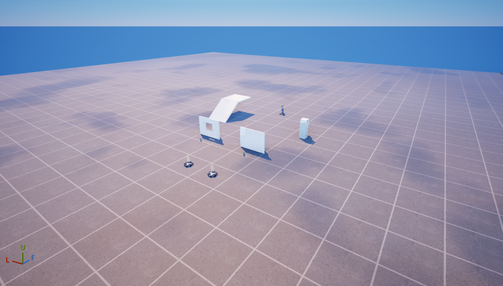

# מצב הבנייה של ProCoachLab

## עבודה פעילה — מימוש לפני בדיקות סיום

עדכון מימוש151: נוספו זמני מקטעים למסלולי העריכות — חמישה במסלול הקירות ושלושה במסלול הרצף. התוצאה מציגה זמן כולל, זמני מקטעים והשוואה לשיא האישי של אותו מקטע; זמן המקטע כולל תנועה ואינו דיוק עריכה או משך לחיצת עריכה. מסך התוצאה מציע חזרה לאותו מסלול, בחירת אחר או לובי, ללא תוספת חלון בזמן חיסול. ההשוואה משתמשת בשיאים שלפני החזרה הנוכחית, ולא מציגה סכום שיאי מקטעים כאילו היה שיא של מסלול שלם.

נוספו לפרופיל BestWallSegmentsו־BestTripleSegmentsעם ברירת מחדל ריקה ושימור בבנאי ההעתקה. הסכמה הקיימת לא אופסה. לפני רישום תוצאה נדרשים מספר המקטעים המתאים, זמנים חיוביים וסכום התואם לזמן המסלול. פער דגימות מעל0.35שניות או קפיצת מיקום מעל600ס״מ מאפשרים המשך תרגול אך מונעים רישום שיא חדש. עצירה בתפריט אינה נכללת בזמן; בחזרה מתחדש בסיס הדגימה. מעטפת ההתקדמות הוצרה ל־220ס״מ ממרכז המסלול והוגבל הגובה גם במסלול הרצף, לצמצום עקיפה של הנתיב.

שלושת המקורות קומפלו ללא אבחונים ונשמרוTrue: `.local/course-splits151-authoring.json`. אבחוניeffectsמהניסיון הראשון נשמרו ותוקנו ל־transactsבפונקציות שמשתמשות במשתנים מקומיים. לא הופעל משחק/סשן/ניסוי או קלט מחשב. [תיעוד השמירה](https://dev.epicgames.com/documentation/en-us/fortnite/using-persistable-data-in-verse) תומך בהוספת שדות ברירת מחדל למחלקה; חזרה עם פרופיל ישן, דיוק זמנים, גבולות המסלול, הצגת עברית ועריכה מקורית/איפוס עדיין דורשים קבלה. עדכון המחקר הממוקד בראשBOT_CORE_RESEARCH_HE.mdמשמר בנפרד את הפער בזיהוי בנייה ועריכות מקוריות בקרב חופשי. ארבעת שערי הבנייה נשארוFalse.

עדכון מימוש150: תוקן חיבור רצפי הבנייה למודל הטקטיקות. החלון הקודם היה3שניות לכל טקטיקה, אף שרצף העלייה יכול להימשך עד8שניות. כעת טקטיקות הבנייה מקבלות חלון מוגבל של12שניות, הכולל את הבנייה והזדמנות ההמשך; לטקטיקות הקרקע נשמר חלון3שניות. רצף בנייה ללא נזק מיוחס באף כיוון אינו מוסיף דוגמת תוצאת קרב. כישלון ביצוע ממשיך לבטל את הדוגמה, ואין שינוי בסכמת36הערכים השמורים. אלה גבולות מימוש שנבחרו, לא מדידת זמן ביצוע או הוכחה שהטקטיקה גרמה לתוצאה.

לאחר עלייה או קופסה שהקוד משלים, נוסף שלב המשך מוגבל ל־3שניות: עדכון תצפית חיובית אם קיימת, ניסיון הצצה מהמחסה או חלון ירי עם תצפית עוינת מקורית עדכנית. אין הרשאת ירי ממיקום זכור בלבד. מעקב הביטול מעדכן כעת תצפיות חיוביות גם בזמן מהלך שמותר לו להימשך באובדן ראייה; רצף עלייה מבוטל אם מיקום האיום שנראה התרחק מעל1024ס״מ מהעוגן של התוכנית. מידע מוסתר אינו מעדכן את העוגן או מיקום האיום.

שלושת המקורות קומפלו ללא אבחונים ונשמרוTrue: `.local/building-learning150-authoring.json`. לא הופעל משחק/סשן/ניסוי או קלט מחשב; ארבעת שערי הבנייה נשארוFalse. [תיעוד Guard](https://dev.epicgames.com/documentation/en-us/fortnite/verse-api/fortnitedotcom/ai/guard_actions_component) מתעד דרישת יעד מזוהה לתקיפה; הוא אינו מוכיח רצף בנייה או תועלת למידה. נוספה פקודת שילוב חוזרת ב־`tools/author_verse_sources.py`, עם בחירת קבצים מפורשת, בדיקת פרויקט ומשחק עצור, אצוות כתיבה/קומפילציה אחת ושמירת ראיות; אינה מפעילה משחק או העלאה. אין להריץ אותה מחדש בלי שינוי מקור שמצריך שילוב.

עדכון מימוש149: ניהול1V1הופרד ל־`coach_duel_flow.verse`עם מצבי המתנה, הכנה, ספירה וקרב. דור סיבוב יחיד מחזיק את משימת ההכנה; כניסה, הופעה מחדש או עזיבה מבטלות דור קודם. משתתפים נבחרים לפי חיבור פעיל, מצב1V1והקצאת הזירה. בהכנה מתבקשים חסינות וקיפאון תנועה; נדרשים שני גופים פעילים, רכיבי איפוס פנויים, שיוך צוות מוצלח, שיגור מוצלח וקרבה לעמדות הפתיחה. לאחר איפוס והענקת ציוד נבדקת חברות שני הגופים באזור ההכנה, עם המתנה מוגבלת, ורק אז מתחילה ספירת3שניות. דמות שהוחלפה או מתה מבטלת את ההכנה. ניקוד ניתן רק לחיסול מיוחס בידי המשתתף הנגדי בזמן קרב פעיל.

נוצר וחובר `PCL_Duel_Preparation_Zone`,בגודל22×22×100אריחים, עם ירי/בנייה/עריכה כבויים. הקוד מפעיל אותו בהמתנה ובהכנה ומכבה בפתיחת הקרב. `DuelPreparationConfigured=True`מציין חיווט בעורך בלבד. שלושת המקורות קומפלו ללא אבחונים והחבילות נשמרוTrue: `.local/duel149-authoring.json`. אבחוניbreakבתוךforמהניסיון הראשון נשמרו ותוקנו ללולאות מוגבלות. יש כעת25מקורות ייצור. מתכון חוזר נשמר ב־`tools/author_duel_rounds.py`, ותיאור ההקצאה והזמנים ב־`uefn/duel-round-layout.json`; אין להריץ שוב ללא שינוי מכוון.

לא הופעל משחק/סשן/ניסוי או קלט מחשב. [Mutator Zone](https://dev.epicgames.com/documentation/fortnite/using-mutator-zone-devices-in-fortnite-creative) מתעד את אפשרויות האזור, ו[ממשק Verse שלו](https://dev.epicgames.com/documentation/en-us/fortnite/verse-api/fortnitedotcom/devices/mutator_zone_device) מתעד הפעלה, כיבוי ובדיקת חברות. הסרת ההגבלות בפועל בתחילת הקרב וביציאה, ציוד אחרי הופעה מחדש, ניקוד, בטיחות האיפוס ומעברי שני משתמשים עדיין דורשים קבלה. מפת ההכנה שלW0–W7עודכנה עם הפניותR01–R30ופערים; אין כאן הכרזת השלמת יחידות או שינוי בהיקף האפיון.

עדכון מימוש148: רגע הניתוח נשמר כעת בנפרד מההיסטוריה המתגלגלת של90שניות ומטבעת64אירועי הנזק. נשמרים אירוע הנזק הנכנס הגדול ביותר שיוחס ליריב, דגימת המצב הסמוכה אליו וקטע מוגבל: עד3שניות לפניו ועד1שנייה אחריו, לכל היותר48דגימות. אירוע גדול יותר מחליף את הבחירה. דגימות מאותו עשירון שנייה מחליפות את האחרונה במקום להגדיל את הקטע. הנתונים מתאפסים בתחילת סיבוב, ואינם נשמרים בפרופיל האישי.

בקליטת נזק נשמרת קודם דגימת המצב, כדי שהאירוע יוכל להצמיד דגימה טרייה. הניתוח והתצוגה משתמשים באותה בחירה ובאותו קטע שמור; הקשר הניתוח מעדיף את דגימת האירוע ואינו בוחר דגימה מאוחרת כראיה למה שקדם לפגיעה. אלה דגימות מיקום/מצב, לא הקלטת וידאו, הוכחת סיבת הפגיעה או זיהוי עריכה. בחירת האירוע לפי גודל נזק היא כלל מיקוד פשוט, לא הוכחה שזו הטעות החשובה ביותר.

שלושת המקורות קומפלו ללא אבחונים ונשמרוTrue: `.local/review148-authoring.json`; אבחון שם משתנה מהניסיון הראשון נשמר ותוקן. לא הופעל משחק/סשן/ניסוי או קלט מחשב. התיעוד הרשמי של [damage_result](https://dev.epicgames.com/documentation/fortnite/verse-api/fortnitedotcom/game/damage_result) ו[נזק למגן](https://dev.epicgames.com/documentation/fortnite/verse-api/fortnitedotcom/game/shieldable/damagedshieldevent) נקרא; דיוק התזמון, רצף מגן/חיים, קטעים אחרי קרב ארוך וחיבור ההמלצה לשיעור ממתינים לקבלת הסיום.

עדכון מימוש147: בקוד ההצצה של היריב נוספה הכנת מיקום מול חלון בבעלות המפגש. הקוד הקודם פתח חלון מבלי להכין עמדה מול הפתח. כעת מחושב מיקום לפי כיוון הקיר, הצד שבו נמצאת הדמות ומיקום האיום האחרון שנצפה; חיתוך קו המבט עם מישור החלון חייב להישאר בתוך הפתח ובמרווח מהמסגרת. החישוב מתחשב בהפרש בין מיקום הגוף למיקום המבט. הוא מוגבל למידות חלוןGridKitשלנו, ואינו מזהה עריכה מקורית של שחקן.

הגעה מתבקשת דרךNavigateToללא נתיב חלקי, עם תקציב1.3שניות, הצלחה מקורית, קרבה בפועל ובדיקת קו המבט מן העמדה שאליה הגיע היריב. החלון נשאר סגור בזמן הכנת העמדה. פתיחה, השהיה, בקשת ירי וסגירה קשורות לגרסת הקרב, המפגש והחלק; הרס או שינוי גרסה מבטלים את הפעולה. גם תחזוקת המחסה וסגירת החלון בודקות מחדש את הגרסה אחרי הכנת הכלי. הירי ממשיך לדרוש תצפית עוינת עדכנית, ואינו מאושר מחישוב קו החלון לבדו.

שני המקורות קומפלו ללא אבחונים ונשמרוTrue: `.local/peek147-authoring.json`. לא הופעל משחק/סשן/ניסוי או קלט מחשב. מיקום מבט לפי [GetViewLocation](https://dev.epicgames.com/documentation/fortnite/verse-api/fortnitedotcom/characters/fort_character/getviewlocation) וניווט לפי [NavigateTo](https://dev.epicgames.com/documentation/fortnite/verse-api/fortnitedotcom/ai/npc_actions_component/navigateto) מתועדים; הקומפילציה אינה מוכיחה מסלול ניווט, מעבר קליע בפתח, פגיעה או תזמון מקצועי. ארבעת שערי הבנייה נשארוFalse, ואין טענת קבלת עריכה מקורית או יכולת פרו.

עדכון מימוש146: הוחל חומר רצפה חדש על שבעה משטחים — הלובי, ארבע הזירות ושני חדרי ההדרכה. חלוקת האריחים נעשית לפי מיקום בעולם, בגודל256ס״מ בלובי ו־512ס״מ באימון, ללא תוספת גאומטריה או שינוי התנגשות. נוצר חומר אב ושתי גרסאות צבע, עם חספוס גבוה ותפרים כהים ועדינים. נוסף גימור לובי בן41רכיבים: שדות תקרה, צלעות, לוחות אור, חופות כניסה ומסגרת לקיר קבלת הפנים. הרכיבים דקורטיביים וללא התנגשות. נוספו שמונה פנסיSpotמקומיים,3200לומן ורדיוס16מטר, ללא הטלת צללים. אין שינוי בתאורת העולם או במנגנון הזמן.

כל פעולות הכתיבה הסתיימו ושמירת החבילות החזירהTrue: `.local/environment146-authoring.json`. מתכון היצירה נמצא ב־`tools/author_environment_finish.py`, ותיאור התוצרים ב־`uefn/environment-finish-layout.json`. לא הופעל משחק/סשן ולא נעשה שימוש בשליטת מחשב. זהו גימור שנכתב בעורך, **לא קבלת איכות חזותית, תאורה בהגדרות נמוכות או ביצועים**. ארבעת שערי הבנייה של היריב לא שונו. הטכניקה מבוססת על גישת הרכיבים החוזרים והפנסים ללא צל ב־[Talisman](https://dev.epicgames.com/documentation/fortnite/talisman-environment-template-in-unreal-editor-for-fortnite); מקור זה אינו הוכחה לביצועי הפרויקט הנוכחי.

עדכון מימוש145: נוספו בקוד חלונות תקיפה והפוגה לפי תפקיד הנשק וקצב האש המקורי שלו, עם תנועה קצרה בין החלונות. אין שינוי בנזק או בקצב האש של הנשק, ואין הסקה של מספר יריות מתוך משך הבקשה. החלפת נשק/כלי וביטול מפסיקים את בקשת הירי של הנשקים שבבעלות הבוט. הרשאת תקיפה קוראת מחדש את התצפיות העוינות העדכניות של המתאמן; היא אינה מסתפקת בתצפית שנשמרה לפני ההשהיה. זיכרון המיקום מתעדכן רק מתצפית חיובית. חיבורRunשל בקר הקרב החלופי נשמר ותוקן להקשר התצפית החדש.

הכנת תחמושת השוטגאן הועברה לנתיב פריטיScene Graphבזמן יצירתNPC: בקשת מחסנית500כדוריAmmoShellsבאמצעות מלאי התחמושת הקיים של הדמות. ההכנה נעשית פעם אחת; בחירת השוטגאן המנוהל מותנית בקבלת הפריט במלאי. מיזוג ערימות וניקוי מתחשבים בכך שהמקור עלול להיצרך; אין הסרה של ערימת יעד שהייתה קיימת ואין נגיעה במלאי שחקן. עריכתItemsבמשנה המלאי בעורך נדחתה בגלל הגבלת תבניות; לא בוצע מעקף דרך שינוי מערך או דגלים. גם מתכון העורך עודכן לשימוש במציב הציבורי שמכבד את ההגבלה.

שני המקורות קומפלו ללא אבחונים ונשמרו: `.local/combat145-authoring.json`. **לא הופעל משחק.** אספקת תחמושת בפועל, טעינה מחדש, תזמון הירי, שינוי זוויות והפסקה באובדן ראייה עדיין ממתינים לקבלת הסיום. תכנון חלונות הירי הוא בחירת מימוש, לא הבטחה של ירייה או פגיעה. המקורות שנקראו: [רכיב נשק](https://dev.epicgames.com/documentation/fortnite/verse-api/fortnitedotcom/armory/fort_trace_weapon_component), [פעולות Guard](https://dev.epicgames.com/documentation/en-us/fortnite/verse-api/fortnitedotcom/ai/guard_actions_component) ו[תבניות נשק](https://dev.epicgames.com/documentation/fortnite/weapon-templates-in-fortnite?lang=en-US). שערי הבנייה לא הופעלו, ואין טענת השלמת יריב פרו.

עדכון מימוש144: מסלול העריכות הועבר משחזור באמצעותSpawnPropלשכבתData Layerשל עשרת חלקי המסלול שהוצבו מראש. הוסרו מקוד המסלול ההפניות הקבועות לחלקים והשחזור בחלקיTrainingKit. קריאת ההורים של נכסיCourseמחזירהBuildingWall/Floor/Stairs/Roof; קריאת חברות השכבה מחזירה10רכיבים. אלה ראיות למחלקות ולחיווט בעורך, **לא הוכחה שהחלקים ניתנים לעריכה מקורית או שיחזרו אחרי עריכה/הרס**.

נוצרו שכבת מסלול ושני רצפים בני3שניות: פריקה, ולאחריה טעינה והפעלה. קוד האיפוס מעביר את השחקן לנקודת המתנה, משלים את שחזור העולם גם אם הבקשה בוטלה, מנקה בניות נוספות בזמן שהשכבה פרוקה וממתין לזמינות משטחי המסלול לפני הכניסה. השהיה בתפריט נשמרת גם בזמן ההכנה. הוסרה דגימת האבחון המחזורית בזמן התרגול. שני המקורות קומפלו ללא אבחונים ונשמרו; שני בקרי הרצף חוברו ללא הפעלה אוטומטית/לולאה וללא השבתת קלט. שיוך נכסי הרצף בוצע בבורר הרגיל לאחר שמונה האפשרויות של כלי החיבור הציג רק ערך ריק; הבחירות נשמרו ונקראו מתוך העורך. שליטת המחשב שימשה רק לבחירות האלה והסתיימה מיד. ראיה: `.local/course-runtime144-integration.json`; תיאור נכסים והפניות: `uefn/course-runtime.json`.

לא הופעל רצף, סשן או משחק. Streamingנצפה כבוי בעורך ולא שונה. לפי [תיעוד Epic](https://dev.epicgames.com/documentation/fortnite/streaming-and-hlods-in-unreal-editor-for-fortnite), רצפים יכולים לטעון ולהפעיל שכבות בזמן משחק. [דיווחי יוצרים](https://forums.unrealengine.com/t/data-layer-object-destruction-broken-and-invisible-collision-issues/2657519) מתעדים תקלות שחזור ופתרונות חלקיים בתצורות קודמות; אינם מוכיחים את התוצאה ב־43.00. יציבות הטעינה, תמיכה, בעלות, עריכה ואיפוס שלActorשהוחלף עדיין דורשים את קבלת הסיום המרוכזת. ארבעת שערי הבנייה של הבוט לא הופעלו.

עדכון מימוש143: נוסף `coach_build_skills.verse`, והעלייה חוברה למבצע שלבים יחיד במקום שני מסלולים כפולים. הרצף כולל13שלבים ושישה חלקים: היערכות על המשטח הנוכחי, קיר תמיכה בצד, רצפה וקונוס מעל הרמפה וקיר יציאה, פתיחת שלושת המעברים, יצירת רמפה, תנועה, רצפת נחיתה והמשך דרכה. הרמפה מתחילה בתא הבא כדי לתמוך ברצפי עלייה עוקבים. בדיקת מלאי60עץ נדרשת לבחירת טקטיקות הבנייה; החיוב עצמו נשאר לכל חלק שנוצר בהצלחה. קצב ההכנה משתנה לפי רמת האתגר.

למבצע יש בעלות על ניווט וציוד, גרסת קרב ומפגש קבועה, זהות וגרסה לכל חלק, חלון זמן מוגבל וזיכרון של המיקום האחרון שנראה. הוא מפסיק על הרס חלק, שינוי גרסה, אובדן כלי, עצירה או החלפת קרב; ניווט מוצלח נדרש גם להתאים למיקום הדמות. עודכנו מרווחי שאילתות הפנים כדי להשאיר שולי חיבור בין חלקים, ותוקנו סגירות בין שני סוגי פתחים וכן ספירת קופסה שקיר שלה נהרס בזמן ההקמה. שלושת המקורות האחרונים קומפלו ללא אבחונים ונשמרו: `.local/protected-ascent143-authoring.json`. יש כעת24מקורות ייצור. **אין תוצאת משחק חדשה, אין קבלת רצף העלייה, אין קבלת תמיכה/משבצת/עריכה מקורית ואין טענת רמת פרו.** ארבעת שערי הבנייה לא הופעלו. רשימת קבלת הסיום עודכנה בלבד.

עדכון מימוש142: נוספה צורת חצי רמפה שנוצרה ויובאה לעורך, והורחב מנגנון הצורות לכל ארבעת סוגי החלקים: קיר מלא/חלון/מעבר/מעבר צד, רצפה מלאה/חצי רצפה, רמפה מלאה/חצי רמפה, וקונוס/גג מורם. לכל בקשה נבדקת התאמת הצורה לסוג, זהות חלק רשום, גרסה, השהיה בין עריכות ומרחק מבוט פעיל. איפוס לצורה מלאה נדחה כאשר מעטפת דמות חופפת לחלק. בחלק רשום יחיד שהיריב מזהה כמכשול לכיוון האיום האחרון, הוא יכול להכין כלי, לפתוח מעבר ולבקש ניווט מוגבל בזמן; זיהוי עמום אינו מעניק בעלות על חלק אחר. רצפת מעבר מחייבת רמפה רשומה מתחתיה, ופתיחת רמפה/גג מוגבלת כדי לא להפיל יריב שעומד מעל החלק.

התגוננות מתחילה כעת בקיר לכיוון האיום; הצלחת קופסה דורשת ארבעה קירות סגורים וגג, ולא קיר יחיד. רצף העלייה מבטל ניווט גם בהחלפת סיבוב/עצירה/מוות. שני מקורות קומפלו ללא אבחונים ונשמרו דרך העורך: `.local/shapes142-authoring.json`. לא הופעל משחק או ניסוי. **SetMesh נותר נתיב מועמד פנימי, ואינו פקודת עריכה מקורית; הצורות והמעברים החדשים עדיין אינם קבלת ארבעת החלקים או רמת פרו.** כל ארבעת שערי הליבה נשאריםFalse. תיעוד Epic שנקרא במימוש: [פעולת SetMesh](https://dev.epicgames.com/documentation/en-us/fortnite/verse-api/fortnitedotcom/devices/creative_prop/setmesh) ו[מידות נכסי בנייה](https://dev.epicgames.com/documentation/fortnite/architectural-modeling-guidelines-in-unreal-editor-for-fortnite?lang=en-US). התיעוד מגדיר פעולת שינוי Mesh ומידות מודולריות; אינו מוכיח בעלות, משבצת, עריכה או רצף קרב של המוצר.

עדכון מימוש141,8בנובמבר: שישה מקורות ייצור קומפלו ללא אבחונים ונשמרו. זירות ה־1V1, הבנייה והעריכות יושרו למיקומים45056ס״מ על רשת512ס״מ;199 רכיבי סצנה הועברו ונשמרו, ונבנו9 רכיבי נקודת המתנה למסלול. כניסת מסלול, יציאה ומיקומי החלקים משתמשים כעת באותם נתוני פריסה. נעילת אזור העריכות בזמן שיעור משמרת את הקרב האישי המושהה ומונעת הקצאה כפולה בקוד; מעבר משיעור מתוך1V1 משחרר את מקום הקרב. הדגמת המאמן מכינה ציוד בבעלותו, מיישבת הופעה דרך GetAgents ומחברת מצלמה מחדש אחרי respawn; חזרת Focus אינה מסיימת את חלון התנועה. אלה שינויים ממומשים וקומפלים, לא תוצאות משחק. ראיות: `.local/lessons141-authoring.json`, `.local/arena-grid-alignment141.json`, `.local/course-staging141-authoring.json`.

הופרדו שתי משפחות נכסים עם ארבעה חלקים בכל אחת: CombatKit של היריב בצוות2, מקבלים נזק וחוסמים פגיעה מאותו צוות; TrainingKit בצוות1, ללא נזק. ארבע הפניות הבנייה הראשיות נקשרו ל־CombatKit. עשרת חלקי המסלול המוצבים מראש וארבע תבניות Course קיבלו צוות1. בבחירות העורך של שחזור המסלול נמצאה קובייה ורודה לכל ארבעת החלקים; כעת נקשרו צורות TrainingKit המתאימות. זהו תיקון בחירת גאומטריה, **לא פתרון מאומת לעריכה מקורית**: המופעים המוצבים מראש והחלקים שנוצרים בשחזור משתמשים במחלקות שונות, וטרם אומתה עריכה של אף אחד מהמסלולים החדשים. אין שינוי ב־playerPlaced ואין הפעלת שערי הבנייה. הכול נשמר; לא הופעל משחק. ראיה: `.local/separated-kits141-authoring.json`; תיאור המשפחות: `uefn/construction-kits.json`.

הוראת המשתמש המחייבת: לא להריץ עוד בדיקות משחק, ניסויי מנוע או לולאות בדיקה עד להכנת המימוש המלא. ממשיכים בבניית קוד, נכסים ומפה; הרצת קבלה מרוכזת בסוף. רכיב הקבלה הזמני הושבת ולאחר מכן הוסר מהסצנה ומהמקור שבעורך. אין שליטת מחשב פעילה.

מפת ההכנה להלן מקשרת לדרישותR01–R30ב־PRODUCT_BRIEF_HE.mdוליחידותW0–W7ב־IMPLEMENTATION_ROADMAP_HE.md. אלה מצבי הכנה ופערים; אין בטבלה קבלת מוצר או טענה שכל שורת קוד נסקרה מחדש.

| יחידה | דרישות מקור | תוצרי מימוש והפניות | פער מהותי |
|---|---|---|---|
| W0 | R22–R25,R29 | נקודת שחזור134; נתוני זירות; coach_arena_access; בקר סיבוב אישי ובקר1V1נפרדים; הסרת מתקני הניסוי מהמוצר | קבלת מעבר בין מצבים, ניקוי ומשאבים עדיין בסיום |
| W1 | R18–R21,R30 | coach_round_flow,coach_ui,coach_text; חזרה ניתנת לביטול ללא מודל כפוי;133נכסי אותיות; העדפות שפה וקול נפרדות | קריאות עברית/RTL/טקסט מעורב, קול וזרימה בפועל לא התקבלו |
| W2/W4 | R04–R09,R13–R14,R22–R24 | coach_equipment,coach_building,coach_build_skills,coach_opponent_behavior,coach_learning; ארבעת החלקים, רצף עלייה, מחסה והכנת הצצה;6טקטיקות והיסטוריה אישית | ארבעת שערי הבנייהFalse; בנייה/עריכה/בעלות/משבצת לא התקבלו. חיקוי נמדד מוגבל לתנועה, ואין יכולת פרו מוכחת |
| W3 | R17,R26–R28 | academy-layout,arena-layout,environment-finish-layout; לובי וארבע כניסות, סגירת זירות, שני חדרי הוראה, שילוט, חומרי רצפה ותאורה מקומית | איכות מתוך מצלמת שחקן, בידוד מגובה, תאורה בהגדרות היעד וביצועים דורשים קבלה |
| W5 | R10–R12,R15,R18–R21 | coach_telemetry,coach_lessons,coach_demonstration,coach_practice,coach_voice; רגע מיוחס וקטע שמור, שלושה שיעורים כלליים, שינוי קצב, עצירה ותרגול | אין הסקה מוכחת של טעות עריכה אנושית. התאמה לאירוע, דיוק ההדגמה ויעילות ההוראה עדיין חלקיים/לא מאומתים |
| W6 | R01–R03,R16–R17,R27,R29 | coach_duel_flow ו־duel-round-layout; בנייה חופשית, מסלול עריכות בשכבה נפרדת, בקר זירות ו־17איפוסים; coach_commerceמושבת | קיבולת אישית אחת לכל סוג ו־2ל־1V1; עריכה מקורית/איפוס/הופעה מחדש והפרדה בין משתמשים טרם התקבלו. חבילות ומחירים לא אושרו, ואין חיוב |
| W7 | R01–R30 | FINAL_GAMEPLAY_CHECKLIST_HE: שישה מסלולי קבלה משולבים | ממתין להכנת המימוש המלא לפי הוראת המשתמש; אין משחק/העלאה/ניסוי מנוע כעת |

ראיית שילוב היסטורית137–139:23מקורות קומפלו ללא אבחונים ו־21הפניות נקשרו בבקר הזירות (`.local/academy-batch-integration.json`). מאז נוספו מקורות ושינויים כמפורט בראש המסמך; נתון זה אינו ספירת המקורות הנוכחית. אין להריץ את האצווה ההיסטורית שוב בלי שינוי מימוש שמצריך זאת.

עדכון ליבת היריב140,8בנובמבר: שלושת מקורות הציוד/הלמידה/ההתנהגות עודכנו וקומפלו ללא אבחונים באצווה אחת, ללא משחק או העלאת תוכן. נוספו שוטגאן ורובה בבעלות היריב, בחירה לפי תפקיד נשק וטווח עם רצועת מעבר יציבה, כיס משאבי עץ שלו עם ניקוי בביטול, חיוב עץ לפי סוג ולא לפי מספר פריטים במלאי, אימות ציוד כלי אחרי ההמתנה ולפני כל חלק ברצף, והשבת נשק בסיום. נשמרת התנוחה שמוגדרת בנכס במקום להחליפה במפה ריקה. רצף ההצצה חוזר לכלי לפני סגירה רגילה; בביטול אינו ממציא עריכה ללא הכלי. למידה הורחבה מ־4ל־6טקטיקות,24ל־36ערכים, עם מיגרציה לפי הקשר; מסלול בנייה נכשל אינו מקבל תגמול על תנועת החילוץ.

ארבעת נכסי החלקים הקיימים קיבלו דגל player-buildable ציבורי ונשמרו, עם עותק שחזור. אין שינוי ב־playerPlaced, אין מאגר native חדש ואין הפעלת ארבעת שערי הקבלה. הקריאה ההיסטורית שלteam_index=0אינה מזהה את שדהteamהציבורי;141מצאה בוSpectatorוהגדירה צוותים מפורשים במשפחות הנפרדות המתוארות למעלה. גם הגדרת צוות בעורך אינה מוכיחה בעלות של סוכן או עריכה. ירי, חומרים, אחיזה, משבצת/צוות/נזק/עריכה של המימוש החדש עדיין אינם מאומתים במשחק. ראיות140: `.local/bot-core140-authoring.json` ו־`.local/bot-core140-owned-props-authoring.json`.

ראיות היסטוריות לפני הוראת העצירה:134 נכשלה בזמינות היריב.135 תיעדה7 מתוך8 מקרים, ובדיקת ספירת הנשקים נכשלה למרות נשקים שנראו בתמונה; היא אינה מעבר מלא ואינה מוכיחה תקינות עברית. מאז הוראת העצירה לא הופעל משחק חדש.

## היסטוריה — המחקר והסשן הקודם

עדכון מחקר, 7 בנובמבר 2026: המשתמש ביטל את המטרה האוטומטית הקודמת וביקש לחקור דרך עבודה יעילה ומוצר איכותי. הוכן [מחקר שיפור העבודה](PROJECT_RECOVERY_RESEARCH_HE.md), ונוסף סדר המשך מוצע W0–W7 בראש [מפת העבודה](IMPLEMENTATION_ROADMAP_HE.md). האפיון עודכן למשוב על עברית, לובי, בידוד אזורים, גימור ותשתית. **לא שונו קוד המשחק או נכסי העורך ולא בוצעה הרצה חדשה בסבב המחקר**. מצב התצוגה המתועד להלן הוא האחרון שנצפה, ולא בדיקת מצב חיה חדשה. אין לחדש אוטומטית את הלולאה הקודמת מרשימות ההמשך ההיסטוריות.

הפיתוח מושהה לבקשת המשתמש לשמירה ולתצוגה ידנית במשחק. קבצי הקוד נשמרו וכל חבילות המפה/התוכן הפתוחות נשמרו דרך כלי העורך; המפה נקייה,19דגלי אבחון כבויים והגדרותTestPlayer/Debug/משאבים הוחזרו. ההרצה הרגילה לתצוגה נשארת פתוחה למשתמש, בלי צופה שיסגור אותה ובלי שליטת עכבר. זו תצוגת אבטיפוס, לא קבלת המוצר המלא.

הריצה האוטומטית האחרונה133 הסתיימה ונשמרה:61רשומות, המקור133קומפל18קבצים ללא אבחונים.132 חשפה כשל ניקוי — בחירת בנייה אחת נשארה מצוידת למרות החזרת המכוש.133 הוסיפה צילום והשבה של כל מצבי הפריטים; נצפו6/6זהויות/הורים/מצבי ציוד תואמים ו־0כלי בנייה מצוידים לאחר הניקוי. ארבעת המתכונים שנבדקו הציגו0רכיביweapon/trace/item-ability ציבוריים בשני השלבים; רובה תקני אישר ששאילתותweapon/trace מזהות רכיב. אין קביעה עלGASפנימי או הוכחת בנייה/עריכה מקורית.132 נשמרה עם כשל הניקוי ואינה הצלחה מלאה. עדיין לא הופעל אימותcheckpointרחב133;131הוא האימות המלא הקודם. הפעלת המשחק לצפייה אינה הוכחת ליטוש חזותי או איכות פרו.

עדכון עבודה132: קוד בדיקת רכיבי פעולה מקוריים עבר קומפילציה132b, אחרי תיקון שגיאת שם משתנה3532. נוספה בדיקת פריטיParticipant עם בקרת רובה תקני, ונבדק שדגלי ההפעלה כבויים; היא טרם הוגדרה או הורצה.19 דגלי בריאות קיימים כעת במקור. המשחק האחרון וה־checkpoint המלא נשארים131, והמקור החדש דורש העלאת תוכן מלאה לפני עוד משחק. אין תהליך או שליטת מחשב פעילים. דיווח המצב למשתמש נשען על7שלבי העבודה:0הושלמו ואומתו,4ממומשים חלקית,2בתשתית/מחקר ו־1בדיקות סיום שטרם בוצעו; זו אינה ספירת25תכונות פונקציונליות ואינה אחוז השלמה משוקלל.

## checkpoint131 — התנהגות Participant ותיקון הכנת הפעולה

נכס ה־Participant וההתנהגות נשמרו ואומתו; הבקשות הידניות נפתרו.128–129 עצרו לפניAttack.130 הראתה שבדיקות שיגור תחתnot לא הביאו למיקומים המבוקשים.131 שינתה רק את אישור פעולות השיגור/הצוות לענפי הצלחה: שתי דגימות מיקום בטווח150ס״מ, זיהוי היעד המסוים כעוין ועם קו ראייה,500עץ ובקשתAttack אחת. בכל40 דגימות הכלי המקורי נשאר מצויד ובהורה הנכון; לא נצפה גוף חדש בנפח המדידה, העץ500 והיעד5000. הבקשה בוטלה בסיום החלון ללא תוצאה.15 בדיקות פרוטוקול וניקוי עברו; בנייה/עריכה/פרסום עדיין לא התקבלו. [הראיות והגבולות128–131](PARTICIPANT_ACTION_128_130_HE.md), [ניתוח131](PARTICIPANT_ACTION_131.json).

אימות151 הפניות/18מקורות/56נכסים תקינים/0אזהרות/מפה נקייה;18 דגלי בריאות ו־3דגלי מבנה כבויים, סקלרים0,4שעריםFalse,המאגר הראשי כבוי וריק,Connected/CanStart. Test Player/Debug ומשאבים הוחזרו, מקור ונכסיArt/NPC תואמים להכנת131 ונדרשת העלאת תוכן מלאה לפני משחק נוסף. אין תהליך או שליטת מחשב פעילים. [checkpoint131](NPC_VISUAL_CHECKPOINT_131.json). R01–R25 עדיין פתוחות, בדיקות המשתמש לסוף. ההיסטוריה להלן נשמרת במצבה בזמן הכתיבה ואינה בקשת פעולה נוכחית.

## checkpoint127 — כלי בנייה מקוריים בבעלות Participant

בחירת המשתמש נשמרה ואומתה. דרך Custom Test Player נוצר Participant עם ארבעה כלי בנייה מקוריים משלו, ללא השאלה או יצירת פריט בקוד האבחון. בכל8 הדגימות נצפו גם רכיבי npc_actions,guard_actions ושני רכיבי תפיסה,6 פריטים עם6 הורים תואמים, ורישום כמשתתף שאינו ברשימת השחקנים האנושיים. Guard פרטי בבקרה הציג רכיבי פעולה/תפיסה אבל0 כלי בנייה. לשניהם0 משאבים.9 תנאי הפרוטוקול עברו, אך לא נשלחו פקודות בנייה, עריכה או לחימה. [תוצאות וגבולות124–127](PARTICIPANT_124_127_HE.md).

חיבור Participant ל־NPC Spawner רגיל נכשל באימות שימוש ב־124; המפה הוחזרה לתקינות ונבחר הנתיב המתועד של Test Player.125–126 היו ניסיונות הגדרה שלא נשמרו בקריאה חוזרת, ללא משחק.127 בחרה דרך הממשק, שמרה ואימתה את הערכים; השליטה שוחררה לפני ההרצה. שחזור ציבורי מדורג של הגדרות האבחון אומת לפני המשחק ובוצע בסיומו.

אימות127:150 הפניות,18 מקורות תואמים,56 נכסים תקינים ללא אזהרות, מפה שמורה,17 דגלי בריאות ו־3 דגלי מבנה כבויים, סקלרים0, ארבעת השעריםFalse והמאגר הראשי כבוי וריק,Connected/CanStart. מקורות ו־Art/NPC תואמים להכנה. Test Player ו־Debug הוחזרו למקור ולכן נדרשת העלאת תוכן מלאה לפני משחק נוסף. אין תהליך או שליטת מחשב פעילים ואין פעולה ממתינה מהמשתמש. בנייה/עריכה בפועל, פרסום ורמת פרו עדיין לא הוכחו; המטרה המלאה פתוחה. [checkpoint127](NPC_VISUAL_CHECKPOINT_127.json).

היסטוריה123: באותה בדיקה הסוג עדיין היה Guard וההמשך סומן כחסום. המשתמש פתר את התלות בהמשך והבחירה אומתה124; אין עוד צורך בפעולה מהבקשה הישנה. יתר ההיסטוריה להלן מתארת את המצב בזמן כל בדיקה, ולא את המצב הנוכחי שבראש המסמך.

## checkpoint122 — תיקון למידה דרך פערי ראייה

מנגנון הלמידה המקורי שוחזר בריצה121 ונכשל ב־8 מתוך11 רצפי נתונים. בריצה122 עברו אותם11 מקרים אחרי תיקון ניתוק רצף התצפיות וביטול תגמול ממתין בעת אובדן ראייה, אי־ידיעה, פער דגימות או זמן לא תקין. הלמידה התקינה ממשיכה לאחר זוג תצפיות חדש. האבחון זהה בשתי הריצות; השתנו רק מחלקת הטלמטריה וקורא האיפוס בפורטל. זו בדיקה אוטומטית של מחלקת Verse האמיתית, ללא פעולת דמות/מלאי/נשק או קלט מחשב, ולא הוכחת איכות בקרב מלא. [התיקון והגבולות](LEARNING_VISIBILITY_121_122_HE.md), [השוואת121–122](LEARNING_OBSERVATION_121_122.json).

אימות122 עבר149 הפניות,18 מקורות תואמים ו־56 נכסים תקינים ללא אזהרות; מפה שמורה.16 דגלי בריאות ו־3 דגלי מבנה כבויים, הסקלרים0, ארבעת השעריםFalse והמאגר הראשי כבוי וריק. המקורות ו־Art/NPC תואמים להכנת122,‏ Connected/CanStart; אין תהליך או שליטת מחשב פעילים. [checkpoint122](NPC_VISUAL_CHECKPOINT_122.json). ריצת הקיר האחרונה נשארת119. בחירת Participant הידנית עדיין ממתינה, בדיקות המשתמש נשארות לסוף והמטרה המלאה לא הושלמה.

תצפית עורך120 לאחר119: חלון Inspector נסגר והבורר המקורי נבדק. מועמד GridWall לא הופיע בחיפוש מדויק, בעוד מועמדי BuildingProp הקיימים הופיעו; לא שונו בחירה או מסננים. סוג Participant הוצג ברשימת עותק NPC, אך פעולות החיבור לא שינו את Guard. קריאה חוזרת מאמתת נכס נקי ותקין ו־hashים זהים119. השליטה שוחררה; ממתינה בחירה ידנית אחת Type→Participant ושמירה בעותק הפתוח. בקשת סגירת החלונות הישנה נפתרה. אין משחק120 או שינוי קוד; [הראיות וההמשך](NATIVE_PICKER_120_HE.md). המפה והמטרה המלאה עדיין לא הושלמו.

## checkpoint119 — המשך נזק אחרי הזזה וחלון/איפוס

119 השלימה השוואה אוטומטית בין קיר מקורי עם עצירת ירי בלבד לקיר מקורי שהוקצה מהמאגר הפרטי, הוזז וחזר, השתנה לחלון וחזר למלא. אחרי3 התראות פגיעה בכל קיר נעצר הירי במצב נצפה, לא נוספו פגיעות בזמן המעבר, ושניהם נהרסו לאחר6 התראות מצטברות; המטרה שמאחוריהם קיבלה18 פגיעות בכל שלב.18 תנאים עברו. זו ראיה מוגבלת להמשך הנזק ברצף הזה, לא בריאות מספרית או בנייה/עריכה מקורית בידי הבוט.118 נכשל לפני ההשוואה;119 תיקן המתנה למצב ירי ודילוג על ירי נוסף לאחר כישלון.

כל10 פריטי המשתמש שוחזרו בזהותם, פרופיל הניסוי הפרטי הוחזר ונקרא מחדש, המשחק עצורConnected/CanStart. אימות149/18/56 ללא אזהרות, מפה שמורה,15 דגלי בריאות ו־3 דגלי מבנהFalse,סקלרים0,4שעריםFalse,המאגר הראשי כבוי וריק. מקורות ו־Art/NPC תואמים להכנת119. אין שליטת מחשב פעילה; בדיקות המשתמש לסוף ו־R01–R25 פתוחות. [ראיות וגבולות118–119](NATIVE_WALL_TRANSITION_118_119_HE.md), [checkpoint119](NPC_VISUAL_CHECKPOINT_119.json). ההמשך הוא הצבה מתחדשת וסמנטיקת בנייה משותפת והפעלת הבוט; בקשת פינוי חלונות העזר עדיין ממתינה ואין לחזור לניסויי הבורר בלעדיה.

## checkpoint117 — בדיקת חיבור מקור וקבלת חלקים מהמפגש

המשחק האחרון נשאר114. שתי דרכי כתיבה ציבוריות לנכס הקיר המקורי ב־115–116 חזרו לבחירה הישנה אחרי קומפילציה; לא הורץSpawnProp עם המחלקה הזאת ואין מסקנת אי־אפשרות.117 הוסיף בדיקות זהות ורישום פנימי לפניSetShape, כולל התאמתlease למאגר. הקוד קומפל ואימות149/18/56 עבר ללא אזהרות, מפה שמורה, כל הדגלים והשערים כבויים. המקור החדש עדיין לא הורץ ולכן נדרשת העלאה.

בחירת הבורר טרם אומתה. כלי הלחיצה לא סגר חלונות עזר, והשליטה שוחררה. ממתינה בקשה יחידה לסגירתMessage Log ו־Session Inspector; זו הכנת עורך ולא בדיקת משחק. המאגר הראשי נשאר כבוי וריק,Connected/CanStart; אין שליטת מחשב פעילה. R01–R25 לא הושלמו. [פרטי115–117 והמשך](NATIVE_SPAWN_BINDING_115_117_HE.md), [checkpoint117](NPC_VISUAL_CHECKPOINT_117.json).

## checkpoint114 — מנהל מאגר לחלקים מקוריים

עדכון זה קודם להיסטוריה להלן. נוסף נתיב ביצוע אופציונלי למאגר חלקים מקוריים, עם הקצאה יחידה לכלActor במשחק, בדיקת מקום/משאבים, פרישה לפי מפגש וטיפול במלאי שנגמר. באבטיפוס של שני קירות נצפו העברה, אותו חלק במלא/חלון/פתח/מלא עם9/8/7/9 תאי חסימה, החזרה לחניה והקצאה נפרדת בלי שימוש חוזר.12 תנאים עברו ב־114.112–113 נכשלו בגאומטריה ונשמרו ככאלה; תיקון כיוון המדידה ותיאום אתחול עם מכשיר בריאות שמסתיר את אותם קירות אפשרו את תוצאת114.

המאגר הראשי כבוי וריק וארבעת שערי הבנייהFalse. זה אבטיפוס בעל מלאי מוגבל, ללא בדיקת ירי/NPC/בעלות/משבצת/עריכה מקורית או חידוש חלק שנהרס. אימות העורך עבר149/18/56 ללא אזהרות, מפה שמורה,14 דגלי בריאות ו־3 דגלי מבנה כבויים, משכים וסף0,‏ Connected/CanStart. מקורות ו־Art/NPC תואמים להכנת114. אין תהליך עבודה או שליטת מחשב פעילים; בדיקות המשתמש נשארות לסוף. R01–R25 לא הושלמו. [מימוש, ראיות וגבולות112–114](NATIVE_POOL_EXECUTOR_112_114_HE.md), [checkpoint114](NPC_VISUAL_CHECKPOINT_114.json).

## checkpoint110 — תגובת צוות בקיר מקורי

עדכון זה קודם להיסטוריה להלן.110 השלימה השוואה על אותו קיר מקורי: ירי מאותו צוות השאיר אותו תקף עם9 תאי חסימה; בקרה עם אותו קיר מוסתר נתנה23 פגיעות במטרה נפרדת; ירי מהצוות היריב הרס את הקיר לאחר6 התראות ואז פגע במטרה14 פעמים.20 תנאי הפרוטוקול עברו. ההתראות אינן בריאות מספרית; אין מכאן הוכחת בעלות, משבצת, בנייה או עריכה בידי הבוט.108–109 היו חלקיות; תיקון מטרת הבקרה ל־None נצפה ב־110.

אימות העורך עבר149 הפניות,18 מקורות תואמים ו־56 נכסים תקינים ללא אזהרות, מפה שמורה.14 דגלי בדיקהFalse, שלושה משכים וסף0, ארבעה שעריםFalse,‏ Connected/CanStart. המקורות ו־Art/NPC תואמים להכנת110. אין שליטת מחשב או תהליך בדיקה פעיל; בדיקות המשתמש נשארות לסוף. R01–R25 לא הושלמו. [הפרטים, הגבולות והמקורות](NATIVE_TEAM_WALL_107_110_HE.md), [ניתוח110](NATIVE_TEAM_WALL_110.json), [checkpoint110](NPC_VISUAL_CHECKPOINT_110.json).

## checkpoint106 — הצבה ומחזור חיים של המועמד החדש

נכס הניסוי החדש עם bIsPlayerBuildable=True נבחר דרך הבורר המקורי, נשמר ונקרא מחדש לפני הקומפילציה ואחרי המשחק. תוקנו אימות החיבור וגיבוי הנכס שנבחר בפועל. ב־105 לא התחיל משחק: השרת נסגר ללא לקוחות מחוברים, בעוד המשחק חיכה לאישור מעבר מהסשן הישן. האישור בוצע, השליטה שוחררה ו־106 הושלמה דרך החיבור.

106 תיעדה שתי הקצאות SpawnProp: כל אחת נצפתה תקפה עם9 תאי חסימה, ולאחר מכן ללא תוקף ועם0 תאים בזמן ירי מקורי. מטרה נפרדת קיבלה27 פגיעות מיוחסות לשחקן. לא בוצעו Dispose/Damage ישירים במהלך הניסוי; הציוד, המיקום ודגלי הניסוי שוחזרו והמשחק נעצר. בריאות מספרית, נזק מדויק בכל קיר, שימור נזק, משבצת מקורית, בעלות ועריכה/איפוס נשארים פתוחים. זו אינה השוואה מבוקרת מול TrainingWall עם הדגל כבוי ואינה הוכחה שהדגל פתר בנייה מקורית.

האימות המעודכן עבר149 הפניות,18 מקורות תואמים ו־55/55 נכסים ללא אזהרות; מפה שמורה.13 דגליםFalse,3 משכים וסף0,4 שעריםFalse,Connected/CanStart,פריסה12/16. המקורות והנכסים תואמים לתוכן106 וכל התהליכים הסתיימו. הממשק שימש רק להכנה ולחיבור, ולא במהלך ניסוי המשחק; אין שליטה פעילה. המטרה המלאה R01–R25 לא הושלמה, ובדיקות המשתמש הפיזיות נשארות לסוף.

השלב הבא הוא הסמנטיקה המשותפת של בנייה מקורית: משבצת, בעלות, עריכה ואיפוס, לצד שימור נזק במחלקה הזאת. אין לחזור לבדיקות אחיזה/Attack שכבר נבדקו במקום לקדם את אלה. [ראיות106 והגבולות](NPC_PLAYER_BUILDABLE_PROP_106.json), [פרטי105–106](NATIVE_BUILD_CANDIDATE_105_HE.md), [מצב שמור](NPC_VISUAL_CHECKPOINT_106.json). פרשנות השמירה ב־104 מסויגת בהמשך105–106; ראיות המקור נשמרות.

## checkpoint104 — מועמד בנייה מבודד; משחק אחרון 103

ריצה 101 לא שלחה Attack מפני שהכלי הוסר בשלב הזיהוי והמיקוד, אף שנקראו 500 משאבים. 102 הוסיפה ציוד חוזר חד־פעמי אחרי זיהוי עוין וראייה עדכנית, ואז שלחה בקשת Attack אחת. 103 שמרה את הפעולות והוסיפה תיעוד קריאה בלבד. פרוטוקול 40 הדגימות הושלם בשתיהן; הכלי הוסר שוב, משאבים נשארו 500, בריאות היריב 5000 וללא פגיעות מיוחסות. הקריאה לא החזירה תוצאה לפני ביטול המשימה בסיום החלון. אין הצלחת בנייה או כישלון API גורף שנגזרים מכך.

הישות הנוספת בשאילתה הייתה תואמת בדיוק למצלמת המדידה: אותה זהות במרחק 0 ס״מ ממנה בכל 40 הדגימות, ללא רכיבי mesh/item/inventory/NPC שנבדקו, ואינה בנפח המדידה אחרי החזרת המצלמה. ספירת הגופים חזרה לקו הבסיס. היא נפסלה כראיית בנייה. על כלי הבנייה לא נמצאו רכיבי fort_item_ability_component ציבוריים בשני המועדים שנבדקו; זו אינה בדיקת כל ה־GAS הפנימי. כל 14 הפריטים והציוד שוחזרו, שני המלאים ושלוש הנעילות נוקו, ניקוי חוזר וביטול משימה/מנוי נזק ושחזור צוות היריב עברו. בדיקות ההחזקה נשארו מסומנות ככושלות. הצלחת האחיזה הסטטית ב־100 אינה הבטחת יציבות בקרב.

ב־104 נוצר עותק מבודד של TrainingWall, אחרי שנמצא ש־bIsPlayerBuildable כבוי בקיר וברצפה הנוכחיים ופועל במועמד ממחלקה אחרת. בעותק שונה רק הדגל ל־True; יתר הדגלים והמקור לא שונו, ונשמרו hashes וגיבויי לפני/אחרי. הנכס עבר ולידציה ונקשר ל־SpawnedWallAsset של מכשיר הכיול הפרטי והכבוי. חיבורי הקירות והקורס הראשיים נשארו כפי שהיו. זהו ניסוי מוכן בעורך, ללא קבלת SpawnProp, עריכה, בעלות או משבצת. נדרשת העלאת תוכן מלאה לפני הרצה; התוכן המבושל של 103 אינו כולל את העותק והחיבור החדשים.

המקור האחרון `player-buildable-candidate104-editor-build.json` קומפל ללא אבחונים. אימות 104 עבר 149 הפניות, 18 מקורות תואמים ו־55/55 נכסים ללא אזהרות; מפה שמורה. 13 דגלי בדיקה False, שלושה משכים וסף אפס וארבעת שערי הבנייה False. המשחק עצור Connected/CanStart, פריסת 12 מכשירים ו־16 טרנספורמציות רועננה וכל התהליכים הסתיימו. אין שליטת מחשב. [checkpoint104](NPC_VISUAL_CHECKPOINT_104.json).

ההמשך הוא בדיקת הצבה, הישרדות, collision והרס של העותק מול מקורו, ובהמשך נזק ושינוי צורה על אותה זהות ואינטראקציה עם בנייה מקורית. אין להפעיל שערי בנייה על סמך דגל סטטי או ולידציה. המטרה המלאה R01–R25 עדיין פתוחה ובדיקות המשתמש הפיזיות נשארות לסוף. מחקר וראיות: [NATIVE_BUILD_ACTION_102_104_HE.md](NATIVE_BUILD_ACTION_102_104_HE.md). מאגר הסקיל המשותף לא שונה בעקבות דחיית ה־policy הקודמת.

## checkpoint100 — שרטוט ועיפרון נראים בידיים; 7בנובמבר2026 UTC

נמצא הבדל מועיל במסלול העברת המלאי.98חנה את שני הנשקים המקוריים של ה־Guardבמלאי זמני מחוץ לו באמצעותAddItemישיר; הם נותרו חונים ולא מצוידים בכל48הדגימות, אך הכלי איבד ציוד והרובה נראה.99הוסיף רק קריאת המלאי הנוכחי והשוואת זהויות: בכל48הדגימות היו3פריטים ו־0ranged,ללא פריטrangedחדש או מקורי במלאי, ובכל זאת נראה רובה. זו ראיית פער בין המדידות להצגה, ללא זיהוי ודאי של הרובה או אבחנה פנימית במנוע.

100הוסיף פעולה אחת לפני כלAddItemלחניה:RemoveItemמפורש מהמלאי המקורי, עם הצלחה והורה מקור שנוקה, כאשר ההשבה נרשמת לפני המוטציה. יתר17מקורותVerse,ערכי המכשיר ונכסיArt/NPCזהים ל־99; ההשוואה שומרתdiffמדויק. הפעם8/8דגימות קצרות ו־40/40ארוכות דיווחו כלי מצויד/הורה תקין,לא נצפה אירוע אובדן אחריEquip, וכל48קריאות המלאי הראו0rangedופריט אחד מצויד. התמונה האמיתית מה־GameViewportבתוך החלון מראה את ה־Guardאוחז שרטוט ועיפרון בתנוחה נכונה. זהו תיקון שנצפה בתרחיש הזה,לא הוכחה לסיבה פנימית יחידה או לרציפות/יציבות בכל הקשר. [השוואה99–100](NPC_NATIVE_EXPLICIT_REMOVAL_COMPARISON_99_100.json),[צילום100](NPC_NATIVE_BUILD_VISUAL_EVIDENCE_100.json).

כל18התנאים המצומצמים עברו: הכלי חזר לאותו מקור עם ספירה4,אותם2נשקים חזרו להוריהם המקוריים,כל14זהויות/הורים/ציוד שוחזרו,3query guardsהוסרו לפני ההשבה ואפס רכיבי החזקה נותרו על הפריטים. מלאי החניה ומלאי הכלי הוסרו רק כשהיו ריקים,ניקוי חוזר עבר. נמדדו0vetoesושאילתתEquipאחת. צופי98/99/100הסתיימו0והמשחק נעצר. [בדיקות100](NPC_NATIVE_BUILD_LEASE_100.json),[אירועים100](NPC_NATIVE_TOOL_PHASES_100.json),[ספירות100](NPC_NATIVE_CURRENT_INVENTORY_100.json).

המקור `npc-native-build-explicit-remove100-build.json` קומפל ללא אבחונים והורץ. אימות העורך100עבר149הפניות,18מקורות תואמים ו־54/54נכסים ללא אזהרות;מפה שמורה.13דגלי בדיקהFalse,3משכים וסף0,4שערי בנייהFalse. נשמרConnected/CanStart,פריסת12מכשירים/16טרנספורמציות רועננה;מקור ו־Art/NPCתואמים להכנה100,כלworkersהסתיימו ואין שליטת מחשב. [checkpoint100](NPC_VISUAL_CHECKPOINT_100.json).

המשך: פעולה מקורית מול יעד עוין מזוהה,לא עוד תנוחות/מסגור/חניה בלבד. ההחזקה אינה הצבה/עריכה/איפוס,בעלות,משבצת או רמתפרו. הקצאת כליNPCעצמאיים,הפסקות/מוות/עזיבה ושארR01–R25עדיין פתוחים. [תכנית הבקרה הבאה](NATIVE_BUILD_ACTUATION_NEXT_HE.md). בדיקות המשתמש נשארות לסוף;מאגר הסקיל המשותף עדיין ממתין לדחייתpolicyבלי ניסיון עקיפה.

## checkpoint97 — ציוד הכלי עדיין לא יציב; 7בנובמבר2026 UTC

בקרות93–97 סגרו כמה השערות אך לא פתרו את אחיזת הכלי.93בלי הפעלת ערימת מצלמה עדיין0/40מצויד;94עם הסרת/החזרת תפריט בלבד40/40מצויד.95הקדים עצירת ניווט/Tether והמתנה לציוד הכלי ושמר40/40, אך96איבד את הכלי0.033395שניות אחרי הציוד עוד לפני התפריט/מצלמה, ולכן95אינו תיקון יציב.96מצלם רובה מקורי ברור.97הוסיף שלושה query guards זמניים דרך ממשק המלאי הציבורי; עדיין אובדן0.834914שניות אחרי הציוד ו־0/40מצויד בחלון התצוגה, שגם בו רובה נראה בבירור. נמדדו0vetoesושאילתתEquipאחת; אין הוכחה שהחלפת ה־AI בתרחיש זה עברה באירועי השאילתה שננעלו. אין להסיק סיבת מצלמה מהאירועים המוקדמים או מגבלה כללית מהכשל המצומצם.

כל14הפריטים שוחזרו בזהות/הורה/ציוד, הכלי חזר למקור עם ספירה4, המלאי הזמני נעלם וניקוי חוזר עבר.97גם מאמת הסרת כל3ה־guards לפני השבה ואפס רכיבי החזקה על הכלי/הנשקים המקוריים בסיום.95הצופה הסתיים1בגלל בדיקת מצלמות אופציונלית אחרי הרצף שחסרה לה תצורתrouting; הכשל נשמר והניקוי הסתיים. ההסתעפות תוקנה כך שב־bypassלא נקראת שאילתה לא נחוצה זו; צופי96/97הסתיימו0. הראיות ההיסטוריות לא נדרסו.

המקור `npc-native-build-query-guards97-build.json` קומפל ללא אבחונים והורץ. אימות העורך97עבר149הפניות,18מקורות תואמים ו־54/54נכסים ללא אזהרות; המפה שמורה.13דגלי הבדיקהFalse,שלושה משכים וסף0,ארבעה שערי בנייהFalse. המשחק עצורConnected/CanStart; מקור ו־Art/NPCתואמים לצילום ההכנה. אין שליטת מחשב או בדיקת משתמש. אחיזת כלי, הקצאה עצמאית ופעולות בנייה/עריכה/איפוס/בעלות/משבצות עדיין לא הוכחו; היעדR01–R25פתוח. עדכון הסקיל המשותף נשאר ממתין לדחייתpolicyללא ניסיון עקיפה.

המשך ממוקד: להחנות זמנית את הנשקים המקוריים מחוץ למלאי ה־Guard באמצעות פעולות מלאי ציבוריות, עם השבת כל הפריטים והסרת המלאי גם במסלולOnEnd. לא לחזור על תיקוני תנוחה/מצלמה/סדר אוquery guardsבלבד. לאחר בידוד ההחזקה לעבור מיד לפעולת בנייה וליחסי בעלות/משבצות. ראיות ופרטי הבקרה: [NATIVE_HOLD_NEXT_CONTROL_HE.md](NATIVE_HOLD_NEXT_CONTROL_HE.md), [בדיקות97](NPC_NATIVE_BUILD_LEASE_97.json), [אירועים97](NPC_NATIVE_TOOL_PHASES_97.json), [צילום97](NPC_NATIVE_BUILD_VISUAL_EVIDENCE_97.json), [checkpoint97](NPC_VISUAL_CHECKPOINT_97.json).

## checkpoint92 — החזקה יציבה ללא הכנת תצוגה; 7 בנובמבר2026 UTC

91 הוסיף תצפיות קריאה־בלבד על מסלול90: מצב כלי לפני/אחרי כל שלב ומנוי אחד ל־ChangeEquippedEvent, שמתבטל לפני ההשבה. הכלי נותר מצויד בכל המדידות המיידיות שלפני ואחרי StopNavigation, Tether, הסרת תפריט, המתנת0.25שניות, הצבת מצלמה ו־AddTo. אירוע0הראשון נצפה0.367359שניות אחרי AddTo, בשלב ההמתנה למעבר המצלמה; הרובה המקורי לא היה מצויד בדגימת האירוע, אך היה מצויד אחרי ההמתנה. חלון התצוגה נשאר0/40מצויד. זו מדידת גבול זמן, לא הוכחה שהמצלמה לבדה היא הסיבה. [NPC_NATIVE_TOOL_PHASES_91.json](NPC_NATIVE_TOOL_PHASES_91.json), [ניתוח lease91](NPC_NATIVE_BUILD_LEASE_91.json).

92 הוסיף בקרה באותו אורך לאחר ההעברה ושמונה הדגימות הראשונות, ללא פעולות תנועה, Tether, תפריט, מצלמה, מיקוד, תקיפה או קלט. כל40דגימות השנייה דיווחו כלי מצויד, הורה יעד וספירות3/1. לא התקבל אירוע אובדן ציוד, והרובה המקורי עדיין לא היה מצויד בסיום ההחזקה. אותו פריט חזר למקור עם ספירה4, כל14זהויות הפריטים/הורים/ציוד שוחזרו, המלאי הזמני נעלם, ניקוי חוזר עבר והמנוי בוטל לפני ההשבה. כל11התנאים המצומצמים עברו. אין צילום ואין בקשת בנייה/עריכה/איפוס בבקרה הזאת. [NPC_NATIVE_BUILD_LEASE_92.json](NPC_NATIVE_BUILD_LEASE_92.json), [אירועים92](NPC_NATIVE_TOOL_PHASES_92.json).

המסקנה מוגבלת אך משנה את הצעד הבא: החזקה ארוכה כשלעצמה עובדת בתצורה הניטרלית שנבדקה, והניגוד מצמצם לקבוצת פעולות הכנת התצוגה. הוא אינו מוכיח סיבתיות של AddTo או שולל שונות ריצה/עיבוד אסינכרוני. ההשוואה המחושבת: [NPC_NATIVE_HOLD_COMPARISON_91_92.json](NPC_NATIVE_HOLD_COMPARISON_91_92.json). המשך: אותו מסלול תצוגה, כשמשמיטים רק AddTo/RemoveFrom של ערימת המצלמה; משאירים עצירת תנועה/Tether, תפריט, הצבת מצלמה, זמני המתנה ו־40דגימות. אין לבקש או לקבל framebuffer כצילום NPC כשהמצלמה לא הופעלה. לאחר בידוד ותיקון הסיבה לחזור להקצאת כלים עצמאית ולבנייה/בריאות/בעלות/משבצות; לא עוד שינויי תנוחה/מסגור ללא מדידה.

המקור האחרון `npc-native-build-neutral92-build.json` קומפל ללא אבחונים והורץ. אימות העורך אחרי92עבר149הפניות,18מקורות תואמים לצילום,54/54נכסים ללא אזהרות ומפה שמורה.11דגלי הבדיקה False, שלושת משכי הצילום והסף אפס, ארבעת שערי הבנייה False. המשחק עצור Connected/CanStart, פריסת12מכשירים/16טרנספורמציות רועננה וכלworkersהסתיימו. מקור ו־hashes של Art/NPC תואמים לריצה; [NPC_VISUAL_CHECKPOINT_92.json](NPC_VISUAL_CHECKPOINT_92.json). אין שליטת מחשב, בדיקות המשתמש נשארות לסוף, ועדכון מאגר הסקיל המשותף נשאר ממתין לדחיית policy הקודמת ללא עקיפה. המטרה המלאה אינה שלמה; הקצאת מוצר עצמאית, אחיזה חזותית, פעולת בנייה/עריכה/איפוס, בעלות ומשבצות עדיין לא הוכחו.

## checkpoint90 — צילום מתוזמן, אך החזקת הכלי הארוכה נכשלה; 7 בנובמבר2026 UTC

89 הוסיף חלון native viewport ל־lease של88: עצירת ניווט/Tether, מיקוד בצופה ידידותי ללא תקיפה, הסתרה זמנית של התפריט ומצלמה קיימת. שמונה הדגימות הראשונות דיווחו כלי מצויד, אך כל40דגימות החלון הארוך דיווחו0מצויד עם40התאמות הורה. הצופה התחיל16.196שניות אחרי סיום החלון, לא נשלחה בקשת צילום ואין תמונה. בקרה קצרה והשבה תקינות אינן החזקה ארוכה. הניתוח הראשון89מכסה10תנאי lease קצר בלבד; הניתוח המורחב מוסיף את40הדגימות ומסמן כישלון. ראיות: [NPC_NATIVE_BUILD_VISUAL_FAILURE_89.json](NPC_NATIVE_BUILD_VISUAL_FAILURE_89.json), [NPC_NATIVE_BUILD_LEASE_EXTENDED_89.json](NPC_NATIVE_BUILD_LEASE_EXTENDED_89.json). אין להסיק כשל רינדור מתמונה שלא נלקחה.

90 הסיר את פעולת Focus וחישב מצלמה מכיוון הגוף בפועל; ברירת המחדל של עזר המצלמה נשארה זהה עבור שאר הבקרות. נוספה בדיקה חוזרת של הורה המקור ואי־ציוד אחרי המתנת הקמת המלאי. TransferAttempted מונע כיבוי ציוד במקור שהשתנה לפני שבכלל נעשתה העברה. המקור `npc-native-build-visual90-no-focus-build.json` התקמפל ללא אבחונים והורץ. גם90דיווח8/8מצויד לפני חלון המצלמה, אך0/40מצויד בתוך החלון עם40/40הורות תקינה. לכן הסרת המיקוד לבדה לא פתרה; עדיין לא בודדו השפעות התפריט, המצלמה, ה־Tether וזמן השהייה. זה אינו פסק יכולת כללי של NPC.

תוקן סדר הצפייה באמצעות push-then-observe-run.py: תהליך ההעלאה מסתיים ומחזיר Completed ורק אז הצופה מתחיל מיד, ללא פער תזמון של המודל. ב־90בקשת framebuffer היתה בתוך החלון: גיל ready בתזמון0.644שניות ובבקשה בפועל0.967שניות. בתמונה מופיע הכיתוב Shadow, אך אין גוף NPC או blueprint ברורים. אין קבלת אחיזת כלי, ואין להסיק שורש רינדור או יכולת פלטפורמה מהפריים הזה; מטא־נתוני המקור אינם מזהים בנפרד את מסגרת ה־GPU או המצלמה המקורית. [NPC_NATIVE_BUILD_VISUAL_EVIDENCE_90.json](NPC_NATIVE_BUILD_VISUAL_EVIDENCE_90.json), [ניתוח lease90](NPC_NATIVE_BUILD_LEASE_90.json).

בשתי הריצות אותו כלי הוחזר למקור עם ספירה4, כל14זהויות הפריטים/מלאי/ציוד שוחזרו, המלאי הזמני נעלם וניקוי חוזר עבר. המצלמה והתפריט הוחזרו לפי לוגי ה־defer. אין כאן בדיקת הפסקה בזמן lease, הקצאת כלים עצמאית, בנייה/עריכה/איפוס או בעלות. השאלת כלי השחקן היא ייחוס בלבד, לא הקצאת מוצר. היריב הראשי לא שונה ושערי הבנייה נשארים False.

בסיום90עבר אימות149הפניות,18מקורות תואמים לצילום הקומפילציה,54/54נכסים ללא אזהרות ומפה שמורה.11דגלי הבדיקה False, שלושת משכי הצילום והסף אפס, ארבעת שערי הבנייה False. המשחק עצור Connected/CanStart, פריסת12מכשירים/16טרנספורמציות רועננה, כלworkersהסתיימו ואין שליטת מחשב. המקור ו־hashes של Art/NPC תואמים להכנת90; [NPC_VISUAL_CHECKPOINT_90.json](NPC_VISUAL_CHECKPOINT_90.json). אין מצב blocked או complete למטרה; ידע הסקיל המשותף עדיין ממתין לדחיית policy הקודמת ללא עקיפה, ובדיקות המשתמש נשארות לסוף.

המשך ממוקד: לוגי מצב קריאה־בלבד מיד לפני/אחרי StopNavigation, Tether, הסתרת התפריט, הפעלת מצלמה, המתנת blend ומסגור חוזר. לא עוד שינוי תנוחה/מיקוד/מסגור ללא מדידת נקודת אובדן. לאחר מכן לתקן את הנתיב שנמדד ולברר הקצאת כלים עצמאית. מחקר allocation חזר לתיעוד Inventories Configuration ול־NPC Inventory Modifier; עצם קיומם אינו הוכחת יצירת מתכוני בנייה ל־NPC. שורת Participant הריקה כבר נבדקה בעבר; קריאת spawner ישנה מצביעה על TestPlayerCreativeMannequin ואינה הוכחת יריב לפרסום. המטרה המלאה אינה שלמה.

## checkpoint88 — העברה, ציוד והשבה של כלי בנייה מקורי, 7 בנובמבר 2026 UTC

המקור `npc-native-build-lease88-lifecycle-build.json` התקמפל ללא אבחונים והורץ. הקומפילציה88הקודמת בלי תצפיות הניקוי הנוספות לא היתה מקור הריצה. נוספה בקרת NativeBuildToolLease פרטית, כבויה כברירת מחדל ומחייבת את בקרת הייחוס. נוצר רכיב build hotbar ציבורי על ישות זמנית בבעלות הבקרה תחת שורש ה־Guard היחיד שנמדד; אחרי0.25שניות היה ריק. שאילתות קבלה ישירה והסרה עברו. AddItem ללא מיזוג העביר פריט בנייה מקורי אחד, שהיה לא מצויד אצל השחקן: ספירת המקור4→3, יעד1 והורה הפריט תאם ליעד. ציוד ה־Guard הקודם הוסר והכלי המקורי צויד בהצלחה. כל8דגימות רבע־שנייה דיווחו כלי מצויד, הורה יעד וספירות3/1. אין צילום או בקשת הצבה/עריכה/איפוס בריצה הזאת. [NPC_NATIVE_BUILD_LEASE_88.json](NPC_NATIVE_BUILD_LEASE_88.json).

ההשבה הצליחה לפני despawn: אותו פריט חזר למלאי המקורי עם ספירה4, הציוד המקורי של ה־Guard הוחזר, וכל14זהויות הפריטים שנשמרו חזרו לאותו הורה ומצב ציוד. המלאי הזמני היה ריק בעת בקשת ההסרה, ובשאילתת המשך נמצאו0רכיבי build hotbar אצל ה־Guard. ניקוי חוזר עבר; לא נשאר ניקוי ממתין ולא נרשמו סירובים. כל10תנאי הבקרה המצומצמים עברו. מסלולי defer חיצוני ו־OnEnd כוללים ניסיון השבה; כשל השבה משאיר את ה־NPC לצורך התאוששות. הפסקת משחק/מוות בזמן שהכלי שאול עדיין לא נבדקו, ואין להסיק את הצלחתם מסיום רגיל.

זהו lease לצורך בקרת ייחוס בלבד. המוצר צריך להקצות ל־NPC כלים עצמאיים ולשמור לשחקן את כל ארבע אפשרויות הבנייה; השאלת כלי למשך הקרב אינה פתרון מוצר שקיבלנו. אחיזה חזותית, הצבה, עריכה, איפוס, בעלות ומשבצות נשארים נפרדים מ־Equip. היריב הראשי לא השתנה; דגלי הציוד הניסיוניים ושערי הבנייה נשארים כבויים.

בסיום88אימות העורך עבר149הפניות,18מקורות זהים לצילום הקומפילציה,54/54נכסים תקינים ללא אזהרות ומפה שמורה. כעת יש11דגלי בדיקה, כולל nativeBuildToolLease, וכולם False; שלושת משכי הצילום והסף אפס, ארבעת השערים False. המשחק עצור Connected/CanStart, פריסת12מכשירים/16טרנספורמציות רועננה וכלworkersהסתיימו. מקור ו־hashes של נכסי Art/NPC תואמים להכנת הריצה; לא בוצעה עריכת נכס או מקור אחרי88. ראיה: [NPC_VISUAL_CHECKPOINT_88.json](NPC_VISUAL_CHECKPOINT_88.json). לא הופעלה שליטת מחשב; בדיקות המשתמש נשארות לסוף. מאגר הסקיל המשותף עדיין pending בעקבות policy הקודם, ללא ניסיון עקיפה. המטרה המלאה אינה שלמה.

המשך: בקרת צילום native tool בחלון המשחק עם אותה השבה, בדיקת הורה/אי־ציוד מקור מחדש אחרי ההמתנה להקמת המלאי, ובהמשך הפסקה יזומה בזמן lease. לאחר בקרת הנראות יש לברר הקצאת כלים עצמאית ל־NPC והפעלה אמיתית; אין להפוך את שמונה דגימות הציוד לשמונה פעולות בנייה. אין לחזור על שינויים חזותיים בכלי המותאם כאילו מסלול מקורי זה טרם נבדק.

## checkpoint87 — מלאי כלי בנייה מקורי ושאילתות קבלה, 7 בנובמבר2026 UTC

המקור `npc-native-build-topology87-identity-build.json` התקמפל ללא אבחונים והורץ. הקומפילציה הקודמת בשם87ללא identity לא היתה מקור הריצה. נוספה בקרה פרטית NativeBuildToolReference, כבויה כברירת מחדל, שפועלת לפני יצירת ציוד מותאם או קרב. היא קוראת מלאים ושאילתות CanRemoveItem/CanAddItemDistribute בלבד; לא העבירה/ציידה פריט של השחקן, לא יצרה רכיב מלאי, לא ביקשה ירי ולא שינתה מצלמה או קלט. בחירת רובה מקורי של ה־Guard קדמה לתמונת המצב. [NPC_NATIVE_BUILD_REFERENCE_87.json](NPC_NATIVE_BUILD_REFERENCE_87.json).

בפועל נמצאו אצל השחקן10רכיבי מלאי ו־10פריטים, כולל build hotbar אחד עם ארבעת כלי הבנייה. אצל ה־Guard נמצאו8רכיבי מלאי ו־4פריטים, שורש מלאי ישיר אחד, וללא רכיב build hotbar מזוהה בתצורה הזאת. כל ארבע השאילתות אישרו הסרה מהמקור וקבלה דרך CanAddItemDistribute של שורש ה־Guard, עם0שגיאות. זו קבלה בשאילתה בהקשר הנוכחי, לא העברה, בחירת תת־מלאי בפועל או הצלחת ציוד. כל14זהויות הפריטים שנשמרו נשארו באותו מלאי ובאותו מצב ציוד; טופולוגיית לפני/אחרי זהה. לא נעשתה בקשת הצבה/עריכה/איפוס. העדר רכיב בתצורה הנמדדת אינו מסקנת יכולת כללית של NPC.

המשך קונקרטי: לבדוק רכיב build hotbar זמני שבבעלות הבקרה תחת השורש היחיד שנמדד, קבלת פריט ישירה ומחזור חיים ריק. לאחר מכן lease מוגבל לכלי מקורי עם בדיקת הורה/זהות והשבה מלאה של אותו פריט ושל הציוד המקורי לפני despawn. אין להשמיד פריט שאול או להניח שהצלחת Equip יוצרת מבנה. כלי עריכה/מכוש/משאבים ובעלות/משבצות נשארים דרישות נפרדות. אין עוד ניסוי תנוחה או סדר ציוד מותאם שטרם נוסה; לשמור את85/83 כתוצאות כשל ספציפיות ולא כשלילת פלטפורמה.

בסיום87המשחק עצור Connected/CanStart. כעת יש עשרה דגלי בדיקה, כולל nativeBuildToolReference, וכולם False; שלושת משכי הצילום והסף אפס, ארבעת שערי הבנייה False. אימות העורך עבר149הפניות,18מקורות זהים לצילום הקומפילציה ו־54/54נכסים ללא אזהרות, מפה שמורה; פריסת12מכשירים/16טרנספורמציות רועננה. המקור ו־hashes של נכסי Art/NPC זהים להכנת הריצה; אין שינוי נכס חדש או rollback87. דגלי המתקן הוחזרו אחרי המשחק. צילום מצב מאומת: [NPC_VISUAL_CHECKPOINT_87.json](NPC_VISUAL_CHECKPOINT_87.json). כלworkersהסתיימו, לא הופעלה שליטת מחשב, ובדיקות המשתמש נשארות לסוף. עדכון הסקיל המשותף נשאר pending בעקבות policy, ללא ניסיון עקיפה. המטרה המלאה אינה שלמה.

## checkpoint86 — בקרה של תנוחת ברירת מחדל, משחק אחרון85; 7 בנובמבר2026 UTC

85 השווה ל־82 דילוג על ה־setter של map, רק בבוט הפרטי, והשאיר את תנוחת fire_torch השמורה בפרפאב. תנוחה זו נקראה מחדש מהנכס לפני הניסוי. root Visible היה true כמו82, ללא שינוי סדר הציוד83. נוספה מדידת torch לצד map. 40 דגימות כלי ושמונה דגימות רובה דיווחו map0/torch1; rootEnabled היה1 בכלי ו־0 ברובה. בקשות שני צילומי viewport היו בחלונות המקור (גיל ready מתוזמן12.165/0.741שניות). הכלי עדיין דף ציאן במותניים וידיים מונמכות, ללא torch ברור. בפריים הרובה הידיים בתנוחת אחיזה אך הרובה עצמו אינו נראה ברור. אין קבלת נראות לכלי או לרובה בסבב85; דגלי שרת אינם מחליפים את התמונה. הבדל בין פריימים אינו הוכחת סיבתיות או רציפות. [NPC_AUTHORED_POSE_EVIDENCE_85.json](NPC_AUTHORED_POSE_EVIDENCE_85.json).

בדיקות הציוד נשארו חלקיות:60/60כלי מצויד אך58/60גם לא בנרתיק (20/18/20),48/48דגימות חזרה לרובה ופעימות נזק בכל שלב. שמונה callbacks מיוחסים,280נזק מקורי; שלוש פעולות החזרה, בקרה יזומה וביטול ארבעה מנויים/השבת שני פריטים/ניקוי חוזר עברו. בדיקת15התנאים מסומנת ככישלון בשל תנאי הנרתיק. לא הוכחו אנימציה תקינה, בנייה/עריכה או רמת פרו.

בקרת התנוחה הוסרה, setter map והבנאי הפרטי הוחזרו. המקור `npc-authored-pose86-rollback-build.json` קומפל ללא אבחונים; coach_equipment זהה84, ורק coach_health_probe שונה במדידת torch הנוספת לקריאה בלבד. אין משחק/cook86. Visible בנכס הוחזר ל־false עם גיבוי/שמירה/קריאה חוזרת. העורך שונה מתוכן85; להמשך נדרשת העלאת תוכן מלאה, ללא warm reuse.

אימות86 עבר149הפניות,18מקורות זהים לצילום,54/54נכסים ללא אזהרות ומפה שמורה. תשעת הדגלים וארבעת השערים False, שלושת משכי הצילום והסף אפס. המשחק עצור Connected/CanStart, פריסת12מכשירים/16טרנספורמציות רועננה, כלworkersהסתיימו ואין שליטת מחשב. ראיה: [NPC_VISUAL_CHECKPOINT_86.json](NPC_VISUAL_CHECKPOINT_86.json). בדיקות המשתמש הפיזיות נשארות לסוף.

העבודה הבאה עוברת לבקרת ייחוס בכלי בנייה מקורי דרך המלאי הציבורי, במקום עוד שינוי property של תנוחה או החלפה ראשונית שכבר נוסו. תחילה לקרוא טופולוגיית מלאי שחקן/Guard, לזהות build hotbar אמיתי, לשמור זהות פריט/מלאי הורה/מצב ציוד וספירות, ולבדוק CanAdd/CanRemove לפני העברה. ניסיון lease יהיה פרטי, קצר, עם החזרת אותו פריט והשבת מצב, כולל מסלולי שגיאה, לפני despawn. אין להעתיק או לחלץ נכס מוגן. ראשית לבודד אחיזה מקורית; היא אינה הפעלת בנייה, עריכה, איפוס או בעלות. התיעוד הציבורי נקרא מחדש ומציין inventory root/edit tool, build hotbar ו־harvest tool כחלק מדרישות edit mode. ההעברה/ההפעלה שלנו עדיין לא קומפלו ולא הורצו. שאלת היוצר בפורום2850177נקראה מחדש, ללא תשובת Epic שנצפתה; אינה אישור פלטפורמה או אימות עצמאי של הפרויקט. ארבעת שערי הבנייה נשארים False, והמטרה המלאה אינה שלמה. עדכון הסקיל המשותף נשאר ממתין לדחיית policy הקודמת, ללא ניסיון עקיפה.

## checkpoint84 — החזרת בקרה שלא פתרה אחיזה; משחק אחרון83, 7 בנובמבר2026 UTC

אימות סיום84:149 הפניות,18 מקורות זהים לצילום הקומפילציה,54/54 נכסים תקינים ללא אזהרות ומפה שמורה. תשעת דגלי הבדיקה וכל ארבעת שערי הבנייה False; שלושת משכי הצילום וסף הקיר אפס. המשחק עצור Connected/CanStart, פריסת12 מכשירים/16 טרנספורמציות רועננה. כל workers של83/84 הסתיימו ולא הופעלה שליטת מחשב. [NPC_VISUAL_CHECKPOINT_84.json](NPC_VISUAL_CHECKPOINT_84.json) מעגן את קריאת מצב העורך.

83 השווה ל־82 שינוי התנהגות יחיד: במסלול הפרטי בלבד, EndFire ו־Unequip מפורש ובדוק לרובה לפני ציוד הכלי הראשוני. Visible הראשי נשאר true בזמן הניסוי ו־map לא שונה. ארבע הסרות מפורשות הצליחו, ללא סירוב. 40 דגימות כלי קראו Visible1/Enabled1/map1 ושמונה דגימות רובה Enabled0/map1. שני צילומי viewport התבקשו בתוך חלונות המקור, בגיל ready מתוזמן11.265/1.116שניות. בפריים הכלי הדף עדיין בגובה המותניים, הידיים מונמכות והרובה ביד ימין; בפריים הרובה יש אחיזה בשתי ידיים. השינוי לבדו לא פתר את התצוגה בתרחיש הזה. אין מכאן מסקנת יכולת כללית של NPC. ראיות: [NPC_INITIAL_RELEASE_EVIDENCE_83.json](NPC_INITIAL_RELEASE_EVIDENCE_83.json).

60/60 דגימות כלי מצוידות, אך רק58/60 גם לא בנרתיק (20/18/20); כל48 דגימות החזרה לרובה תקינות, עם פגיעות בכל שלב. בדיקת15 התנאים מסומנת ככישלון בשל תנאי הנרתיק; אין להשוות ריצה אחת ל־82 כהוכחת סיבתיות. תשעה callbacks מיוחסים,315 נזק מקורי, שלוש פעולות החזרה מוצלחות, בקרה יזומה, ביטול ארבעה מנויים והשבת שני פריטים/ניקוי חוזר. לא נמדד נזק בתוך חלונות דגימת הכלי. ארכיון83 שומר את הקוד שבוצע.

השינוי הניסיוני הוסר. `npc-initial-release84-rollback-build.json` קומפל ללא אבחונים; צילום כל18 המקורות זהה בדיוק לצילום82. זו החזרה מקומפלת בעורך, ללא ריצה או cook84. גם Visible בנכס הוחזר ל־false, עם גיבוי/שמירה/קריאה חוזרת. לכן העורך הנוכחי שונה מהתוכן המבושל83; נדרשת העלאה מלאה חדשה, אין warm reuse. קובץ הבקרה `.local/root-mesh83-control.json` מתעד את השחזור.

המשך: לבודד את תנוחת torch השמורה מול שינוי map בזמן הריצה, עם אותו mesh גלוי, לפני כתיבת מעקף אנימציה. אין לחזור על סדר ההסרה הראשוני או על מסגור מצלמה כתיקון שטרם נבדק. נבדק מחדש תיעוד Epic להפעלת אנימציות על NPC: animation_sequence שנחשף ל־Verse ובקר ציבורי הם מועמד מתועד, אך התאמת השלד וביצועו ביריב הזה טרם אומתו. קשירת NPC ל־Sequencer משהה את התנהגותו ומחזירה מיקום בסיום; היא אינה פתרון קרב חופשי שקיבלנו. המקור והיקף הקריאה מופיעים בקובץ הראיות83. בנייה/עריכה/בעלות/משבצות ורמת פרו נשארות פתוחות, ושערי הבנייה ודגלי המוצר הניסיוניים כבויים. לא הופעלה שליטת מחשב, ובדיקות המשתמש נשארות לסוף. המטרה המלאה אינה שלמה.

## checkpoint82 — בידוד ראות ה־mesh ומדידת התנוחה, 7 בנובמבר 2026 UTC

המקור האחרון `npc-root-mesh82-build.json` התקמפל ללא אבחונים והורץ עם שינוי נכס יחיד ומגובה: Visible של ה־mesh הראשי בפרפאב שבבעלות הפרויקט עבר מ־false ל־true. נוספו רק לוגים פרטיים של מצב הרכיבים. אחרי הריצה הראות הוחזרה ל־false ונשמרה/נקראה חזרה; שאר שדות הרכיב נותרו זהים. גיבוי בינרי, hashes וקריאות הנכס נמצאים ב־`.local/root-mesh82-control.json`. התוכן שכבר בושל לריצה82 מכיל את הראות true, ולכן אינו זהה לנכס הנוכחי בעורך. נדרשת העלאת תוכן חדשה לפני שימוש בתצורה המשוחזרת; אין לבצע warm reuse עיוור.

40/40 דגימות חלון הכלי דיווחו root Visible=1, Enabled=1 ו־map_pose=1. בחלון הרובה 8/8 היו Visible=1, Enabled=0 ו־map_pose=1. מכאן שהרכיב אכן נמצא וערך map נקרא בזמן הריצה; אין להמשיך להניח שה־setter פשוט לא נמצא או לא שמר את הערך. זה עדיין אינו מוכיח שהאנימציה יושמה על NPC. הבקרות החזותיות נלקחו בתוך חלונות המקור: גיל ready בתזמון בקשה 5.145/0.972 שניות, ללא דחיות. בפריים הכלי הופיע דף ציאן בגובה המותניים; הידיים מונמכות ורובה עדיין מונמך ביד ימין. אין קבלת אחיזה/קריאת מפה. בפריים הרובה יש אחיזה בשתי ידיים והדף אינו נראה. זו התקדמות בנראות רכיבי הבן בעקבות שינוי הראות הראשית, בלי הוכחת הצמדה נכונה, רציפות אנימציה או סמנטיקת בנייה. ראיה: [NPC_ROOT_MESH_EVIDENCE_82.json](NPC_ROOT_MESH_EVIDENCE_82.json).

כל 15 בדיקות הציוד המצומצמות עברו בסבב82: 60/60 כלי מצויד ולא בנרתיק, 48/48 דגימות חזרה לרובה, פגיעות בכל חזרה, בקרה יזומה והחזרה, ביטול ארבעה מנויים, השבת שני פריטים וניקוי חוזר. שלוש פעולות reconciliation הצליחו; שבעה callbacks מיוחסים ו־245 נזק מקורי. אלו דגימות שרת בתרחיש פרטי, לא הוכחת העדר הבהוב בין דגימות. היריב הראשי שומר את שני דגלי הציוד הניסיוניים כבויים. ארבעת שערי הבנייה נשארים False.

לאחר השחזור עבר אימות העורך: 149 הפניות, 18 מקורות זהים לצילום הקומפילציה, 54/54 נכסים תקינים, אפס אזהרות ומפה שמורה. תשעת דגלי הבדיקה False, שלושת משכי הצילום וסף הקיר אפס. המשחק עצור, Connected/CanStart נשמר; פריסת12 מכשירים/16 טרנספורמציות רועננה. אין worker או שליטת מחשב פעילים. הבדיקות הפיזיות של המשתמש נשארות לסוף.

המשך ממוקד: להפריד בין שחרור מפורש של הרובה היוצא כבר בציוד הכלי הראשון לבין ההחלפה המרומזת הנוכחית; בקרה נפרדת של torch מול map אם נדרשת. אין לערבב שתי התנהגויות באותה בקרה או להסיק מגבלת NPC מצילום זה. אחר כך להשלים מודל/ציר אחיזה תקינים ורצף פעולה, תוך המשך בירור בנייה/עריכה/בריאות/משאבים/בעלות/משבצות. המטרה המלאה R01–R25 אינה שלמה. עדכון מאגר הסקיל המשותף עדיין ממתין בעקבות דחיית policy שתועדה ב־SKILL_KNOWLEDGE_SYNC_PENDING_81.md; לא בוצע ניסיון עקיפה.

## checkpoint81 — צילום מסונכרן ואימות נראות הרובה, 7 בנובמבר 2026 UTC

המקור המקופל האחרון הוא `npc-managed-viewport80-build.json`; 81 השתמש באותו תוכן שכבר נטען ובאותם ערכי מתקן, ללא Push חדש. הצופה מצא CanStart, הפעיל StartGame בעצמו (07:56:05.211→07:56:05.431 UTC) ותפס את שתי הבקשות בזמן חלונן. אימות העורך אחרי 81 עבר 149 הפניות, 18 מקורות זהים ו־54 נכסים תקינים ללא אזהרות; המפה שמורה. תשעת דגלי הבדיקה False, שלושת משכי הצילום וסף הקיר אפס, וארבעת שערי הבנייה False. פריסת 12 מכשירים ו־16 טרנספורמציות רועננה. המשחק עצור, Connected/CanStart נשמר, ואין workers או שליטת מחשב פעילים.

79 תיקן את סדר ההחזקה והמסגור: Tether/Attack התחילו לפני חישוב המצלמה, ונוסף מסגור אחרי מעבר המצלמה. תנועה בין המסגור האחרון ל־ready היתה אפס ב־XY. בחלון המשחק נראה Guard במרכז עם הרובה המקורי ואחיזה תקינה. זו קבלת פריים סטטי של נשק מקורי בלבד, ללא בנייה/עריכה או רצף אנימציה: NPC_NATIVE_VIEWPORT_EVIDENCE_79.json.

80 חיבר אותו נתיב viewport לרובה המנוהל ולכלי, אבל הבקשות היו מאוחרות: צילום כלי התבקש 0.089 שניות אחרי סגירת החלון, ורובה 9.467 שניות אחרי סגירתו. הצופה התחיל כשהמשחק כבר Running; התפריטים כבר חזרו. התמונות האלה אינן ראיית הצמדה או אי־הצמדה של הפריטים. ראיה: NPC_MANAGED_VIEWPORT_EVIDENCE_80.json. רשומת ההתחלה האוטומטית של העורך לא נקראה ולא שונתה; התנהגות Running המוקדמת נצפתה, ומתועדת אפשרות Auto Start אחרי Push אצל Epic.

מנגנון הצופה תוקן: מעקב ready/finished/שחזור מצלמה, ניקוז עמודים לפני בחירת בקשה ודחיית חלון שנגמר או נותרו לו פחות משלוש שניות. שחזור offline של שני הכשלים האמיתיים ב־80 דחה אותם: NPC_CAPTURE_FRESHNESS_REPLAY_80.json. ב־81 הושלמו ניתוב הלקוח וההכנות לפני StartGame, ללא העלאה חדשה. גיל ready בבקשה היה 0.643/0.857 שניות, עם 39.357/7.143 שניות שנותרו לכלי/רובה, וללא בקשות שנדחו. אין צורך לשנות העדפות עורך או להפעיל שליטת מחשב בשביל התרחיש הזה.

התוצאה החזותית כעת מבחינה: בפריים הרובה המנוהל נראה Guard עם אחיזה תקינה ומבזק ירי; זו ראיה סטטית חיובית לרובה התבנית. בפריים הכלי הדמות נראית, אבל אין דף/כלי בנייה ברור וביד נשאר רובה מונמך. קבלת נראות כלי הבנייה נשארת False. 40 דגימות חלון הכלי דיווחו כלי מצויד, רובה לא יורה ו־HP יעד 5000; שמונה דגימות חלון הרובה מצוידות, שש יורות. בכל שלושת המחזורים 60/60 כלי מצויד, אך 58/60 גם לא בנרתיק; כל 48 דגימות החזרה לרובה מצוידות/לא בנרתיק, עם פגיעות בכל חזרה. שלוש החזרות המתועדות והבקרה היזומה הצליחו; ארבעה מנויים בוטלו, שני הפריטים המקוריים הושבו וניקוי חוזר עבר. סך שבעה callbacks מיוחסים ו־245 נזק מקורי. NPC_TOOL_INTENT_CHECKS_81.json מסמן כישלון החזקה מלאה; אין להעלים אותו בגלל פריים ירי מוצלח. ראיות חזותיות ותזמון: NPC_MANAGED_VIEWPORT_EVIDENCE_81.json.

קריאת פרפאב בלבד בשם inspection82 (לא ניסוי משחק82) אישרה שה־PCL_BuildPlan יורש held_item_template. הרכיב הראשי MeshComponent הוא Enabled=true, Visible=false, HiddenInGame=false; התנוחה השמורה היא ברירת המחדל fire_torch, בעוד PrepareBuildPlan מנסה להגדיר map בזמן ריצה. דף/מסגרת/קווים נבנו כישויות ילדות בזמן יצירת הנכס. זהו נתיב תצורה קונקרטי לבדיקה, לא הוכחה למגבלת NPC או לכך שה־setter נכשל. הקובץ `.local/held-plan82-prefab-inspection.json` הוא read-only ולא בוצעה בו או אחריו עריכת נכס.

העבודה הבאה: לבדוק את רכיב התנוחה ומצב ה־mesh בפועל אחרי הכנה/ציוד, ולבצע בקרה יחידה ומגובה של תצוגת mesh ראשי בפרפאב שבבעלות הפרויקט. אפשר להשוות torch מקורי גלוי לפני החלפתו במודל דף ראשי מתאים; לא להסיק חוסר תמיכה מ־mesh שהוסתר במכוון ולא לדלג על חוזי החלפת mesh הציבוריים. כשמשתנה קוד/נכס נדרשת העלאה חדשה. ה־warm reuse העתידי הוקשח לדרוש hashes של קבצי Art/NPC בשתי ההכנות נוסף על מקור וערכי מתקן; 80/81 ההיסטוריים לא כללו שדה זה ולכן אינם בסיס תקין להשוואת נכסים חדשים. יש להכין snapshot חדש לפני cook חדש. כל המנגנונים הניסיוניים כבויים בראשי, השערים כבויים, ובנייה/עריכה מקוריות, משאבים, בעלות, משבצות ושאר R01–R25 עדיין פתוחים. בדיקות המשתמש הפיזיות נשארות לסוף. המטרה המלאה פעילה ולא הושלמה.

## checkpoint78 — בקרה עם מלאי מקורי וצילום חלון המשחק, 7 בנובמבר 2026 UTC

המקור האחרון `npc-native-viewport78-menu-build.json` קומפל ללא אבחונים ונבדק במשחק. אימות העורך עבר 149 הפניות, 18 מקורות זהים ו־54 נכסים תקינים ללא אזהרות; המפה שמורה. כל תשעת דגלי הבקרה הנקובים ב־NPC_VISUAL_CHECKPOINT_78.json כבויים, שלושת משכי הצילום וסף הקיר אפס, וארבעת שערי הבנייה כבויים. פריסת 12 מכשירים ו־16 טרנספורמציות רועננה. המשחק עצור ו־Connected/CanStart נשמר בכוונה. אין workers או שליטה במחשב פעילים.

76 בדק Guard עם שני הנשקים המקוריים, בלי החלפה/הוצאה מהמלאי ובלי יצירת רובה תבנית או כלי. בכל 40 דגימות היה נשק טווח מקורי מצויד; 29 callbacks מיוחסים ל־NPC, 534.96875 נזק. בצילום הנפרד הרובה נראה מול הגוף אך הידיים אינן בתנוחת אחיזה/ירי רגילה. הבקרה אינה מקבלת pose או מוכיחה גורם פנימי. ראיות: NPC_NATIVE_VISUAL_CONTROL_76.json ו־NPC_NATIVE_VISUAL_EVIDENCE_76.json.

77 הוסיף צילום framebuffer אמיתי דרך CaptureGameViewport ומצלמת Fixed Point קיימת, שהוזזה רק בזמן המשחק והוספה זמנית לצופה. תפריט הלובי נשאר גלוי והמסגור אינו מאשר צילום של ה־NPC. קריאות הוספה/הסרה נרשמו, וקריאת עולם הלקוח אישרה שמיקום המכשיר חזר ל־4700/5900/900. אין קבלה חזותית לנשק מתוך הדמות המקומית שמופיעה לצד התפריט. ראיה: NPC_NATIVE_VIEWPORT_EVIDENCE_77.json.

78 הסיר זמנית את אותו widget של התפריט בלי להרוס מנויים, והוסיף אותו בחזרה רק אם הוא עדיין ה־Menu הנוכחי. נרשמו הסרה/החזרה של אותו אובייקט וכן שחרור ושחזור המצלמה; הצילום מראה שהתפריט הוסר. המראה המשוחזר של התפריט לא צולם בנפרד. שתי הפעולות נעשו דרך קוד המפה, ללא לחיצות, שליטת מחשב או teleport של השחקן. המלאי המקורי נשמר, 40/40 דגימות נשק מצויד ושתי יחידות טווח; 26 callbacks מקוריים ו־435.96875 נזק. בקרות המלאי/קרב/ניקוי עברו, בלי הוכחת pose.

הצילום כעת חושף בעיית מסגור קונקרטית: ה־NPC זז 163.937 ס״מ ב־XY בין הדגימה האחרונה לפני חישוב המצלמה לבין ready. הזווית המתוכננת אל המיקום החדש שונה בכ־36.592 מעלות מכיוון המצלמה. בצילום מופיע חלק מה־NPC בקצה הימני. הקוד מציב את המצלמה, ממתין שנייה, ורק אז מתחיל חלון Tether/Attack; זהו סדר שיש לתקן לפני עוד מסקנות על פריט או אנימציה. מטא־נתוני framebuffer אינם מזהים את המצלמה/מסגרת ה־GPU המקורית, ולכן ההסבר הוא מסגור שנמדד ולא קבלת renderer כוללת. ראיה: NPC_NATIVE_VIEWPORT_EVIDENCE_78.json.

המשך ביצוע: לייצב את חלון ההחזקה בבעלות הבדיקה לפני חישוב המצלמה, לחשב שוב מה־pose שנמדד אחרי הייצוב, ואז לצלם פריים שבו הידיים והנשק באמת במסגרת. אין לחזור על הסתרת תפריט בלבד או על קריאות AddTo כפתרון למסגור שכבר נמדד. אם המלאי המקורי מצולם נכון, להשוות באותו נתיב לרובה המנוהל ולכלי; לא לשנות Cosmetic תקין על סמך השערה. לא היה צורך להפעיל שליטה במחשב בסבבים אלה. רק אם פעולה במחשב תהיה נחוצה, להפעיל אותה לאותה פעולה ולשחרר מיד. כל בדיקות המשתמש הפיזיות נשארות לסוף. מנגנוני הציוד הניסיוניים כבויים בראשי, כל שערי הבנייה כבויים, והבנייה/עריכה/בעלות/משבצות ורמת פרו עדיין פתוחים במסגרת R01–R25. המטרה המלאה אינה שלמה.

## checkpoint75 — צילום לקוח ללא שינוי מבט וחשיפת פער חזותי, 7 בנובמבר 2026 UTC

המקור האחרון `npc-visual-capture75-build.json` קומפל ללא אבחונים ונבדק במשחק. אימות העורך עבר 149 הפניות, 18 מקורות זהים ו־54 נכסים תקינים ללא אזהרות, והמפה שמורה. כל שבעת דגלי הבדיקה כבויים, סף הקיר אפס וארבעת שערי הבנייה כבויים. שני סקלרי הצילום החדשים VisualToolCaptureSeconds/VisualRifleCaptureSeconds הוחזרו לאפס ונבדקו גם באימות ובפריסת המתקן. המשחק עצור ו־Connected/CanStart נשמר להמשך. אין worker או שליטת עכבר/מקלדת פעילים.

נוסף צילום Lit מעולם הלקוח עם מצלמה אבחונית מפורשת ונפרדת, דרך כלי SceneCapture הציבורי. צילום בסיס ושני צילומי יריב נשמרו; מיקום השחקן וכיוון המבט נשארו זהים לפני ואחרי כל צילום. אלה רינדורים נפרדים, לא screenshots של חלון המשחק. זמן הבקשה/התשובה היה 28–32 שניות; הוא כולל תעבורה ואינו מדד לזמן מסגרת משחק. ב־75 בלבד הורחבו חלונות המחזור הראשון ל־40 שניות כלי ו־8 שניות רובה לצורך הצילום. ברירת המחדל במכשיר היא אפס.

התוצאה החזותית אינה עוברת: בתמונות הכלי והרובה נראית דמות קדמית בלי פריט מוחזק ברור בידיים. מאחור נראה אובייקט דמוי רובה, שזהותו ובעליו אינם מוכחים מהתמונה. אין להסיק עדיין אם מדובר בהצמדה, באנימציה, ברלוונטיות של הלקוח או במגבלת הרינדור הנפרד. צילומים/מטא־נתונים/גבולות: `NPC_VISUAL_EVIDENCE_75.json` ו־`images/npc-tool-offscreen-75.png`, `images/npc-rifle-offscreen-75.png`. עדיין אין קבלת נראות של כלי או רובה.

השרת רשם 40 דגימות שנייה של כלי מצויד/רובה לא מצויד/לא יורה, HP יעד 5000 לאורך חלון הצילום; בחלון הרובה הוא רשם רובה מצויד בכל שמונה הדגימות, ירי ב־6/8 ו־105 נזק. אחר כך 60/60 דגימות כלי דיווחו IsEquipped, אך רק 56/60 היו גם לא בנרתיק. כל שלוש החזרות לרובה וכל 48 דגימות הציוד/נרתיק שלו עברו, אבל לא נמדדה פגיעה בכל חלון חזרה. הבקרה היזומה הצליחה ונרשמו ארבע פעולות החזרה בתקציב, ארבעה מנויים בוטלו, ושני הפריטים המקוריים הושבו וניקוי חוזר עבר. `NPC_TOOL_INTENT_CHECKS_75.json` נכשל בתנאי ההחזקה/פגיעות; אין להציגו כקבלה מלאה או כרגרסיית תזמון זהה ל־74, כי החלונות הורחבו.

קריאת הגדרות לאחר 75 נשמרה בשם inspection76: בשתי הגדרות ה־NPC כבר מוגדר FortniteCharacter עם CID HenchmanBad ותנועה Default בתוך GuardSpawn. אין תוספת Cosmetic נפרדת, אבל המראה אינו חסר מהשדות; לא בוצע שינוי נכסים על סמך ההשערה הזו. מדובר בקריאה בלבד, לא בניסוי משחק 76. פרטים ב־`.local/npc-cosmetic76-properties.json`.

העבודה הבאה: להכין בקרה חזותית מול נשק המלאי המקורי של Guard, בזווית מאומתת, לפני החלפתו בתבנית/כלי מותאמים. להשוות רינדור נפרד לנתיב מצלמה נוסף רק אם הבקרה מחייבת זאת, תוך שמירת העדפת המשתמש שלא לשלוט במחשב. רק אחרי בידוד הפער לתקן הצמדת פריט/תנוחה או נכס מתאים; לא להניח שחסר Cosmetic ולא להחליף נראות בסמנטיקת בנייה. אחר כך להמשיך חלונות קצרים/ביטול ומחזורי NPC ובנייה/עריכה/משאבים/בעלות/משבצות. כל שערי הבנייה כבויים, מנגנוני הציוד הניסיוניים כבויים ביריב הראשי, והמטרה המלאה פעילה ולא הושלמה. כל בדיקות המשתמש הפיזיות נשארות לסוף.

## checkpoint74 — החזרת כלי עם רצף הסרה מפורש, 7 בנובמבר 2026 UTC

המקור האחרון `npc-tool-reconcile74-release-build.json` קומפל ללא אבחונים ונבדק במשחק בסבב 74. אימות העורך עבר 149 הפניות, 18 מקורות זהים במאגר/עורך/צילום קומפילציה ו־54 נכסים תקינים ללא אזהרות; המפה שמורה. כל שבעת דגלי הבדיקה כבויים, הסף אפס וארבעת שערי הבנייה כבויים. פריסת 12 מכשירים ו־16 טרנספורמציות רועננה. המשחק עצור; Connected/CanStart נשמר בכוונה להמשך. אין עובד קומפילציה/התחלה/צפייה/אימות או שליטה בעכבר/מקלדת פעילים.

71 הוסיף תיעוד נפרד לציוד ולנרתיק: אובדן הכלי הראשון נצפה אחרי כ־0.401 שניות, עם 5/20 דגימות כלי בראשון ו־20/20 בשני הבאים. ההורה התאים למלאי הנעול בכל 60 הדגימות. 72 הוסיף החזרה ניסיונית מאירועים דרך PostPhysics; 60/60 דגימות נראו תקינות אך לא נרשמה פעולת תיקון, ולכן אין ראיה לסיבתיות באותו סבב.

73 קלט החזרה ממשית באותו timestamp של סימולציה אך חשף כשל: שלוש החזרות לרובה נדחו, וירי/נזק התרחשו גם כשהמלאי דיווח כלי מצויד ורובה בנרתיק. הבקרה היזומה נדחתה. `NPC_TOOL_INTENT_CHECKS_73.json` נכשל במפורש; אין להציג אותו כהחזקה או מעבר תקינים.

74 הוסיף Unequip מפורש לפריט היוצא לפני Equip של הבא במסלול הניסיוני, כולל בעת החזרה לכלי ובחירת רובה. הבקרה היזומה הוכיחה כלי→רובה ממשי והחזרה לכלי בעדכון PostPhysics באותו timestamp שרת. כל 60 הדגימות היו כלי מצויד ולא בנרתיק, ללא רובה מצויד/מחוץ לנרתיק/פעיל; לא נמדד נזק בין הדגימה הראשונה לאחרונה בחלונות הכלי. שלוש בחירות הרובה הצליחו, כל 48 דגימות הרובה מצוידות ולא בנרתיק, ונמדדה לפחות פגיעה אחת בכל שלב חזרה. בסך הכול חמש פגיעות מקוריות, 175 נזק. ארבעה מנויים בוטלו, הניקוי מכלי מוחזק החזיר שני פריטים מקוריים וניקוי חוזר עבר. כל 15 התנאים המצומצמים ב־`NPC_TOOL_INTENT_CHECKS_74.json` עברו.

זו הוכחת תרחיש פרטי אחד של התאוששות מבוקרת ומעבר ציוד. זו אינה הוכחת רציפות בכל מסגרת, pose מרונדר, שורש הכשל הפנימי, התנהגות פרו או עריכה/בנייה מקוריות. גם הנעילות וגם מנגנון ההחזרה כבויים כברירת מחדל ביריב הראשי; רק ההתנהגות הפרטית מפעילה אותם. הניקוי המפורש נוסף רק כשקיים רכיב ההחזרה. אין ירי מקדים או יצירת נזק מלאכותי במוצר.

המשך: להתקדם מהמעבר שנמדד אל נראות ללא קלט משתמש, חלונות קצרים וביטול/מחזור NPC ואינטראקציות בנייה, בריאות, משאבים, בעלות ומשבצות. לא לחזור על 65–69 או על תיקון מלאי בלבד כהוכחת חוויית בנייה. כלי MCP ציבוריים לגילוי לקוחות וצילום מעולם/מצלמה אומתו בתיאורי הכלים הנוכחיים ב־`.local/public-runtime-tool-discovery74.json`; צילום runtime מזווית חופשית טרם נוסה, ואין להסיק מכך API משחק לפרסום. מאגר הידע עד S225, עם הפרדה בין מקורות לבין ראיות מקומיות. כל R01–R25 והקבלה הסופית עדיין נבדקים לפי מפת השלבים; בדיקות המשתמש הפיזיות נשארות לסוף. המטרה המלאה לא הושלמה.

## checkpoint70 — בקרות ציוד והפרדת ניסוי מהמוצר, 7 בנובמבר 2026 UTC

הקוד האחרון הוא `npc-query-guards-isolated70-build.json`: קומפילציה ללא אבחונים, 18 מקורות זהים במאגר ובעורך ומתאימים לצילום הקומפילציה. אימות העורך עבר 149 הפניות ו־54 מתוך 54 נכסים, ללא אזהרות; המפה שמורה. כל שבעת דגלי הבדיקה כבויים, סף שינוי הקיר אפס וארבעת שערי הבנייה כבויים. פריסת 12 מכשירי הבקרה ו־16 הטרנספורמציות רועננה. המשחק עצור, והחיבור נשמר בכוונה במצב Connected/CanStart להמשך העבודה. אין תהליך התחלה, צפייה, קומפילציה או אימות שנותר פעיל, ולא הופעלה שליטה בעכבר או במקלדת בסבב הזה.

70 הוא שינוי קוד שאומת בעורך בלבד. המשחק האחרון שנבדק הוא 69; לא בוצע משחק חדש או cook חדש של 70.

נוסף API נפרד `PrepareBuildPlan`, שמכין את הכלי במלאי בלי לבקש לצייד אותו. היריב הראשי משתמש בו לאחר אתחול הרובה. נוסף מנגנון ציבורי לדחיית בקשות ציוד/הסרה עם שחרור לפני החלפת נשק וניקוי. הוא הוכיח דחיית פקודות מפורשות וניקוי מכלי מוחזק, אך לא פתר את ההחלפה האוטונומית הראשונה. לכן `EnableToolQueryGuards` כבוי כברירת מחדל; רק התנהגות מתקן הבקרה הפרטי מפעילה אותו. אין פקודת ירי מקדימה שהוטמעה במוצר, ואין חזרה לשינוי הוצאת הרובה שנדחה ב־62.

| ניסוי | מה נבדק | דגימות כלי מצויד במחזורים 1/2/3 |
|---|---|---|
| 65 | דחיית הסרת הכלי דרך השאילתה הציבורית | 1/4, 4/4, 4/4 |
| 66 | הכנת הכלי לפני הופעת היעד; גיל 3.58 שניות בציוד הראשון | 1/4, 4/4, 4/4 |
| 67 | פקודת תקיפה מפורשת לפני ציוד הכלי הראשון | 2/4, 4/4, 4/4 |
| 68 | ציוד מתוך OnBegin של ה־NPC, עם ציוד בבעלות ההתנהגות | 0/4, 4/4, 4/4 |
| 69 | דחיית בקשת ציוד גם לרובה המנוהל | 1/4, 4/4, 4/4 |

בכל חמש הבקרות חזר הרובה ונמדד מצויד בכל 48 דגימות של שלבי הירי, שלוש בחירות הנשק הצליחו וניקוי מכלי שנמדד מצויד ונעול החזיר את שני הפריטים המקוריים. 69 אימת דחייה מפורשת של הסרת כלי וגם של ציוד רובה; שתי הנעילות נפתחו לפני הירי והוסרו בניקוי. זו קבלת חוזי השאילתות והניקוי בתרחיש הפרטי, לא קבלת החזקה רציפה. `PUBLIC_ITEM_QUERY_CONTROLS_69.json` מסמן במפורש שהחזקת הכלי הראשונה עדיין נכשלת. אין תוצאה עוברת לרגרסיית החזקה מלאה.

בדיקת רכיבי העורך אישרה שההתנהגויות המתאימות משויכות ליריב הראשי ולמתקן הפרטי; לא נמצא תיקון חיווט חסר. 68–69 אימתו ארבע פקודות ציוד מתהליך ה־NPC עם זהות סוכן תואמת. לא הוכח גורם פנימי להחלפה. מוני שאילתות תחת מסנן ומסלולי native/transaction אינם הוכחה גורפת לגבי כל בחירת נשק.

ראיות מרכזיות: `NPC_TOOL_INVESTIGATION_65_69.json`, `PUBLIC_ITEM_QUERY_CONTROLS_69.json`, הראיות והניתוחים הפרטניים 65–69, ו־`ACADEMY_EDITOR_EVIDENCE.json`. מקורות עד S223; החוזים מתועדים בנפרד מקומפילציה, משחק ופרסום. הבקרות בוצעו ללא קלט משתמש וללא שינויי נשק, נזק ישיר או שינויי מצב שחקן.

המשך העבודה: לחקור שאלה חדשה על הקשר בין פריט המלאי, הנשק/ה־pose המוחזקים ובחירת הציוד האוטונומית; לא לחזור על הכנה מוקדמת, פקודה מקדימה, הקשר coroutine או וטו בלבד כפתרונות שכבר הוכחו. לבדוק נתיב ציוד/אנימציה אחר עם גבולות נאמנות מפורשים, ולהמשיך באינטראקציות הבנייה, הבעלות והמשבצות ושאר R01–R25. נראות הכלי, רמת פרו, עריכה מקורית, שני לקוחות ופרסום עדיין לא אומתו. בדיקות המשתמש הפיזיות נשארות לסוף. המטרה המלאה אינה שלמה.

## checkpoint64 — עמדת ירי, ניקוי הורה וחקירת כלי הבנייה,7בנובמבר2026UTC

קומפילציה ועורך עד64; המשחק האחרון שנבדק בפועל הוא63. המקור האחרון npc-owned-hold64-build.json עבר ללא אבחונים. אימות הסיום עבר149הפניות,18מקורות זהים bytesבמאגר/עורך ומתאימים לצילום הקומפילציה,54/54נכסים תקינים ללא אזהרות,מפה שמורה. Connected/CanStart נשמר בכוונה להמשך, המשחק עצור; כל7דגלי הבדיקהFalse,סף0,ארבעת שערי הבנייהFalse. פריסת12מכשירים/16transforms רועננה. אין פעולת התחלה/צפייה/קומפילציה/אימות או שליטה בעכבר/מקלדת שנותרה פעילה.64לא נדחף/נבדק במשחק חדש; התוכן האחרון שהועלה ללקוח הוא63.

58הוסיף CoachHoldAttackWindow משותף ל־HoldAngle/הצצה. לאחר סטרייפ רגיל בתיבתXYבאלכסון2077ס״מ,46דגימות בחלון העיגון היו באותהXY,6.679ס״מ מהמרכז,עם5פגיעות35מקוריות. זמן12.5שניות סיים לפני יעד48הדגימות. לאחר שחרור נצפתה תנועה.60הראה שה־defer של הילד לא הגיע לנקודת הניקוי בעת חזרת ההורה; נוספה קריאת שחרור מפורשת מההורה.64מוסיף HoldPending כדי לא לבקש Untether עבור טקטיקה שלא פתחה עיגון שלנו. לוגיקת הבעלות64קומפלה בלבד; pause/סיבוב/מוות של המוצר עצמו עדיין דורשים אימות. אין הוכחה לשחזור leash מקורי; גם NavigateTo לפני שחרור מפורש ב־60עבר75ס״מ,ולכן תנועה לבדה אינה הוכחת הסרת העיגון.

המעבר מכלי לרובה עובד במתקן הפרטי, אבל החזקת הכלי אינה מאומתת:59החזיק כלי ב־1/4דגימות במחזור הראשון ו־4/4בכל אחד מהשניים האחרים. בקרות Idle61,הוצאת הרובה62ו־Focus63לא ייצבו:0/12דגימות כלי מצויד בכל אחת. הרובה חזר ונמדד יורה ופוגע לאחר כל מחזור.62שינה זמנית את מחלקת הציוד; השינוי הוחזר במדויק61תחת בדיקת hash,והארכיון/הראיות נשמרו. אין תוספת ToolParkedRanged פעילה. ב־63כל48דגימות הרובה מצוידות/לא בנרתיק,שלוש בחירות הצליחו,8פגיעות280נזק כולל פגיעת בסיס ופגיעה35אחרי הדגימה האחרונה,וניקוי/החזרת שני המקוריים וניקוי חוזר עברו. לא לתאר כלי מוחזק או ניקוי ממנו מתוך לוג בקשה בלבד.

אימות63הראשון נעצר בהבדלCRLF/LF בשני מקורות ששוחזרו מסקריפט; הטקסט היה זהה.64נרמלUTF8/LF ללא שינוי תוכן בשניהם,שמר before/after hashes,והאימות החוזר עבר. מקורותS213–S217נוספו/נבדקו,בדיקת שלמות מאגר הידע עברה; מקור אינטרנט אינו מסומןruntime-verified בגלל ניסוי מקומי. פרטים,מקורות וראיות: NPC_NATIVE_AIM_HE.md,HEALTH_RUNTIME_EVIDENCE_58..63.json,NPC_BUILD_PLAN_ANALYSIS_59/61/62/63.json ו־ACADEMY_EDITOR_EVIDENCE.json.

המשך: חקירה טרייה ממוקדת על יציבות ציוד/שליטת Guard/אנימציה,עם משתנה מבחין חדש; אין לחזור על Idle/הוצאת רובה/Focusבאותו מתווה כ״תיקון״. להמשיך בחלונות קצרים ובביטול/מחזור NPC,בבנייה/עריכה/נזק/משאבים/בעלות ומשבצות ובשארR01–R25. רמת פרו,נראות כלי,עריכה מקורית,שני לקוחות ופרסום לא אומתו. בדיקות המשתמש הפיזיות נשארות לסוף והמטרה אינה שלמה. כל הרישומים הבאים היסטוריים.

## checkpoint57 — תיקון חלונות פעולת היריב, 7 בנובמבר2026UTC

תוקן כשל שבבדיקות55–56 סיים race של Focus+Attack לפני הדגימה הראשונה: Focus חזר, והענף שלו סיים את החלון.56 אימת שהיעד הוא בדיוק Target של מערכת הזיהוי ושזהה לישות הגוף; השערת זהות שגויה נדחתה בתצורה זו. נוסף CoachFocusCompanion משותף לבקר היריב ולמתקן הבדיקה; חזרת בקשת מבט לא מסיימת לבדה חלון תקיפה/הצצה/תנועה/מכשול.

57 עבר48 דגימות בשלב המשולב עם28 דגימות ירי וחמש פגיעות מקוריות מיוחסות/175 נזק באותו שלב, אחרי שנרשמה חזרת Focus. סך12 פגיעות/420 נזק כולל הבסיס ופגיעה אחרי הדגימה האחרונה. ניקוי הרובה, השבת שני הפריטים וניקוי חוזר עברו. [מחקר ותוצאות52–57](NPC_NATIVE_AIM_HE.md), [הוכחת הכשל והתיקון](FOCUS_WINDOW_REGRESSION_56_57.json). אין פה הוכחת דיוק פרו, מבט שנשאר נעול או תנועה נשלטת: היורה זז באופן אוטונומי ונמדדה תיבת תיחום גדולה.

npc-focus-window57-build.json קומפל ללא אבחונים. האימות המלא עבר149 הפניות,18 מקורות זהים במאגר/עורך/צילום הקומפילציה ו־54/54 נכסים עם אפס אזהרות; המפה שמורה. שבעת דגלי הבדיקהFalse, סף0, ארבעת שערי הבנייהFalse. המשחקCanStart וחיבור העריכהConnected נשמרים במכוון להמשך העבודה; verifier --connected מאמת את שני הערכים האלה ולא מדלג על בדיקות הנכסים/הדגלים. אין worker או שליטה במחשב שנותרו פעילים. פריסת12 המכשירים/16transforms רועננה.

הלקוח הקודם42084 סיים יציאה רגילה אחרי שנמצא Leave Match modal; לקוח חדש38332 התחבר52. מאז עבדו העדכונים דרך PushChanges ללא שליטה נוספת. הראשי נשאר Accuracy HIGH; רק המתקן הפרטי VERY HIGH עם גיבויי before/after53. ההשוואה5/8 פגיעות52/53 אינה הוכחת שיפור סיבתי.

המשך: תנועה/עמידה מתוכננות — לבדוק את Tether הציבורי מול התנועה האוטונומית — וחלונות קצרים, מעבר לכלי בנייה וחזרה לרובה, מחסנית ומחזור NPC; לאחר מכן אינטראקציות הבנייה והמשך שאר המפה. המוצר המלא לא הושלם וכל בדיקות המשתמש הפיזיות נשארות לסוף. הרישומים הבאים היסטוריים.

## checkpoint51 — ציוד, התאוששות ואימות, 7 בנובמבר2026UTC

הבנייה npc-managed-loadout-lifecycle-build.json עברה ללא אבחונים ו־18 מקורות זהים במאגר/עורך/צילום הקומפילציה. מחלקת הציוד המשותפת מחליפה נשקיNPC בלבד, מחזיקה את הפריטים המקוריים, בודקת פעולות מלאי ומנקה ב־OnEnd. בדיקת המנוע כוללת אתחול/בחירה וניקוי חוזרים. היריב הראשי קיבל500 medium ammo במופע המלאי שבבעלותו; הגדרות הנשקים ופריטיו האחרים נשמרו.

49 מספק ראיית ירי מבודדת: חמש פגיעות מיוחסות ו־175 נזק.50 ו־51 לא סיפקו בדיקת משחק:50 נקטע בתזמון ההפעלה,51 לא חיבר לקוח משחק. אין לייחס להם איכות קרב או הצלחת המימוש המשותף. [הראיות, הכשלים והיקף השילוב](NPC_EQUIPMENT_INTEGRATION_HE.md).

ה־verifier תוקן בעקבות בקרה שהוכיחה כי בחירת הבעלים ממלאת את קריאת AssetForEditor אחרי פתיחה מחדש; טעינת הנכס לבדה לא שינתהnull. החיבורים המקוריים לא הוחלפו. האימות המלא עבר149 הפניות,18 מקורות,54/54 נכסים ואפס אזהרות, עם מפה נקייה. שבעת דגלי הבדיקהFalse, סף0, ארבעת שערי הבנייהFalse, Disconnected/Unconnected. פריסת12 מכשירים ו־16transforms רועננה. אין משימות התחלה/צפייה/אימות או שליטה במחשב שנותרו פעילות.

המשך: לשחזר חיבור לקוח ולעבור לבדיקת ציוד/ירי/ניקוי משותפת בסבב חדש; לקרוא Accuracy של ה־NPC לפני שינוי כיול, ובהמשך לבחון מעברי כלי בנייה, דיוק/קצב ואינטראקציות בנייה. המוצר המלא לא הושלם; הבדיקות הפיזיות של המשתמש נשארות לסוף. הרישומים הבאים היסטוריים.

## ציוד היריב — סבבים49–50, 7 בנובמבר2026UTC

סבב49 הוכיח ירי של NPC ברובה תבנית כמקור הטווח היחיד:104 דגימות equipped1/holstered0, קו ראייה עוין1 וללא no-fire; חמש פגיעות מיוחסות ליורה,175 נזק,5000→4825. שני הנשקים המקוריים הושבו. תחילת ירי נצפתה כבר בבסיס, לפני Attack המפורש; אין הוכחת סיבתיות להוצאת הנשק מהנרתיק, קצב פרו, פגיעה בכל ירייה או weapon-causer פרטני. [ניתוח49](NPC_RIFLE_ANALYSIS_49.json).

אותו מסלול הועבר למחלקת coach_equipment ונקשר לאתחול/סיום היריב. npc-managed-loadout-fixed-build.json קומפל ללא אבחונים. שני שיפורים מאוחרים — לוג כשל מדויק ובדיקת אתחול/ניקוי חוזרים באותה בדיקת משחק — טרם קומפלו מחדש.50 נעצר לפני כל דגימות המשחק; Started/Connected אינם Completed של העלאת התוכן. הצופה תוקן כך שיסרב לכל פעולת עורך לפני תוצאת התחלה/העלאה Completed; הבדיקה המקומית דחתה50 לפני חיבור. [פירוט השילוב והכשל](NPC_EQUIPMENT_INTEGRATION_HE.md), [ראיות50 שנקטע](HEALTH_RUNTIME_EVIDENCE_50_INTERRUPTED.json).

אחרי פתיחה מחדש ניסיון ניקוי הגיע ל־SaveActor והעורך קרס עם Illegal call to StaticFindObjectFast while serializing object data. אין אישור לשמירת הדגלים הכבויים; נדרש לקרוא אותם מחדש ולסיים ניקוי. השליטה הופעלה רק לפתיחת הפרויקט ואופסה מיד עם תחילת הטעינה; כשהעורך נעלם נבדקו חלונות ללא קלט והשליטה אופסה שוב. אין בדיקת משחק חדשה שהצליחה או אימות מלא חדש; checkpoint48 בהמשך הוא האחרון שעבר. ארבעת שערי הבנייהFalse, והעבודה הכוללת עדיין פעילה. כל בדיקות המשתמש נשארות לסוף.

## התקדמות ליבת הבנייה — סבבים47–48, 7 בנובמבר2026UTC

תוקן אתחול המאפיינים של החלקים הפרטיים: שני AttributeInitKeys ריקים הוגדרו כ־PropWood/2 דרך מאפייני העורך הציבוריים של הנכס שבבעלות הפרויקט. הגדרות ושמירה נבדקו; אין כתיבת HP לקיר בזמן משחק. [פירוט התיקון והגבולות](PROP_HEALTH_INIT_FIX_HE.md).

בסבב47 הקיר הראשון נשאר תקף במשך2.75 שניות לפני הירי המתוכנת. נצפו יצירה→אי־תקפות במהלך ירי מקורי, הקצאה שנייה ואי־תקפות נוספת. ההתנגשות9→0→9→0; לאחר מכן17 פגיעות במטרה מאחור,5000→4405. לא נקראו Damage/Dispose על הקירות במהלך הניסוי. ערכיHP וייחוס פגיעות פרטניות בקיר לא נקראו; המוניטור המפורש של הקיר המוצב היה כבוי. זו הוכחת מחזור חיים של prop בתצורה הזו, לא עריכת שחקן או בעלות מקורית.

הוחל תיקון יצירת נכסים המאתחל רק מפתחות ריקים. ארבעת נכסי הקרב קיבלו את meshes הנכונים של GridKit והגדרותיהם נקראו אחרי קומפילציה/שמירה. שלוש הפניות מנהל הבנייה, שהיו עדיין קוביות ברירת מחדל, חוברו דרך בחירת הנכס המקורית וכפתור Use Selected Asset. השליטה אופסה מיד בסיום. SelectAssets החזיר timeout למרות בחירה שהופיעה בעורך; ההשפעה אומתה בפועל וב־AssetForEditor, ולא הוסקה מתוצאת הבקשה.

בסבב48 נוצרו ארבעת חלקי הקרב וה־LessonWall, וכולם נשארו תקפים במהלך הרצף. הקיר החדש החזיר9→8→7→9 תאי התנגשות במלא/חלון/פתח/מלא; בקרה ריקה0. גם הזזה/שינוי/השבה של הקיר המוצב נרשמו בנפרד. [ראיות48](STRUCTURE_RUNTIME_EVIDENCE_48.json), [הפניות נכסים](OWNED_PROP_BINDINGS_48.json).

האימות המלא אחרי48 עבר149 הפניות,18 מקורות זהים במאגר/עורך/צילום הקומפילציה ו־54/54 נכסים ללא אזהרות. הבנייה health-probe-spawn-asset-control-build.json נשארה עם אותם מקורות Verse וללא אבחונים. המפה שמורה, דגלי הבדיקה והשעריםFalse, הסף המספרי0, והסשן סגורDisconnected/Unconnected. אין משימות התחלה/צופה/אימות או שליטה במחשב שנותרו פעילות. בדיקות המשתמש הפיזיות נשארות לסוף.

המשך: שילוב הצבה/עריכה עם נזק במחלקות הקרב, משאבים, תמיכה, בעלות ומשבצות משותפות; וכן ירי תבנית בידיNPC וביצוע היריב. בקרת ירי שימושית נוספת היא בקשת Attack עם מטרה עוינת לאחר ציוד התבנית והפרדה מנשקי fallback: הבקרה הקיימת מפעילה את Attack של הנשק המקורי לפני הוספת התבנית, ובשלבי התבנית נצפה holstered. אין עדיין מסקנה כללית על הגבלת NPC. ארבעת שערי הקבלהFalse והמוצר המלא לא הושלם.

## השוואת נזק נקייה בשינוי צורה — סבבים42–43, 7 בנובמבר2026UTC

ההשוואה [42–43](MESH_HEALTH_COMPARISON_42_43.json) השתמשה באותם מקורות מקומפלים, קיר מוצב יחיד, בריאות התחלתית200, מוניטור מפורש לאותו קיר ונקודת כיוון על תא מלא.42 השאיר את הקיר מלא;43 החליף את צורת אותו מופע לחלון אחרי שלוש פגיעות מיוחסות לשחקן. בשניהם שש פגיעות מיוחסות בסך הכול הביאו להריסה, ללא פגיעות ממקור אחר. ב־43 שאילתת ההתנגשות הייתה9 לפני ההחלפה ו־8 אחרי חלון עדכון; אחרי ההריסה0 בשניהם. פגיעות במטרה שמאחור התקבלו רק אחרי ההריסה:16×35 בסבב42 ו־18×35 בסבב43.

זו ראיה נקודתית התואמת שימור נזק בשינוי צורה מלא→חלון, ללא ריפוי/החלפה/נזק מלאכותי לקיר. בריאות מספרית לא נקראה מהקיר. זו אינה עריכת שחקן מקורית, ואינה מוכיחה reset, רצפה/רמפה/גג, בעלות, משבצות או פרסום.42 התחיל מחיבור קר ו־43 דרך PushChanges מלא; ההבדל מתועד. שערי הקבלה נשאריםFalse.

סבב40 סיפק בקרת6 פגיעות, אך41 זוהם ב־18 callbacks של ירי שאינו מהשחקן. תוצאת41 נשמרה ונפסלה מהשוואת שימור הבריאות; המצב החדש IsolatedWallControl אינו מפעיל יריב עוין/Attack או יריNPC. הראיות, המקורות והפריסות המקוריים נשמרים לפי מזהה סבב.

אחרי43 האימות המלא עבר149 הפניות,18 מקורות זהים במאגר/עורך/צילום הבנייה,53/53 נכסים ללא אזהרות ומפה שמורה. הבנייה health-probe-isolated-wall-build.json ללא אבחונים; כל דגלי הניסוי והשערים כובו, והסשן נסגר ל־Disconnected/Unconnected. השליטה במחשב אינה פעילה; הבדיקות הפיזיות של המשתמש נשארות לסוף.

סבב44 יצר חלק וקרא9 תאי התנגשות, אך בקרת הירי נעצרה לפני ירי עקב מצלמה שטרם התעדכנה. נוספה המתנה מוגבלת של עד6 שניות, בלי להחליש את שערי המיקום/הכיוון. ב־45 הירי רץ אך חלק LessonWall שנוצר נשאר תקף עם9 תאים, והמטרה מאחור5000.46 בדק עותק פרטי עם bCanBeDamaged=True כבר בהגדרות הנכס לפני היצירה; ההפניה נבחרה במבחר המקורי, נקראה דרך AssetForEditor ואומתה בשמירה/cook. ערך CanBeDamaged בזמן המשחק נקרא1, ובכל זאת לא נצפתה הריסה בחלון שתי פאזות ירי של5 שניות. לא נוצר דור שני. המוניטור המפורש של הקיר המוצב כובה במצב זה; אפס callbacks שלו אינו מדידת נזק לחלק שנוצר.

לכן יש ראיות ליצירה/התנגשות/כיוון/ירי מול החלק, אך **אין עדיין ראיית הריסה ויצירה חוזרת**. אין מכאן מסקנת אי־אפשרות או הוכחה שהחלק חסין/בעל כמותHP מסוימת. השלב הבא הוא בקרת נזק חיובית של אותו נכס/בירור אתחול בריאות ויכולת הריסה; להבחין בין קיר מוצב לחלק שנוצר ובין ערך damageability למעבר חיים ממשי. [מחקר ההקצאה](BUILD_ALLOCATION_RESEARCH_HE.md) והראיות44–46 שומרים על ההפרדה הזו.

האימות המלא האחרון אחרי46 עבר149 הפניות,18 מקורות זהים במאגר/עורך/צילום הבנייה ו־54/54 נכסים ללא אזהרות; מפה שמורה, אבחוני Verse ריקים בבנייה health-probe-spawn-asset-control-build.json. אומתו גם ההפניה הפרטית החדשה והגדרת הנזק לפני יצירה. כל ששת דגלי הניסוי False, סף החלפתMesh אפס, ארבעת שערי הקבלהFalse, והסשן נסגר במפורש ל־Disconnected/Unconnected. פעולת השליטה היחידה הייתה בחירת הנכס במבחר העורך (והקטנת חלון העזר); מיד אחריה אופס runtime השליטה. כל הבדיקות הפיזיות של המשתמש נשארות לסוף. המוצר המלא לא הושלם.

## מצב שמור ואימות עדכני — סבב36, 7 בנובמבר2026UTC

האימות המלא עבר:149 הפניות ייחודיות,18 מקורות זהים בבייטים בין המאגר לעורך ותואמים לתצלום הקומפילציה,53/53 נכסים תקינים ללא אזהרות, מפה שמורה. הבנייה `health-probe-aim-feedback-build.json` החזירה אבחונים ריקים. הקישורים נקראו דרך מאפיין העורך הציבורי `AssetForEditor`; ערכיnull מכלי Object נשמרו בנפרד לאבחון. לא הוחלפו נכסים כדי לעבור את האימות. הפרש סיומות שורה בלבד בקובץ הבדיקה אוחד לעותק העורך לאחר אימות התוכן וה־hash של הבנייה.

סבב34 הוכיח5 פגיעות אמיתיות מיוחסות לשחקן בדמות יריב עם אותו רובה:5000→4779.5. סבב35 נעצר לפני ירי עקב סף כיוון. סבב36 עבר כיוון0.999915 וירה מולObjective Cube:40 דגימות ירי פעיל, ללא ירידת בריאות5000 או אירועי נזק למטרה. נמצאה התנגשות בקו הירי, אך זהות הגוף ופגיעה בליסטית לא הוכחו. אין מכאן מסקנה כללית שנזק למבנים חסום.

המשחק והסשן נסגרו במפורש; ארבעת דגלי הבדיקה וארבעת שערי הבנייהFalse, מפה נקייה,12 מכשירי כיול ו־16transforms עודכנו בתיעוד. השליטה במחשב משוחררת. מוצר המאמן עדיין לא הושלם: בנייה/עריכה, בעלות, פגיעה במבנים, איכות התנהגות ולמידה עדיין דורשים מימוש/ראיות בהתאם לאפיון. בדיקות המשתמש הפיזיות נשארות לסוף.

המשך ממוקד: לבדוק פגיעה בליסטית אמיתית וסינון/בריאות המטרה בזמן משחק באמצעות קריאות לקוח ציבוריות, או בקרת נשק מקורי מול אותו יעד. להבחין בין native legacy weapon לבין template, בלי לחזור לכיולי תחמושת/מיקום/No Fire שכבר בודדו. לאחר פתרון נזק לקירות להמשיך באינטראקציות הבנייה והעריכה; לא להפעיל את שערי הקרב לפני ראיות מתאימות.

## תוצאת ירי אמיתית — סבב34, 7 בנובמבר2026UTC

בקרת דמות עם אותו רובה trace הצליחה:5 אירועי נזק חיוביים מיוחסים לשחקן, בריאות5000→4779.5; בסיס ללא ירי נשאר5000. המטרה עמדה בנתיב(-1536,-2400,96), כיוון בפועל0.999915, ושאילתת overlap מצאה את דמות המטרה ראשונה. שאילתת overlap אינה trace בליסטי. שלוש פגיעות בשלב עלות תחמושת מקורית ושתיים בשלב עלות0 אינן הוכחת קצב ירי רציף או רמת פרו.

קריאת מצב לקוח ללא קלט בזמן שלב הירי השני אישרה גוף במיקום הצפוי ומהירות0. ניקוי דיווח הסרת הרובה, חזרת עמדה ושחזור vulnerability למצב המקורי; ארבעת דגלי הניסוי והשעריםFalse. המשחק נעצר ונשמר חיבור עריכהConnected/CanStart לצורך המשך ישיר. הראיה היא HEALTH_RUNTIME_EVIDENCE_34.json; אין עדיין הוכחת ירי NPC בתבנית הזו, נזק למבנים או בעלות/עריכה מקורית.

לאחר פתיחה מחדש GetProperties(assetForEditor) החזירnull, בעוד בממשק העורך הוצגו קישורי LessonWall ו־TrainingCone השמורים. האימות המלא נעצר בסתירה הזו; לא הוחלפו קישורים ולא נטען שעבר.18 המקורות השמורים תואמים למאגר ולבנייה של34. הבנייה החדשה health-probe-objective-aim-build.json קומפלה עם אבחונים ריקים ומוסיפה נקודת כיוון מפורשת לבקרת Objective. סבב35 בהכנה, עםCube בנתיב הדמות ונקודת כיוון40ס״מ; אין תוצאת משחק35 בשלב זה.

## עדכון התאוששות — 7 בנובמבר 2026 UTC

הבנייה `health-probe-character-lane-cleanup-build.json` הושלמה עם אבחונים ריקים; 18 מקורות המאגר תואמים לתצלום הבנייה. תיקוני ניקוי/שחזור ציוד ונתיב בקרת הדמות קומפלו. תיאורים ישנים בהמשך המסמך של שינויים "לא קומפלו" הם היסטוריים. אין עדיין תוצאת משחק חדשה או הוכחה שהתיקון פתר את תקיעת הלקוח.

העורך התאושש, ואז נסגר באופן רגיל לאחר בדיקה שאין חבילות מפה/תוכן לא שמורות. Fortnite עלה ללובי ללא קלט משחק. עורך חדש נטען; לאחר פתיחת ProCoachLab נדרש אימות חיבור ומקורות, ואז סבב34 חדש. סבב33 לא סיפק ניסוי משחק מתועד משום שהלקוח לא התחבר לשרת. ארבעת שערי הבנייה נשארים False, והמוצר עדיין לא הושלם. השליטה במחשב משוחררת בזמן טעינה ועבודת קוד.

# ProCoachLab — מצב בנייה

תאריך עדכון: 7 בנובמבר 2026 (מקומי). זהו רישום של ראיות בפועל, בנפרד מהחזון ומהמחקר.

## המצב האחרון — בדיקות סיום טכניות ותיקון שיוך

אימות מלא לאחר סבב 32 עבר מול `health-probe-direct-rifle-build.json`: 149 הפניות ייחודיות, 18 מקורות זהים במאגר/עורך/צילום הבנייה, 53 נכסים תקינים, אפס פסולים ואפס אזהרות ולידציה, ומפה שמורה (IsDirty=False). נבדקו גם חיבורי הטלפורטר/אזור No Fire והגדרות הנזק של האי. `ACADEMY_EDITOR_EVIDENCE.json` מעודכן ל־2026-11-06T23:13:31UTC. הסשן נסגר ונקרא Disconnected/Unconnected. אין משימת בנייה/העלאה/צופה או שליטה במחשב שנותרו פעילים. ארבעת שערי הבנייה נשארים False והמטרה הכוללת לא הושלמה.

### סבב 33 — חיבור נכשל, קוד בקרה חדש קומפל

[רשומת 33](HEALTH_RUNTIME_EVIDENCE_33_DISCONNECTION.json) מתעדת בקרת שחקן מול דמות מקורית שהוכנה וקומפלה ב־`health-probe-character-target-confirmed-build.json` ללא אבחונים. מקור הנשק נשמר באותו מסלול: תבנית פרטית מועברת ממלאי carrier לשחקן. ה־carrier והמטרה באותה קבוצה, המטרה עוינת לשחקן, לפני המדידה מאתחלים 5,000 HP, ויש בסיס ללא ירי, ייחוס מפעיל ושחזור פגיעוּת. לא נשלחת בקשת Guard Attack במסלול הזה.

StartSession החזיר Completed, אך העורך דיווח Disconnected/Unconnected גם בחלון ההמתנה הנוסף. חלון Session Inspector אישר שהשרת נסגר כי אין לקוחות משחק מחוברים. לא נקלטה תוצאת בקרה ולא נשמרה תמונת מצב לקוח; אין כאן הצלחה או כישלון של ירי למטרה. דגלי Enabled/AutoRun/UseWeaponCalibration/UseCharacterTargetControl וכל שערי הבנייה נקראו False ב־23:30:46UTC. משימות ההתחלה, הצופה וצופה הלקוח הסתיימו.

בקשת GetClientLogEntries מאוחרת עם regex כבד ולא מעוגן נתקעה; התהליך הקורא בוטל, אך העורך נשאר לא מגיב וצורך מעבד. זהו רצף תצפיות, לא אבחון מחסנית שמוכיח סיבת שורש. משיכת פלט מאוחרת נכשלה באתחול MCP. הקורא הישן הוצא משימוש; החלופה קוראת זנב מקומי מוגבל. התגלתה גם שגיאת תרבות/תאריך בקורא PowerShell הראשון; הרשומה מסמנת את קובץ האבחון הפסול, והרפרודוקציה והמסנן המתוקן שמורים בנפרד.

נשמר ואומת גיבוי של 236 קובצי פרויקט ב־`.local/backups/ProCoachLab_saved_recovery_20261106_233930`. זהו גיבוי של קבצים שמורים בלבד. נשאלה שאלה אם קיימים שינויים של המשתמש שלא נשמרו לפני התאוששות המחייבת סגירה. טרם התקבלה תשובה; לא הופסק תהליך העורך או המשחק. בדיקת חלון הייתה צפייה בלבד, ללא קלט, וה־runtime של השליטה אופס מיד.

### המשך מוכן מקומית — עדיין לא סונכרן או קומפל

שני קבצים במאגר שונים כעת מהקוד השמור בעורך: `coach_equipment.verse` ו־`coach_health_probe.verse`. הפאץ' ב־`.local/pending-offline-core-fixes.patch`; צילום גיבוב ב־`.local/pending-offline-source-state.json`.

מטרת הדמות הועברה לקו ישיר מול נקודת הירי; נוספה שאילתת sweep מהמצלמה עם תיעוד מגעים, בנפרד מ־trace בליסטי מקורי, וכן מיקום ישות הרובה שאינו בהכרח המיקום של הלוע. אין כרגע הוכחה שהמסלול פנוי או שנגרמת פגיעה.

תיקון המלאי מפסיק ירי, בודק Unequip ו־RemoveItem ומשאיר ישות כאשר הפעולה נדחית. ניקוי תוכנית הבנייה משתמש באותו מסלול. קודם תוצאת ההסרה לא נבדקה לפני RemoveFromParent. בקרת השחקן מבקשת להחזיר את הציוד הקודם ומאפשרת חלון עדכון לפני הסרה; החזרת עלות תחמושת נבדקת מול אותה ישות שעדיין קיימת, כדי לא לכתוב לרכיב שכבר הוסר. אין טענה שהתיקון נבדק במנוע או פתר את תקיעת הלקוח.

אחרי התאוששות העורך יש לסנכרן ולקמפל את המקורות המקומיים לבנייה חדשה לפני כל ניסיון נוסף; אין להריץ שוב את הקוד הישן של 33. לאחר מכן מזהה חדש 34, עם mode הדמות ומדידות הלקוח. האימות המלא האחרון נשאר 32, הבנייה האחרונה שנצפתה כמתקמפלת היא 33, והשינויים המקומיים החדשים אינם מאומתים. המטרה הכוללת וכל ארבעת שערי הבנייה עדיין פתוחים.

### סבב 32 — טלפורט וכיוון אומתו; אזור איסור ירי נשלל בתצורה הזו

[סבב 32](HEALTH_RUNTIME_EVIDENCE_32.json) השתמש בהפניה לרובה הפרטי גם כאשר מצב ההצטיידות משתנה. בקרת ה־NPC עם נשקים מקוריים גרמה ל־12 אירועי נזק חיוביים מיוחסים ליורה: 5,000→4,815.015625. אלה אירועי פגיעה הכוללים גם פיזור, ולא 12 יריות נפרדות. היורה נע במהלך Attack; רמת הדריכות נשארה Alerted וקרא IsInVolume=0 בכל הדגימות. המטרה נשארה נייחת. אין מדידת קצב ירי נקייה ואין עדיין רמת פרו.

מכשיר הטלפורט המקורי יצר שישה TeleportedEvents. הגוף נשאר ב־(-1536,-4096,77.15), בתוך שער ה־150 ס״מ מהמיקום המבוקש; מהירות נמדדה אפס. לאחר כיוון נמדד alignment=0.999994 מול וקטור המטרה, מעל שער 0.995. לכן בקרת השחקן אכן רצה. בכל 40 דגימות, בעלות רגילה ואפס, IsFiring=1, holstered=0 ו־IsInVolume=0; בריאות המטרה נשארה 5,000 ואירועי הנזק אפס. זו הוכחת הפעלת ירי, מיקום וכיוון בתצורה הזו, ללא הוכחת פגיעה במטרה או נזק לקיר.

קריאת השחזור למיקום החזירה הצלחה, לא נרשמה שגיאת ציוד והרובה הפרטי הוסר. הניסוי והשערים כובו ונשמרו. חיבור העריכה נסגר בנפרד אחרי שמירת הראיות; אימות המקור/נכסים והמפה מתבצע מול `health-probe-direct-rifle-build.json`. ההמשך צריך לבדוק נתיב פגיעה/התנגשות ומטרה חיובית לפני חזרה לבריאות קירות; אין הצדקה לחזור שוב על בדיקות תחמושת, סטיית מיקום או חברות באזור בלי שינוי חדש.

### סבב 31 — דריכות מלאה, רובה שנבחר אינו ההפניה הנכונה לבקרה

[סבב 31](HEALTH_RUNTIME_EVIDENCE_31.json) סיים 90 הודעות חדשות. AlertLevel היה Alerted (3) כבר מתחילת הבסיס ובכל דגימות התקיפה. המטרה נשארה נייחת, ובמהלך Attack הממושך נגרמו שישה אירועי נזק המיוחסים ליורה, בסך 39.601562. HP ירד מ־5,000 ל־4,960.398438. אין בכך הוכחת ירי רציף, והעיכוב אינו מוסבר על ידי מד דריכות שעדיין מתמלא.

אחרי הקרב הוספת תבנית הרובה והצטיידות דיווחו הצלחה, אך החיפוש הדורש IsEquipped לא החזיר אותה חצי שנייה אחר כך. לכן בקרת השחקן והטלפורטר כלל לא רצו בסבב הזה. אין ראיה שהטלפורטר הצליח או נכשל. בהמשך הבקרה תשתמש בהפניה המדויקת לרובה הפרטי שנוצר, בנפרד ממצב ההצטיידות שייבדק.

קריאה חוזרת של אזור No Fire בקורס אישרה AffectsGuards=True וירי כבוי. גבולות actor כוללים רכיבי עורך ואינם בדיקת חברות באזור. נוסף בירור ישיר בזמן משחק באמצעות IsInVolume ליורה ולשחקן, לצד קואורדינטות היורה. בנקודת הרישום הבנייה `health-probe-direct-rifle-build.json` הייתה בתהליך קומפילציה; היא הושלמה לאחר מכן ללא אבחונים והרצה32 מופיעה לעיל. הסבב הסתיים בדגלים ושערים False, משחק עצור וחיבור עריכה שמור. אין שימוש בשליטה במחשב.

### סבב 30 — נזק מיוחס עם נשקים מקוריים בלבד

[סבב 30](HEALTH_RUNTIME_EVIDENCE_30.json) סיים 115 הודעות חדשות. בקרת הקרב הועברה לפני יצירת תבנית הרובה; המלאי כלל רק AR/Pump מקוריים, עץ ותחמושת. המטרה הוצבה בקו אחר והוחזקה ב־stasis ציבורי עם שחרור בניקוי. עוינות וקו ראייה נרשמו שניהם 1, ומיקום המטרה נשאר קבוע בכל 28 דגימות הבסיס/Attack.

הבסיס ובקשת Attack בת חמש שניות נשארו ללא נזק. סמוך לבקשה הקצרה העשירית נרשמו עשרה אירועים חיוביים של 11.898438, כולם `by_shooter=1`, ובריאות ירדה מ־1,000 ל־881.015625. האירועים הגיעו בתוך כ־9 מילישניות, ולכן הם אינם ראיה לעשר יריות נפרדות או לירי רציף; הם תואמים אפשרות של פיזור shotgun, אך זהות הנשק טרם אומתה. זו ראיית נזק אמיתי מיוחס ל־NPC בבקרה הנוכחית, ללא Damage ישיר.

אחרי הקרב תבנית ה־trace על NPC כבר נרשמה holstered=0, אך IsFiring נשאר 0 בעלות רגילה ואפס. שיגורי השחקן נרשמו מיד במיקום המבוקש בשלושה ניסיונות, ובהמשך נמדדה שוב הסטה; השער עצר ירי. המקור לסטייה אינו מאומת. כל הדגלים והשערים כובו, המשחק עצור והחיבור Connected/CanStart נשמר להמשך.

הוכנה בנייה `health-probe-native-teleporter-build.json` ללא אבחונים. היא מוסיפה מכשיר טלפורט מקורי פרטי, כבוי לפי שלב, ללא קבוצת יעד, ללא שימור תנע, ושער כיוון בפועל. בקרת הקרב מאריכה את Attack ל־12 שניות, רושמת alert level ומאתחלת מטרה ב־5,000 HP לפני המדידה. יש כעת 149 הפניות עורך לאחר הוספת מכשיר הכיול. התנהגות הבנייה החדשה עדיין ממתינה לסבב 31 ולאימות המלא.

### סבב 29 — תנאי הקרב עדיין לא מבודדים

[סבב 29](HEALTH_RUNTIME_EVIDENCE_29.json) סיים 107 הודעות חדשות. מלאי העץ המקורי זוהה: קטגוריית Resource אחת, stack של 500 ורכיב fort_inventory_resources_component אחד. בחירת נשק מקורי הצליחה. בעת הזיהוי הראשוני הייתה עוינות אך HasLineOfSight=0; המטרה נעה בזמן Attack. לא נגרם נזק למטרה בבקשה הממושכת ובעשר הקצרות. זו אינה השוואת קצב נקייה מול אויב נייח שנראה היטב, ואין ממנה מסקנת מגבלה.

מיקום השחקן אחרי השיגור סטה שוב בכ־300 ס״מ ומהירותו בזמן המדידה הייתה אפס. בדיקת ה־150 ס״מ עצרה את הירי. השחזור והניקוי הושלמו; המשחק עצור, הדגלים והשערים False וחיבור העריכה נשמר Connected/CanStart. ההמשך מבודד נשקים מקוריים לפני הוספת התבנית, מציב מטרה נייחת באמצעות stasis ציבורי עם שחרור בניקוי ודורש קו ראייה. נוסף רישום מיקום מיידי ושלושה ניסיונות מוגבלים ללא הקלת בדיקת המרחק. השינויים האלה טרם אומתו בהרצה.

### סבבים 27–28 — מיקום מתוקן ונזק אמיתי בבקרת Guard Attack

[סבב 27](HEALTH_RUNTIME_EVIDENCE_27.json) אימת בחירת נשק טווח מקורי לפני הוספת רובה הכיול (`initial_ranged_selection=1`). נצפו שמונה מלאים וארבעה פריטים תחת agent; הדגימות של רובה ה־trace על NPC נשארו בנרתיק וללא ירי. האויב זוהה, אך HP נשאר 1,000 בבסיס ובבקשת Attack. אירועי נזק Amount=0 על ה־Objective לא הורידו HP. רישום הגוף הראה שהשחקן עדיין בלובי אחרי בקשת השיגור הישנה, ולכן אין לפרש את בקרת הכיוון הישנה כירי מכוון למטרה.

תוקנו ארבע קריאות TeleportTo שהיו בתוך `not`: הקריאה המשנה מצב מועברת לענף הצלחה חיובי. ה־API מתועד כ־transacts/decides, ולכן ביטול טרנזקציה הוא הסבר הנדסי לממצא; אין כאן טענה שעמודי ה־operators שלא נטענו נקראו. [סבב 28](HEALTH_RUNTIME_EVIDENCE_28.json) עם התיקון רשם מיקום מטרה תואם בדיוק. בבסיס ללא Attack נשארו 1,000 HP; בזמן בקשת Attack נרשמה פגיעה של 33 וירידה ל־967. זהות הנשק והמפעיל לא נרשמו אז, ולכן ייחוס לרובה המקורי הוא השערה בלבד. שיגור השחקן התקדם לאזור הכיול אך סטה מהסמן; בדיקת המרחק עצרה את הירי ולא הוקלה.

שני הסבבים הסתיימו בדגלי ניסוי ושערי בנייה False, משחק עצור וחיבור עריכה Connected/CanStart שנשמר במפורש להמשך. לא נעשה שימוש בשליטה במחשב או בקלט משחק. סבב 29 מוכן עם בנייה `health-probe-burst-control-build.json` ללא אבחונים: ייחוס מפעיל לפגיעה, השוואת Attack ממושך לעשר בקשות קצרות, מיקום/מהירות וקטגוריות משאבים. העלאה בחיבור הקיים עדיין אינה תוצאת הרצה.

הגדרת האי PickaxeDestructionPreset שונתה מ־None ל־Default, נשמרה ונקראה בחזרה; נזק נשק 100%, EnvironmentDamage=All ו־TeamDamageFilter=Default נשארו כפי שהיו. [התיעוד הרשמי](https://dev.epicgames.com/documentation/fortnite/converting-assets-into-props-in-unreal-editor-for-fortnite) מבחין בין נזק מכוש לנזק נשק ופיצוץ. זהו תיקון הגדרה שנדרש לחוויית החלפת קירות, ללא הוכחת משחק וללא הסבר בדיעבד לכיולי הפיצוץ. רשומה: `uefn/island-damage-settings.json`.

האימות המלא האחרון של כלל ההפניות והנכסים עדיין מתייחס לבנייה של סבב 26; נדרש אימות מלא נוסף אחרי שינויי המקור הנוכחיים. כל ארבעת שערי הבנייה נשארים False. המוצר עדיין לא הושלם ולא הוכח כיריב ברמת פרו.

### סבב 26 — בקרת Attack מוכנה, ללא הרצה חדשה

[סבב 26](HEALTH_RUNTIME_EVIDENCE_26_DISCONNECTION.json) לא הגיע לנתוני משחק חדשים. היומן הראה סיום בישול שרת והמתנה לפלטפורמת הלקוח; צופה ההרצה דגם Disconnected במשך חלון המתנה נוסף של 120 שניות. לכן אין תוצאה על זיהוי היעד, בקשת Attack או בחירת הנשק המתוקנת. דגלי הניסוי הוחזרו ל־False ונשמרו, השערים נשארו False, והמצב הסופי Disconnected/Unconnected.

האימות המלא לאחר הניקוי עבר מול `.local/health-probe-native-combat-build.json`: 148 הפניות תקינות, 18 מקורות זהים לעורך ולצילום הבנייה, 53 נכסים תקינים, אפס אזהרות ו־IsDirty=False למפה. רשומה: `ACADEMY_EDITOR_EVIDENCE.json`. פריסת הניסוי רועננה מהעורך, כולל קיבולת שני NPCs ותחמושת 500. אין משימת התחלה או צופה שנותרו פעילים. השליטה במחשב לא הופעלה; הפעלת הדמות בבקרת 25 הייתה בקוד המשחק בלבד.

ההמשך הוא הרצה חדשה של בקרת הקרב הקיימת, עם מזהה חדש ובלי לכתוב מחדש את ההיסטוריה. אם סשן בריא יתחבר, כדאי לבחון המשך באותו Edit Session עם StopGame ו־PushChanges בין ניסויים במקום לפתוח חיבור חדש לכל סבב; טרם נמדדה השפעת השינוי הזה. אין להחליף בדיקת זיהוי/תקיפה בנתון IsEquipped, ואין להסיק חסימת NPC מתוך ניתוק טעינה.

### סבבים 24–25 — תחמושת, נרתיק ובקרת שחקן

[סבב 24](HEALTH_RUNTIME_EVIDENCE_24.json) הוסיף רק 500 כדורי Medium מקוריים למלאי של NPC הכיול; במלאי נצפו ארבעה פריטים במקום שלושה. לא שונו נתוני הנשק או הגדרות התחמושת של האי. כל דגימות הירי נשארו 0 ובריאות ה־Objective נשארה 5,000.

[סבב 25](HEALTH_RUNTIME_EVIDENCE_25.json) השווה את אותו רובה בין NPC לשחקן, בעלות התחמושת המקורית 1 ובעלות 0 זמנית לצורכי אבחון. בכל 40 דגימות ה־NPC: simulating=1, holstered=1, firing=0. בכל 40 דגימות השחקן: simulating=1, holstered=0, firing=1. HP המטרה נשאר 5,000 בכל המצבים. זו בקרה חיובית למצב הפעלת הירי על שחקן, ללא הוכחת נזק בפגיעה. אין מכאן מסקנה כללית על מגבלת NPC.

כיוון המבט שחושב אחרי שיגור השחקן היה כ־115 מעלות, במקום הכיוון הצפוי לנקודת הכיול. מקור הסטייה עדיין לא אומת. בדיקת עורך טרייה מצאה AddToPlayersOnStart=False בשתי מצלמות השיעור; לא אומתה בעיית מצלמה פעילה מהנתון הזה בלבד. בהמשך נוספו רישומי מיקום הגוף ונקודת המבט. שיגור השחזור בסיום החזיר הצלחה, הפריט שהיה מצויד הוחזר ללא הודעת כשל, הרובה הפרטי הוסר, מצב השחקן הסתיים בניקוי הסשן וכל דגלי הניסוי והשערים נקראו False.

נצפו גם שני פריטי WeaponRanged מקוריים ללא רכיב trace. קוד הבחירה תוקן כך שבמקרה כזה הוא מעדיף את נשק הטווח המצויד או הקודם, תוך השארת בחירה לפי מאפייני נזק/קצב למסלול trace. אין לייחס עדיין הצלחת בחירה או שליפה לתיקון המוצר לפני הרצת התרחיש. הבנייה החדשה `.local/health-probe-native-combat-build.json` קומפלה עם 18 מקורות וללא אבחונים; היא מוסיפה NPC מטרה פרטי, זיהוי אויב, בסיס ללא בקשת תקיפה ואז Attack רשמי, עם קריאת HP ואירועי נזק בנפרד. האתחול של 1,000 HP קורה לפני חלון המדידה, ואין Damage ישיר. קיבולת מכשיר הכיול בלבד הוגדלה לשני NPCs; הפניות העורך נשארו 148. אימות הבתים המלא הושלם לאחר ניקוי 26 כמפורט לעיל.

### סבבים 22–23 — גישה וציוד תוקנו; הירי עדיין לא אומת

[סבב 22](HEALTH_RUNTIME_EVIDENCE_22_DISCONNECTION.json) הסתיים בניתוק לפני שהגיעו הודעות ניסוי חדשות; ניקוי הדגלים והשערים הושלם. אין בו תוצאה על התיקון.

[סבב 23](HEALTH_RUNTIME_EVIDENCE_23.json) הוסיף את התבנית המקורית בעזרת AddItemDistribute תחת ה־agent, קיבל הצלחת Equip ומצא את הנשק המצויד. נמדדו מאפייניו המקוריים: Damage=35, מכפיל סביבה 1, קצב 3.9 וטווח 27,500 ס״מ. אחרי BeginFire, כל 20 דגימות IsFiring היו 0, HP נשאר 5,000 ומונה נזק 0. אין לייחס לכך ירי מוצלח, וגם לא להסיק חסימה כללית של NPC. הסשן והמשחק נסגרו; Enabled/AutoRun/UseWeaponCalibration והשערים נקראו False.

התיקון המשותף משתמש ב־agent כטיפוס מחייב בפונקציות הציוד ובקריאות היריב והשיעורים. BuilderBody נשמר עבור סינון התנגשות, ו־BuilderAgent נפרד משמש לגישה למשאבים. כלי התכנון מנסה AddItemDistribute בשורש המלאי במקום לדרוש hotbar שלא נמצא ב־NPC שנבדק. הבנייה הנוכחית `.local/academy-agent-inventory-build.json` קומפלה עם 18 מקורות וללא אבחונים. הצלחת כיול הציוד אינה מאמתת חומרים, כלי תכנון, שינוי דיוק או איכות הדגמה במוצר.

הבדיקה המבחינה הבאה צריכה להפריד תחמושת/מצב נשק מהפעלת ירי על NPC: לבדוק אספקת תחמושת מקורית ולשקול אותה תבנית בבקרת שחקן נפרדת, עם שימור ושחזור מלאי ומיקום וללא קלט משתמש. מידע המחסנית בפועל ויכולת ההפעלה עדיין לא אומתו. אין לשנות HP ידנית כדי להציג הצלחת ירי. פריסת הכיול הנוכחית רועננה אחרי הניקוי; הארכיונים של ההרצות נשמרו ללא שינוי. האימות המלא לאחר מכן אישר 148 הפניות, 18 מקורות זהים לעורך ולבנייה, 53 נכסים תקינים ללא אזהרות ומפה שמורה (`ACADEMY_EDITOR_EVIDENCE.json`).

### סבבים 20–21 — הופעת NPC ואיתור שורש המלאי

[סבב 20](HEALTH_RUNTIME_EVIDENCE_20.json) התחבר עם חיבור ה־HTTP המתוקן. ה־NPC הופיע והקבוצה הידידותית אומתה, אך הקוד דיווח equipped_trace_weapon_unavailable לפני BeginFire. לכן אין מדידת ירי או נזק מנשק בסבב הזה.

[סבב 21](HEALTH_RUNTIME_EVIDENCE_21.json) הוסיף רק אבחון גבולות: מתחת לישות הדמות נמצאו 0 רכיבי inventory; מתחת ל־agent נמצאו 8 ושלושה פריטים. אף אחד מהם לא חשף fort_trace_weapon_component, ולא נמצאה תת־מחלקת fort_inventory_weapon_hotbar_component. תבנית assault_rifle_template שנוצרה חשפה גם item_component וגם fort_trace_weapon_component, אבל ההוספה כלל לא נוסתה מפני שהלולאה חיפשה hotbar מתחת לדמות. זהו כשל במסלול החיפוש שנבדק, לא כישלון ירי.

התיקון הממוקד מעביר את הכיול לחיפוש תחת ה־agent ול־AddItemDistribute בשורש המלאי, בהתאם לדוגמת [Inventory Component](https://dev.epicgames.com/documentation/fortnite/inventory-component-in-fortnite). קבלת הפריט, הצטיידות, IsFiring וירידת HP נבדקים בנפרד; עדיין אין ראיית הצלחה שלהם. שני הסבבים הסתיימו בהחזרת דגלי הניסוי והשערים ל־False וב־Disconnected/Unconnected, בלי קלט משחק.

### סבבים 15–19 — בקרה חדשה, הכנת ירי והפרדת timeout מכשל משחק

[סבב 15](HEALTH_RUNTIME_EVIDENCE_15.json) הריץ את הזוג החדש ליד הלובי: מטרה עם 5,000 HP ומקור פיצוץ בהגדרותיו המקוריות, על רצפה מפורשת. שמונה אירועי פיצוץ לא הפחיתו HP; קריאת Damage(7) נפרדת בסיום הורידה ל־4,993. לכן גם הזוג הזה טרם סיפק בקרה חיובית לפיצוץ. אין מסקנה כללית על יכולת הפלטפורמה.

הוכן ניסוי חלופי ממוקד: NPC יורה בנשק מקורי מול אותה מטרה, עם דגימות IsFiring ובריאות, ללא Explode וללא Damage ישיר. הגדרת NPC בבעלות הפרויקט חוברה למכשיר הופעה ייעודי; במידת הצורך הקוד מצייד assault_rifle_template ציבורי. זהו קוד שנבנה וחובר, לא ירי שנצפה. `.local/health-probe-native-weapon-build.json` הוא הבנייה הנוכחית: 18 מקורות תואמים לעורך, ללא אבחונים. האימות המלא האחרון כלל 148 הפניות, 53 נכסים תקינים, אפס אזהרות ומפה שמורה.

סבבים [16](HEALTH_RUNTIME_EVIDENCE_16_DISCONNECTION.json), [17](HEALTH_RUNTIME_EVIDENCE_17_DISCONNECTION.json) ו־[18](HEALTH_RUNTIME_EVIDENCE_18_DISCONNECTION.json) לא סיפקו הודעות ניסוי חדשות. בסבב 18 נצפה CanStart גם בזמן UpdatingContent ופקודת StartGame נדחתה כלא זמינה; הצופה דורש כעת Connected לפני ניסיון הפעלה. אין לייחס להרצות האלה הצלחה או כישלון של הנשק עצמו. בסיום הוחזרו ונקראו דגלים ושערים כבויים.

[סבב 19](SESSION_RUNTIME_EVIDENCE_19.json) בדק חיבור כשהניסויים כבויים. החיבור המקורי הסתיים ב־HTTP ReadTimeout; קריאה עצמאית מאוחרת מצאה Connected/Running. המשחק והסשן נסגרו, כל הדגלים והשערים נקראו False והמפה לא הייתה מלוכלכת. הממצא מצדיק הפרדת זמן ההמתנה של HTTP ממצב המנוע בפועל. חיבור מקומי עם זמן קריאה תחום של 600 שניות עבר בדיקת קריאת מצב; לא שונו הגדרות אבטחה או הרשת.

לא נעשה קלט משחק. בפעולת ממשק נקודתית הוצג מסך טעינת Edit Session בלקוח; לא הייתה בקשת כניסה או אישור, והשליטה אופסה מיד. התוצאות האלה אינן ראיית בנייה, עריכה, בריאות קירות או רמת פרו. ארבעת שערי הקבלה נשארים כבויים עד ראיה מתאימה.

### סבבים 10–14 — צמצום התקלה למסלול נזק שטרם כויל

סבב 10 שחזר הגדרות ברירת מחדל שנקראו בעת הצבת מקור הכיול, למעט Structure Damage=20. סבב 11 הוציא את המקורות מגבולות ההתנגשות של המטרות. סבב 12 הפעיל רק Damage Indestructible Buildings. בכל שלוש ההרצות נמדדו 1,000 HP ללא ירידה אחרי שמונת הפיצוצים, ואז 993 אחרי Damage(7) הישיר. הקירות נשארו תקפים וללא אירועי נזק. רשומות נפרדות: `HEALTH_RUNTIME_EVIDENCE_10.json`, `11.json`, `12.json`. אף אחת מההשערות הללו לא הוכחה כהסבר לתקלה.

סבב 13 לא סיפק תוצאת משחק: כלי ההתחלה החזיר Completed, אך היומן הציג המתנה לסיום בישול הלקוח ואז סגירת חיבור מרחוק, והצופה מצא Unconnected. לא הוחזרו הודעות בדיקה חדשות. כלי הניקוי נעצר תחילה משום שביקש StopSession אחרי שכבר לא היה סשן; הדגלים כובו ונשמרו לאחר מכן בקריאה נפרדת. הצופה תוקן כך שסגירת סשן שכבר נותק לא תמנע שחזור דגלים. [רשומת הניתוק](HEALTH_RUNTIME_EVIDENCE_13_DISCONNECTION.json) מפרידה זאת מתוצאת יכולת. סיבת הניתוק אינה מאומתת.

[סבב 14](HEALTH_RUNTIME_EVIDENCE_14.json) השתמש בטיימר המובנה של מקור הכיול, 5 שניות מתחילת המשחק, בלי קריאות Reset או Explode מהקוד למקור הזה. במהלך חלון הדגימה לא נמדדה ירידת HP וה־callback בעל פרמטר agent נשאר אפס; אין להסיק ממונה כזה בלבד אם אירוע אוטומטי בלי מפעיל התרחש. נזק ישיר של 7 שוב נמדד. הטיימר, מצב הכיול ודגלי הניסוי כובו ונשמרו בסיום, השערים נשארו False והסשן נותק.

בנקודת הזמן של סבב 14 קומפלו 18 מקורות ללא אבחונים ב־`.local/health-probe-initial-state-build.json`. מקור הכיול אינו מקבל Reset לפני פיצוצו הראשון במצב הידני. נוספו זוג מכשירים חדש ורצפת Static Mesh מפורשת, קרוב ללובי: מקור חדש בהגדרות ברירת מחדל שלא שונו, ומטרה חדשה ששונו בה רק HP=5,000 וקבוצה 2. זהו חיפוש בקרה עובדת, לא ייחוס לשינוי יחיד. ההפניות הפעילות והאפשרויות נקראו מחדש לפריסת הכיול; באותה נקודה היו 147 הפניות עורך. תוצאת סבב 15 מופיעה לעיל.

ניסיון להצבה נקודתית דרך הממשק הופסק לפני הצבה: אחרי פינוי שני חלונות תוצאות, כלי צילום החלון הראשי נכשל פעמיים ב־`window crop is outside captured monitor`. סביבת השליטה אופסה. אין לייחס לניסיון הזה הצבה ידנית, שינוי מכשיר או בדיקת משחק. נשאלה בקשה אופציונלית להעברת העורך למסך הראשי; העבודה דרך MCP ממשיכה ללא תלות בתשובה.

### סבבים 08–09 — קריאת בריאות תקינה, הפיצוץ טרם כויל

[סבב 08](HEALTH_RUNTIME_EVIDENCE_08.json) מדד במפורש 1,000/1,000 HP ב־Objective מקורי. מיקומי שלושת הקירות וארבעת מקורות הפיצוץ היו נכונים בתחילת המשחק ואחרי שני Reset ראשונים. שמונה פיצוצים לא הפחיתו את בריאות ה־Objective, ושלושת הקירות לא נהרסו או דיווחו נזק. בתום ההשוואה בלבד, Damage(7) ישיר הוריד את בריאות ה־Objective מ־1,000 ל־993 ויצר DamagedEvent עם Amount=7. זו ראיית נזק ישיר למטרה הזו בלבד, לא ראיית פיצוץ או בריאות קיר.

[סבב 09](HEALTH_RUNTIME_EVIDENCE_09.json) שמר את אותו קוד ושינה רק Player Damage מ־0 ל־1 בכל ארבעת המקורות. התוצאה נשארה זהה: שמונה אירועי פיצוץ ללא ירידת HP, ולאחריהם נזק ישיר של 7 שנמדד. שני הסבבים הסתיימו בכיבוי ושמירת מכשיר הבדיקה, שערים False ומשחק/סשן מנותקים, ללא קלט לקוח או שליטה במחשב. ההמשך משווה את מקור הכיול להגדרות ברירת המחדל שנקראו מיד לאחר PlaceDevice, כאשר Structure Damage נשאר 20. זהו ניסוי בסיס נפרד עם כמה שינויי הגדרות; אין לייחס תוצאה שלו אוטומטית להגדרה יחידה.

### סבב 07 — ההעלאה התאוששה; תזמון Reset אינו ההסבר היחיד

[סבב 07](HEALTH_RUNTIME_EVIDENCE_07.json) עלה והורץ בהצלחה עם תיקון התזמון. התקבלו 40 אירועי פיצוץ מכל מקור, אבל שלוש המטרות נשארו תקפות ומוני הנזק וההריסה נשארו אפס. לכן תיקון הסדר לבדו לא פתר את היעדר הנזק, וה־BuildingProp הרגיל עדיין אינו בקרה חיובית מאומתת. ארבעת שערי הקבלה נשארו False; כלי הבדיקה כובה ונשמר, והמשחק והסשן נסגרו. לא נעשה שימוש בשליטה במחשב או בקלט משחק.

לכיול הבא נוסף Objective מקורי עם 1,000 HP ומקור פיצוץ רביעי בהגדרות זהות. הקוד מתעד מיקומים בזמן משחק לפני ואחרי Reset ואת בריאות ה־Objective אחרי כל פיצוץ; רק בתום שמונת הפיצוצים מתבצעת בדיקת Damage(7) נפרדת על ה־Objective. אין כתיבת בריאות לקירות. זהו כלי אבחון בלבד, ללא החלפת מנגנון הקירות במוצר. גרסה זו קומפלה עם 18 מקורות וללא אבחונים ב־`.local/health-probe-objective-calibration-build.json`; הרצתה תתועד בנפרד. קריאה עדכנית מהעורך אישרה Environment Damage=All, Structure Damage=All ו־Objectives to End=Off.

### סבבים 05–06 — כיול נוסף ותיקון תזמון שממתין להרצה

[סבב 05](HEALTH_RUNTIME_EVIDENCE_05.json) כלל גם BuildingProp רגיל כבקרה מיועדת. בזמן המשחק CanBeDamaged נקרא True בשלוש המטרות, ומפעיל הפיצוצים היה בקבוצה הראשונה, כך שלא היה צורך לשנות את קבוצתו. ה־cast הציבורי ל־healthful החזיר unavailable בכל שלוש עטיפות ה־creative_prop שנבדקו; אין מכאן קביעה כללית על כל API או מחלקה. אחרי 40 אירועי פיצוץ מכל מקור, שלוש המטרות עדיין היו תקפות וכל מוני הנזק/הריסה נשארו אפס. לכן גם הבקרה הרגילה טרם אומתה כמטרת נזק תקינה, ואין אישור לשמירת בריאות.

נמצאה בעיית תזמון בקוד הבדיקה: בקשת Reset נשלחה 0.25 שניות אחרי הפיצוץ הקודם, לפני זמן ההמתנה המוגדר של שנייה; ההמתנה של 1.1 שניות הייתה אחריה. הסדר תוקן להמתנה לפני Reset, המתנה קצרה לעיבודו ורק אז Explode. התיקון קומפל ללא אבחונים ב־`.local/health-probe-reset-timing-build.json` עם 18 מקורות. לא הוכח עדיין שבעיית התזמון מסבירה את כל היעדר הנזק.

[שני ניסיונות תחילת סבב 06](HEALTH_RUNTIME_EVIDENCE_06_START_FAILURE.json) נכשלו בשגיאת HTTP 502 משירות התוכן של Epic, לפני המשחק. אין תוצאת משחק של הגרסה המתוקנת. חלונות Unable to Play ולאחריהם אזהרת Changes While Offline חסמו את פעולות החיבור; הם אושרו נקודתית בלבד וסביבת השליטה אופסה מיד. קריאות החיבור לאחר מכן אישרו: Disconnected/Unconnected, שני מכשירי הבדיקה Enabled=False ו־AutoRun=False, ארבעת שערי הקבלה False והמפה שמורה.

נבדקו מחדש התיעוד הרשמי וכלי העורך המותקנים: [Playtesting](https://dev.epicgames.com/documentation/fortnite/playtesting-your-island-in-unreal-editor-for-fortnite) מתאר העלאה לשירות התוכן והרצה בלקוח; [MCP](https://dev.epicgames.com/documentation/fortnite/uefn-mcp) מבחין PIC מ־PIE. StartSession המותקן מצהיר שהוא מעלה תוכן, ו־location בוחר Play From Here. לא אומת מסלול מקומי חלופי לבדיקת הנזק הזו. אין מסקנה על תקלה עולמית אצל Epic משתי הבקשות שלנו.

האימות המלא האחרון בעורך, לפני תיקון התזמון בלבד, כלל 142 הפניות, 18 מקורות זהים לעורך, 52 נכסים תקינים ומפה שמורה. תיקון התזמון קומפל לאחריו; לא מייחסים לו בדיקת משחק או אימות בתים נוסף שלא בוצעו. קובצי המקור ופריסות הניסויים נשמרו בארכיונים נפרדים. ההמשך: לבדוק מחדש את מצב השירות ולהכין סבב 07 חדש מאותו קובץ בנייה מתוקן, ללא תכונות צד נוספות. זו ההמשכיות הראשונה שבה חסימת 502 הופיעה; שני ניסיונות באותה המשכיות אינם שלוש המשכיויות חסומות. המטרה הכוללת עדיין פעילה ולא הושלמה.

### סבב 04 — השוואת הנזק עדיין אינה מאומתת

נבנה `coach_health_probe.verse` ונוספו שני קירות BuildingWall זהים, שני Explosive ושני Prop Manipulator בפינת ניסוי נפרדת. המכשירים אינם משנים בריאות. שני הקירות הוגדרו ניתנים לנזק, עם תמיכה מבנית וקבוצה 2. מכשירי הפיצוץ הוגדרו זהים: Structure Damage=20, Player Damage=0, בלי עקיפת מבנים בלתי פגיעים, בלי דחיפה/אודיו/התנגשות ובלי הפעלה אוטומטית מחוץ לבדיקה. Island Environment Damage נקרא All.

[ראיות סבב 04](HEALTH_RUNTIME_EVIDENCE_04.json) כוללות 20 אירועי ExplodedEvent מכל מקור. שני הקירות נשארו תקפים; מוני הנזק וההריסה של המנטרים נשארו אפס. בקיר השני נצפה שוב שינוי גאומטריה 9→8→7→9 באותה הפניה. אין להסיק מכך שהבריאות נשמרה, וגם אין לייחס 400 נזק למטרה מתוך הגדרת 20×20. בריאות בזמן משחק לא נקראה; שתי קריאות בריאות בעורך לפני המשחק היו 0/0, שאינן מצב בריאות במשחק. ארבעת שערי הקבלה נשארו False, כלי הבדיקה כובה והסשן נותק.

להמשך הכיול נוסף prop רגיל מאותו Mesh, כבקרה חיובית נפרדת. מיקומי הפיצוצים שונו לתא שמאלי תחתון שנשאר מוצק בכל הצורות; הרדיוס הוגדל לטייל אחד ואזורי המנטרים ל־1.1 טייל. מיקומי העורך בפועל תועדו, כולל הסטייה הקטנה של מכשירי PlaceDevice. נוספו קריאת CanBeDamaged בזמן משחק, בדיקת cast ציבורי ל־healthful ושליטה בקבוצת מפעיל הפיצוץ עם החזרה בסיום. הניסיון הראשון ל־cast מ־any נדחה בקומפילציה; הגרסה עם פרמטר creative_prop קומפלה ללא אבחונים. הצלחת הקומפילציה אינה הוכחת קריאת HP. גרסת הכיול הזו עוד דורשת הרצה נפרדת; הסבב הקודם נשמר עם מקורו ופריסתו תחת `.local/evidence/health-04`.

### סבבים 02–03 — בקרה מוצבת, תיקון נכס הדגמה והזזת קיר

[סבב 02](STRUCTURE_RUNTIME_EVIDENCE_02.json) השווה את היצירה בזמן משחק לקיר הקורס המוצב מראש. הקיר המוצב זוהה ב־9/9 בכל ארבע הדגימות; הקיר שנוצר מ־WallAsset נשאר בתחילה 1/9. השוואה זו אינה בדיקת קיר שבנה שחקן.

נמצאה תקלה במסלול השיוך: כתיבת `assetForEditor` על עטיפה שנוצרה ידנית החזירה קריאה נכונה לכאורה, אבל אחרי בנייה מחדש ההפניה חזרה לקובייה הוורודה. גם ניסיון עם הפניית generated class לא נשמר במסלול הזה. בחירה בבורר המקורי יצרה הפניה חדשה למחלקה, ונשמרה. נבחרו בו שני נכסי בקרה מסוג BuildingProp: TrainingCone בשדה ConeAsset ו־LessonWall בשדה DemoAsset. סקריפט `uefn/Editor/create_prop_bindings.py` הוצא משימוש ויעצור לפני יצירת עטיפות נוספות. זו אינה הוכחת התאמה של BuildingWall/BuildingFloor/BuildingStairs/BuildingRoof ל־SpawnProp; יתר שיוכי המבנים והקורס נשארים פתוחים.

[סבב 03](STRUCTURE_RUNTIME_EVIDENCE_03.json), עם מקור `structure-probe-native-control-build.json` ו־17 קובצי Verse מקומפלים ללא אבחונים, הראה:

- נכס ההדגמה שנבחר דרך הבורר נוצר בהצלחה וזוהה ב־9/9 בארבע דגימות. זו בקרה של BuildingProp, לא בנייה מקורית.
- אותו קיר קורס מוצב הוזז באמצעות TeleportTo: המיקום הישן חזר 0/9 והחדש 9/9. באותה הפניה SetMesh לחלון, מעבר וקיר מלא החזיר 8/9, 7/9 ו־9/9. החזרה ל־transform המקורי החזירה הצלחה. לא נמדדה לאחריה שאילתה נוספת בזמן המשחק.
- לא הופעלה פעולת עריכה מקורית. בעלות, נזק ובריאות, עדכון רשת מבנים, תפיסת משבצת, הריסה, מעבר/ירי דרך הפתח ועריכה מול שחקן עדיין לא אומתו. מסלול שימוש חוזר בקירות מוצבים הוא מועמד להמשך, לא נתיב קרב מאושר.
- 33 רשומות חדשות תועדו. כלי האיסוף מסנן לפי זמן ההכנה כדי שלא יייחס אירוע סיום מסבב קודם להרצה חדשה; בסיס היומן מדולל עד הסמן האחרון בהכנות הבאות.
- הסשן והמשחק הסתיימו, Enabled/AutoRun הוחזרו ל־False ונשמרו. ארבעת שערי הקבלה נשארו False. לא הופעל קלט משחק. שליטה בעורך שימשה רק לבחירת הנכסים, וסביבת השליטה אופסה מיד לאחר כל קטע.

אימות העורך לאחר סבב 03 הושלם: 132 הפניות אקדמיה תקפות, 17 מקורות זהים לעורך ול־snapshot האחרון, 51/51 נכסים תקינים ללא אזהרות ומפה שמורה (IsDirty=False). [ראיות העורך](ACADEMY_EDITOR_EVIDENCE.json) כוללות כעת גם קריאת נכסי היצירה בפועל; native_build_spawn_bindings_accepted נשאר False. שלושה שדות מבנים וארבעת שדות הקורס עדיין מצביעים לברירת המחדל, ולא מוסתר הכשל מאחורי הצלחת בדיקת נכסים.

### סבב סיום טכני 01 — נמצאה תקלה ביצירה הראשונית

הוכן `coach_structure_probe.verse`, מכשיר בדיקה נפרד שמשתמש באותם ארבעה נכסי יצירה של מנהל המבנים. הוא יוצר חלקים, מתעד תוצאת API ומיקום בפועל, מחליף את צורת אותו קיר, דוגם תשע נקודות ובקרה שלילית, עוקב אחרי תוקף החלקים וקורא מספר חריצים/מצב ציוד של Build Hotbar. הוא אינו משנה שום שער קבלה. שני כפתורי המעבדה הישנים חוברו אליו מחדש ונשארו מוסתרים. פריסה ב־`uefn/structure-probe-layout.json`. לפני ההרצה אומתו 132 הפניות אקדמיה, 17 מקורות מקומפלים ו־51 נכסים תקינים ללא אזהרות. קובץ הבנייה: `.local/structure-probe-build.json`.

לאחר השלמת חיווט הגרסה לבדיקה, התחיל סבב טכני אוטומטי ללא קלט משחק מהלקוח. [ראיות ההרצה](STRUCTURE_RUNTIME_EVIDENCE_01.json) שומרות snapshot מקור ולוגים. StartSession הושלם; בעת בדיקת המצב המשחק כבר היה Running, ולכן לא נשלחה StartGame. רצף הבדיקה רץ בשרת:

- ארבע קריאות SpawnProp החזירו Ok, ארבע הפניות היו תקפות ונקראו בחזרה במיקומים המתוכננים. זו אינה הוכחה לסוג Actor, לבעלות או למשבצת בנייה מקורית.
- במצב ההתחלתי של הקיר התקבלה מסכה `010000000`, כלומר נקודת התנגשות אחת מתוך תשע. אחרי SetMesh לחלון התקבלו 8 (`111101111`), לפתח מעבר 7 (`101101111`), ולחזרה לקיר מלא 9 (`111111111`). הבקרה השלילית נשארה אפס. מכאן שהגאומטריה הראשונית אינה תואמת לקיר המלא שנבחר. זהות ה־Mesh והמחלקה שנוצרו עדיין לא נבדקו; אין להסיק קובייה או BuildingWall מתוך המסכה לבדה.
- שינוי הגאומטריה של אותו prop והשפעתו על דגימת השאילתה נצפו בהרצה הזו. אין ממנה ראיה לשמירת בריאות, עריכה מקורית, חור שעוברים בו/יורים דרכו, ניווט, התאמה לבניית שחקן, גרפיקה או רמת פרו. כיסוי שאילתות עבור קיר מקורי של שחקן עדיין פתוח, ולכן שערי הבנייה נשארים False.
- Build Hotbar החזיר אפס פריטים לפני כל פעולה אנושית של כניסה לבנייה. אין מכאן מסקנה כללית על זמינות הכלים או פעולותיהם.
- הרצף הסתיים; StopGame החזיר Completed, הסשן נותק, ו־Enabled/AutoRun של כלי הבדיקה נקראו בחזרה False ונשמרו. אין סשן משחק פעיל. תמונת העורך תתעדכן שוב אחרי התיקון, ולא נייחס את ה־cook הקודם למצב עתידי.

נבדקו מחדש מסמכי SpawnProp/SetMesh, המאפיין הציבורי VerseAssetPtr.asset_for_editor והחיווט. שמונה הפניות העורך מצביעות לנכסי המועמד והקורס המיועדים, אבל זה אינו מוכיח את מטען היצירה בזמן משחק. ההשערה הנבדקת היא הבדל בין שיוך העורך למטען היצירה; טרם נקבע אם התקלה בשיוך, ב־Blueprint או בנתיב אחר. השלב הבא הוא שיוך דרך בורר הנכסים המקורי ובדיקה חוזרת של אותה גאומטריית התחלה, בלי להחליף בסתר את המחלקה המקורית בקובייה עם Mesh.

במהלך פתיחת בורר הנכסים, קיצור סגירה לחלון משני סגר גם את העורך הראשי. כל השינויים היו שמורים. השליטה אופסה מיד; תהליך העורך הישן הסתיים בלוג ב־16:09:19 UTC. בקשת פתיחה אחת יצרה PID חדש 41208. השחזור הושלם: ProCoachLab נפתח מחדש והחיבור אישר את המפה המדויקת. החלונות המשניים נסגרו דרך כפתורי הסגירה שנצפו, וסביבת השליטה אופסה. אין להשתמש שוב ב־Alt+F4 בחלונות המשניים של UEFN בהליך הזה.

בורר הנכסים המקורי הציג בכל חמשת שדות המבנים את קוביית ברירת המחדל הוורודה, אף שקריאת metadata דרך החיבור הציגה הפניות למועמדים שלנו. בחיפוש המדויק GridWall לא הופיע; בחיפוש PCL הופיעו נכסי BuildingProp שלנו. זו ראיית בורר בהתקנה הנוכחית, לא מסקנה כללית על חוסר אפשרות לבנייה. לא בוצעה בחירה חדשה. נוספה השוואת שאילתות לקיר הקורס המוצב מראש, וחוברה הפניית PreplacedWall; מקור זה קומפל ב־structure-probe-control-build.json. יש להוכיח את השיוך בזמן משחק לפני סגירת התקלה.

### בדיקת טעינה לאחר חיבור העמדות — הושלמה

קריאת StartSession בלי מיקום נעשתה כדי לבדוק הכנה/טעינה, ללא StartGame וללא קלט משחק. הוולידציה המלאה הראשונה נכשלה בגלל Actor ישן בשם `Camera Focus Device`, מהניסיון השגוי ב־CameraFocus. הבדיקה המוקדמת חיפשה `CameraFocus`, אך FindActors מסנן לפי תווית ולכן לא מצאה את התווית עם רווחים; המסקנה שהוא לא נשמר הייתה שגויה. נמצאה בדיוק הפניה אחת, גובתה בחבילה עם SHA256 תחת `.local/backups/rejected-camera-focus-20261106`, והוסרה דרך RemoveFromScene. חיפוש לפי התווית החזיר אפס לאחר ההסרה. לא שונו מסננים או הגבלות נכסים. שתי מצלמות FixedPoint הנכונות נשמרו.

חלון Unable to Play חסם את החיבור. נעשתה שליטה נקודתית אחת לסגירתו ב־Enter; אחר כך סביבת השליטה אופסה והעבודה חזרה ל־MCP. לא הופעל משחק. ניסיון הטעינה השני הושלם: StartSession החזיר Completed, ובלוג ב־15:23:20 UTC נרשם Successfully activated content on all platforms. השרת סיים LoadingNewContent בהצלחה והגיע ל־SpatialLoadingState Ready. זו ראיית cook/הפעלת תוכן בסשן הפיתוח, לא פרסום או בדיקת התנהגות. תוצאת הבקשה ב־`.local/demo-start-session-cook.json`. אימות העורך אחרי הסרת המכשיר כולל 163 Actors בסצנה, אפס CameraFocus, 129 הפניות אקדמיה ו־51/51 נכסים תקינים ללא אזהרות. אין קריאת StartGame או קלט משחק בסבב זה.

### עדכון גובר: עמדות לימוד תלת־ממדיות

[ראיות העורך העדכניות](ACADEMY_EDITOR_EVIDENCE.json) כוללות **129 הפניות אקדמיה תקפות, 163 Actors בסצנה לאחר הסרת CameraFocus, 16 מקורות זהים לעורך ול־snapshot הבנייה, אבחוני Verse ריקים, 51/51 נכסים תקינים ללא אזהרות ומפה שמורה**. הבנייה: `.local/demo-integration-build.json`. לא הופעל משחק חדש, ולא נעשה שימוש בעכבר/מקלדת במהלך יצירת העמדות. שליטה נקודתית מאוחרת יותר לסגירת שגיאת הטעינה מתועדת מעל.

- נוספו שתי עמדות נפרדות עם שבעה חלקי הוראה, מדגים Guard ייעודי, מצלמת Fixed Point ומלאי AR/Shotgun. `coach_demonstration.verse` מחובר למנהל ולכל ההפניות. ההקצאה פרטית לצופה, והיציאה מסירה את המצלמה, משחררת stasis ומבטלת את המשימות של אותו מדגים. תקלה בהופעת המדגים ניתנת לניסיון חוזר; זהות הדמות נבדקת כדי שמשימה ישנה לא תשלוט בהקצאה חדשה.
- הוכנו רצפים למחסה, שינוי זווית ורצפה–קונוס–קיר. הזמן והשלב מוצגים בצד, והתרשים הפך לתצוגה אופציונלית. נדרש אישור ניווט ומיקום לפני מעבר אוטומטי; חריגה עוצרת את ההדגמה ומציעה ניסיון חוזר. עצירה ושינוי שלב מפורש שומרים playhead או מבצעים seek לתנוחת פתיחה בהתאם לפעולה. seek הוא הצבת תצוגת שיעור, לא תנועה טבעית בקרב.
- קיר עם מעבר צד וקונוס משופע חלול נוצרו כגאומטריה עצמאית. ה־bounds שיובאו תואמים למקור בפחות מ־0.001 ס״מ. שינוי צורת ההוראה נעשה ב־SetMesh: **אין מכאן הוכחה שהמדגים בחר משבצות עריכה מקוריות**, ואין התאמה מאומתת עדיין לצורת העריכה המקורית בקורס. התנועה, המעבר דרך הפתחים והירי המקורי דורשים משחק. בקשת BeginFire אינה ראיית פגיעה.
- הוצבו שמונה מכשירי Movement Modulator עם האפשרות המקומית המפורשת Apply To Non-Player Character=True. מערך הפניות נדחה בחיבור MCP, ולכן הוחלף בשמונה שדות יחידים שהתקבלו ונקראו בחזרה. הקוד מרכיב מהם מערך. הערכים הם 0.5–2, ובקצב המבוקש 0.25 משולב גם multiplier מקורי 0.5. **היחס בפועל והשילוב עדיין לא אומתו**; אין שינוי זמן גלובלי או החלת המהירות על הצופה.
- שופרה הצללת תשעת ה־Meshes באמצעות recompute/weighted normals, ונשמרו גם תשעת ה־Blueprints שהתעדכנו כתלות. [צילום המצב הראשוני](images/procoachlab-teaching-initial-after-normals-editor.png) הוא צילום עורך: דמות ה־NPC בו היא preview של המכשיר. ניסיון להמחיש פתח בעריכת רכיב בלבד לא שינה את הגאומטריה שנראתה; שינוי StaticMesh של מופע BuildingProp נדחה כמוגבל לתבנית, ולא נעקף. הצילום אינו תיעוד של פתיחה או מעבר. הסקריפט החוזר להגדרות Mesh הוא `uefn/Editor/configure_teaching_meshes.py`; פריסת העמדות ב־`uefn/demonstration-layout.json`.

ארבעת שערי הבנייה נשארים **False**. עמדות ההוראה אינן מחליפות את דרישת היריב שבונה ועורך בקרב. הבדיקות המרוכזות צריכות להכריע בנפרד: SpawnProp, נזק ורציפות בריאות, בעלות/משבצות, קורס מקורי, ניווט, ירי, קצב, קול, שמירה ושני לקוחות. ההמשך הוא סיום הכנת סביבת האימון ובדיקות הסיום; אין הרחבת תכונות צד לפני הכרעה בליבה.

### עדכון גובר: למידה לפי הקשר ותרגול בקרב

נוספו שני מקורות, `coach_learning.verse` ו־`coach_practice.verse`. [תמונת העורך העדכנית](ACADEMY_EDITOR_EVIDENCE.json) כוללת כעת **15 מקורות זהים לקבצים שבעורך, קומפילציה ללא אבחונים, 97 הפניות אקדמיה תקפות, 43/43 נכסים תקינים ומפה שמורה**. נשמר גם snapshot של הקבצים שנשלחו לפני קריאת BuildAll, ומאומת שה־SHA256 שלהם תואם למקור הנוכחי. קובץ הבנייה הוא `.local/context-practice-current-build.json`. אין בתמונת מצב זו משחק חדש או תוצאות בדיקות התנהגות.

- למידה: שישה הקשרים לפי מרחק וגובה נצפים, וארבע טקטיקות קרקע—החזקת זווית, התקרבות, שינוי זווית וחיקוי תנועה. לכל הקשר נשמרים ניסיון משוקלל וערך תוצאה, עם דעיכה וחיפוש חלופות כדי לא להינעל על דפוס ישן. ייחוס הנזק מוגבל לחלון פעולה בן עד שלוש שניות ולאותו דור קרב; עצירה מבטלת חלון, וסיום סיבוב מסיים אותו לפני החלפת הדור. פרופיל שומר שני מערכים קבועים בני 24 ערכים. זו בחירת טקטיקה מסתגלת, לא למידת עריכות, אימון רשת עצבית או הוכחת רמת פרו. איכות ההסתגלות ושמירה מעבר לביקור עדיין לא נצפו.
- סיכום: אירוע הנזק נקשר כעת לדגימת מיקום סמוכה, לטווח, להפרש גובה ולרצף ראייה מתועד לפני הפגיעה. פערי זמן/ראייה לא ידועה מפסיקים את הרצף. הדגימות מוצגות כהקשר, לא כהוכחת סיבת הפגיעה. כאשר ההיסטוריה חסרה מוצגת אי־זמינות במקום המצאת עריכה. אותו הקשר מוזן להנחיית הקול עם איסור להמציא סיבה או פעולה.
- תרגול ממוקד: מהשיעורים אפשר להתחיל קרב עם יעד של חמש פתיחות קצרות או שינויי זווית. הספירה מותנית בפגיעה מיוחסת ובמחזור ראייה מוגדר; שינוי זווית דורש גם תזוזת השחקן ושינוי יחסי בזווית. חיסול מהיר נבחן כסיום חילוף, והתרגיל יכול להמשיך בין סיבובים לפי בחירה, כדי שלא ידרוש מיריב אחד לשרוד חמש פגיעות Shotgun. יעד הזמן מותאם לאתגר בתחילת התרגיל ונשאר קבוע. ההשלמה עוצרת קרב חי או מציעה קרב נוסף אם היריב חוסל, ומעדכנת מונה ייעודי פעם אחת. אלה חוקים שהוכנו בקוד; לא נבדקו עדיין במשחק. המדד אינו דיוק עריכה, רצף נטול נזק או שליטה כוללת.
- תוקן מעבר בין נושאי שיעור: הספרייה והקול משתמשים באותו נתיב בחירה, שמאתחל שלב ולולאת זמן ושומר את נקודת החזרה לקרב. תוקן גם שימור הפניה למחסה שלנו בעצירה/חידוש של אותו מפגש; תצפיות מיקום ישנות מתאפסות, וחלקים לא תקפים עדיין נפסלים.

נבדקו מחדש [הנחיות השמירה של Epic](https://dev.epicgames.com/documentation/fortnite/verse-persistence-best-practices) ו־[הנתונים הנשמרים](https://dev.epicgames.com/documentation/en-us/fortnite/using-persistable-data-in-verse): השדות החדשים נוספו למחלקה עם ברירות מחדל, הבנאי מעתיק את השדות הקודמים ונשארת בדיקת FitsInPlayerMap. זו התאמה תכנונית וקומפילציה, לא תוצאת טעינת פרופיל בפועל. בדיקת API לקריאה בלבד מצאה גם מחלקות BuildingEditModeMetadata; הראיה היא למחלקות עורך בלבד, ולא נוספה ממנה טענה חדשה על יכולת עריכה של NPC.

המשך ההכנה: הדגמה תלת־ממדית מלאה של טכניקה, השלמת ביצוע/תצפית בנייה ועריכה ושיפור סביבת האימון. אחריהם בדיקות הסיום המרוכזות והשלמת תיקונים על סמך תוצאות. ארבעת שערי הבנייה נשארים False; המטרה המלאה עדיין אינה מושלמת.

### עדכון גובר: הצצה, רצף שיעור, שעון פעיל וניקוי האי

נמשכת הבנייה, ללא משחק חדש. הפעלת Custom Items and Inventory דרך הממשק הושלמה באישור השליטה החדש. [ראיות העורך](ACADEMY_EDITOR_EVIDENCE.json) עודכנו ל־**97 Actors ברשימת האקדמיה, 13 קובצי Verse זהים למקור שבעורך, אבחוני קומפילציה ריקים, 43/43 נכסים תקינים ללא אזהרות ומפה שמורה**. כל עשרת חלקי הקורס נקראו בחזרה ונמצאו תואמים ל־`course-layout.json`. שערי הבנייה נשארים False. אלה ראיות עריכה וקומפילציה בלבד.

הבהרת שליטה מאוחרת יותר: מפעילים שליטה במחשב רק לפעולה נחוצה ומפסיקים מיד בסיומה. העבודה השוטפת נעשית דרך MCP וקבצים. סביבת JavaScript ששימשה לשליטה בעורך אופסה; העורך והחיבור לפיתוח נשארו זמינים.

- היריב: תוקן סדר החלטות הבריאות כך שנסיגה מתחת ל־60 אינה נבלעת בענף ההתגוננות. נוספה הצצה מוגבלת מקיר בבעלות הקוד: ציוד כלי, פתיחת חלון, מעבר לנשק, בדיקת ראייה מקורית טרייה, ירי חסום בזמן וסגירה גם בביטול. הקיר המועדף בקופסת ההגנה נבחר לפי כיוון האיום האחרון שנצפה. חלקים חיים שבבעלות אותו מפגש משמשים שוב במקום לאבד את ההפניה למחסה קיים; טיפוס מחזיר הצלחה רק אחרי תוצאת ניווט ובדיקת מיקום, ולא רק עקב יצירת רמפה. הכול עדיין מאחורי שערי הבנייה ובהמתנה למשחק.
- נוסף ניסיון לחץ על מכשול שה־`guard_awareness_component.DetectedObstacle` דיווח עליו, עם זיכרון ראייה קצר, טווח/כיוון/גבול זירה, החרגת מטרות דמות והימנעות ממחסה שלנו. הפעולה משתמשת ב־Attack/Focus מקוריים, מוגבלת בזמן וניתנת לביטול; גם היא מותנית בשערי הקרב. הלוג רושם כאן בקשה ותוצאת API בלבד; נזק, הריסה והחלפת קיר דורשים ראיות נפרדות. השילוב קומפל; קבלה של מכשול כיעד ונזק אליו עדיין לא נצפו. [תגובת עובד Epic מאוקטובר 2026](https://forums.unrealengine.com/t/using-getfocusinterface-maintain-focus-on-guards-guards-no-longer-shoot/2626611) מדגימה race של Focus ו־Attack עבור מטרה מזוהה; היא אינה מבטיחה יעד מסוג מבנה.
- שיעורים: תרשים בן שבעה שלבים מסביר את סדר רצפה–קונוס–קיר, ומציג שלב נבחר, עצירה, קצב וחזרה. שיעורי מחסה/זוויות כוללים תרשים עמדות. זהו תרשים טכניקה, **לא הדגמת גוף פרו מלאה, עריכה מקורית או שחזור המבנים מהקרב**. מסלול משיעור לתרגול וחזרה לשיעור שומר בנפרד את נקודת החזרה לקרב שנעצר. תפריטים עם יותר משש אפשרויות מחולקים לעמודים, תוך שימור תצוגת השיעור/הרגע; קריאות, RTL ובקר ממתינים למשחק.
- תוקנה גאומטריית הרצף המשולש: הרצפה והקונוס ממוקמים כעת מעל תא הרמפה עצמו, הקיר ביציאה והנחיתה מעבר לו. קודם היו הרצפה והקונוס בתא הבא ולכן לא כפו את רצף העריכה המתוכנן. המופעים וקוד האיפוס תואמו; נוספו צדדים ותקרה למסלול. [חמש בדיקות מרחביות](COURSE_GEOMETRY_EVIDENCE.json) עברו מתוך המידות והפריסה. הן אינן הוכחת עריכה/מעבר/איפוס מקוריים.
- שעון פעיל מחסיר הפסקות שיעור ותפריטים מהתאמת הקושי, מהזמנים שנשמרים ומהתצוגה. אירועי נזק מעדכנים את דלי הדגימה הנוכחי של 100ms, כך שריבוי פגיעות אינו מקצר את חלון 900 הדגימות. נרשמים עד עשרה סיכומי סיבוב בפרופיל, ותצוגת זמן הקרב משתמשת בזמן הפעיל. שמירה ודיוק זמן במשחק עדיין לא נצפו.
- תשלום: נוסף `coach_commerce.verse` וחובר מנהל זכאויות. השאילתה מוגבלת למשפחת זכאויות משלנו, עם ביטול הרשמות, רענון לאחר החזר/שלילה, הגבלת זמן וללא דגל בעלות כספי שנשמר בפרופיל. המנהל **Disabled, רשימת Offers ריקה, ורק סוגים מופשטים הוגדרו**; לא נוצר מוצר פעיל ולא נפתח מסך רכישה. [הצעת החבילה](MONETIZATION_PROPOSAL_HE.md) היא הצעה לבדיקה, לא החלטת משתמש. תכונות ההרחבה זמינות בזמן ההכנה בלי להעמיד פנים שנרכשה זכאות.
- מפה: לאחר גיבוי מאומת הוסרו 162 מבני ניסוי מקוריים שתועדו ב־[ראיות הניקוי](SCENE_CLEANUP_EVIDENCE.json). אחר כך הוסרו גם שמונה מתקני P01 לבנים שאינם משמשים את האימון הפעיל; קובץ הפריסה שלהם נשמר, ושני כפתורי P01 הוסתרו והושבתו במשחק. ה־spawner החלופי והחיבורים הדרושים נשמרו. נוסף חומר לבסיס המקורי, שבילי קישור וסימוני אזורים. שכבת משטח חופפת שיצרה אי־יציבות בתצוגה הוסרה; חומר הקרקע הוחל על ארבעת המשטחים המקוריים בלי לשנות גובה או פיזיקה. [צילום המפה](images/procoachlab-campus-offscreen.png) ו־[צילום הלובי](images/procoachlab-hub-offscreen.png) הם צילומי עורך. הסביבה עדיין אב־טיפוס, לא עיצוב סופי או ראיית איכות משחק.

קומפילציה אחרונה לאחר לוגיקת השימוש החוזר במחסה והפרדת מחזור ההצצה מהחלטת הקרב הרגילה: `.local/academy-preparation-current-build.json`. החיפוש העדכני חזר למסמכי [גרסה 43.00](https://dev.epicgames.com/documentation/fortnite/43-00-fortnite-ecosystem-updates-and-release-notes?lang=en-US), [פעולות Guard](https://dev.epicgames.com/documentation/en-us/fortnite/verse-api/fortnitedotcom/ai/guard_actions_component), [סוג Participant](https://dev.epicgames.com/documentation/fortnite/using-npc-character-definitions-in-unreal-editor-for-fortnite?lang=en-US) ולדוח יוצר על בנייה מקורית; לא התקבלה ממנו הוכחה לנתיב NPC מקורי חדש. יכולות שאינן נצפות נשארות לא מאומתות. המשך העבודה נשאר ליבת בנייה/עריכה אמינה, הדגמה מלאה, למידת הרגלים עשירה וחוויית אי; אין מסקנת ״הכול מוכן״ מהאימותים הנוכחיים.

### עדכון גובר: מסלול בנייה בבעלות הפרויקט, קורס, תצוגת רגעים וכלי מוחזק

המשך הבנייה פעיל לפי [מפת השלבים](IMPLEMENTATION_ROADMAP_HE.md). המשתמש התיר כעת במפורש שליטה במחשב לאחר שלא מצא את הגדרת המלאי. באמצעות ממשק העורך נפתח שוב ProCoachLab והופעל `Project Settings → Beta Access → Custom Items and Inventory`. ההגדרה נקראה גם מקובץ הפרויקט כ־`bIsCustomInventoryAllowed=true`. לא הופעל משחק חדש, וההוראה לרכז בדיקות משחק בסוף נשארת בתוקף.

מצב העורך שנקרא ונשמר ב־[ראיות העורך](ACADEMY_EDITOR_EVIDENCE.json): **81 Actors ברשימת האקדמיה, 12 קובצי Verse זהים בעורך ובמקור לפי SHA256, אבחוני קומפילציה ריקים, 42/42 נכסים תקינים, אפס אזהרות והמפה אינה dirty**. ארבעת שערי קבלת מועמד הבנייה עדיין False. קובץ הראיות הוחלף בתמונת המצב החדשה; המספרים הישנים בהמשך הם היסטוריה.

תיקון הצירים גובר על תיאור הגאומטריה הראשונית: קיר במישור XZ; רצפה ורמפה עם pivot בקצה Y האחורי; עליית רמפה לכיוון +Y; גג בגובה 192 ס״מ. נוצרו שבעה Meshes מקוריים ושלושה חומרים ב־`Art/GridKit`, עם אימות bounds מיובאים לכל אחד. ניסיון לחבר stock mesh של Fortnite נדחה במפורש ב־AssetReferenceRestrictions/FortExposedAssets; ההפניה הוחזרה לנכס בבעלות הפרויקט ועברה אימות. לא נעשה שימוש בהפניה הדחויה ולא שונו מסננים/בודקים. [כללי הצירים](../uefn/grid-conventions.json) מפרידים בין מדידות העורך לבין ההשערה על תאימות זמן משחק.

עשרת מופעי הקורס הוחלפו במופעים חדשים שיורשים את הגאומטריה והדגלים המעודכנים. המאפיין StaticMesh של ה־Actor הוא template-only בגרסה זו; לא נכפתה כתיבה למופע. חיבורי מנהל הקורס עודכנו לפני הסרת המופעים הישנים. תוקנו גם חזרה משיעור שאחרי הפסד, עצירת עדכוני שיעור בתפריטים אחרים וניקוי דגימת תנועה זמנית בתחילת סיבוב. טקטיקת קופסת הגנה הוכנה עם ארבעה קירות, גג וחלון ועם ביטול/כישלון/מעבר לנשק; היא נשארת מאחורי שערי הבנייה הממתינים למשחק.

- נוצרו באמצעות המפעל הציבורי הרשום Blueprints בבעלות הפרויקט עם הורים `BuildingWall`, `BuildingFloor`, `BuildingStairs`, `BuildingRoof`. ההצבה מהנכס, חיבור `creative_prop` ואימות הנכסים התקבלו. זו התקדמות לעומת כישלון ההצבה הישירה של stock PBWA; המסנן לא שונה. `is_player_buildable` הוגדר ב־defaults, ודגלי מופע הוגדרו רק במופעים שבהם הדבר מותר. עדיין לא אומתו עריכה מקורית, בעלות/תא בנייה, רציפות בריאות, תמיכה, יצירת זמן משחק או cook/publication.
- הוצבו חמישה קירות ותרגול רצפה/גג/קיר עם רמפה ומשטח נחיתה. חובר מנהל הקורס לכל עשרת החלקים, לארבעת נכסי האתחול, לזוג האיפוסים ולגבול פרטי; מנהל האקדמיה חובר אליו. הוכנו תזמון לפי חציית קו זינוק, עצירה בתפריט, חידוש, מניעת התנגשויות באיפוס, השלמה ושיאים נשמרים. הספירה היא התקדמות פיזית במסלול, לא דיוק עריכות. כל אלה עדיין ממתינים למשחק.
- נוספו דגימות שאילתת collision בתשע נקודות במישור הקיר, עם התעלמות מערוץ avatar. פלט הלוג הוא מספר נקודות חסומות בלבד; הוא אינו אירוע עריכה או הוכחת בעלות. כיסוי מבנים מקוריים בשאילתות נשאר לא מאומת.
- ליריב ולשחקן הוגדרו AR נדיר ו־Pump אפי. ליריב נוספו 500 עץ. קוד ציוד בוחר נשק מתוך המלאי המקורי, משנה שגיאת כיוון בלי לשנות נזק/קצב ירי, וכולל חיוב עץ במצב חומרים מוגבלים. בפרויקט הנוכחי חיוב החומרים כבוי בהתאמה לאימון עם חומרים בלתי מוגבלים.
- מדיניות היריב כוללת כעת רמפה, רצפת המשך וגג מגן; פתיחת יציאה אחרי אובדן ראייה; סיור חסום במקום המתנה אינסופית; חיקוי מוגבל של תנועה נצפית שהקדימה נזק אמיתי; וכריעה/עמידה עם ביטול. מהירות התנועה אינה מוגברת מעל multiplier של 1. תקרת מיומנות ורמת פרו לא הוכחו.
- נוצר `PCL_BuildPlan` מהורה `held_item_template`, עם לוח תכנון וגאומטריית קווים בבעלות הפרויקט. הנכס נכשל באימות כשהמלאי כבוי ועבר 1/1 אחרי הפעלתו. קוד הציוד מחבר/מצייד אותו ומשתמש בתנוחת מפה בזמן פעולות בנייה. זהו מראה של כלי תכנון מותאם, לא הוכחה לאנימציית הבנייה המקורית; התאמה ל־NPC דורשת משחק.
- ההיסטוריה מחזיקה עד 900 דגימות מיקום, כיוון, בריאות וראייה ב־10Hz. תצוגת סיום מציגה מבט מלמעלה על דגימות סביב אירוע נזק אמיתי, עם תנועה בציר הזמן, עצירה ומהירות 0.25x–2x. זו תצוגת נתונים שנרשמו, לא וידאו או שחזור המבנים. ההיסטוריה המלאה אינה מוזנת ליריב מאחורי מחסה.
- נוספו ספריית שיעורים, מסך התקדמות והמשך מהנושא האחרון. אין המלצה על טעות בעריכה מתוך נזק ותנועה בלבד. עדיין חסרות הדגמת טריפל מדויקת, תרגול החלטה תחת לחץ ואבחון מבנים עשיר.
- חוברו פקודות שיחה מובנות ומוגבלות לשינוי סגנון, פתיחת שיעור וחזרה לקרב, בחלון זמן אחרי פנייה מהשחקן. נרשמות ומבוטלות עם קישור הקול. שירות, קול, השהיה ודיוק בחירת הפעולה לא נבדקו. מסמכי Structured Output מציינים אנגלית; תרגום עברי דינמי דרך `Prompt` לא מחובר. בהעדפה עברית מוצגים סיכום עובדתי ותוכן שיעור מקומי, בנפרד מתמליל הדיבור האנגלי.

מקורות חדשים/מרועננים: [Beta מלאי מאז 40.20](https://dev.epicgames.com/documentation/fortnite/40-20-fortnite-ecosystem-updates-and-release-notes?lang=en-US), [הגדרת Beta בדוגמת Keycard](https://dev.epicgames.com/documentation/fortnite/create-a-keycard-with-the-prefab-editor-in-fortnite), [תנוחת כלי מוחזק](https://dev.epicgames.com/documentation/fortnite/fort-item-owner-pose-modifier-component-in-fortnite), [פעולות שיחה מובנות](https://dev.epicgames.com/documentation/fortnite/drive-gameplay-with-structured-output-in-unreal-editor-for-fortnite). מאגר הידע עודכן והבדיקה המקומית שלו עברה. המקורות אינם תוצאות משחק בפרויקט.

המשך העבודה: השלמת ביצוע הבנייה/העריכה וההדגמות, חיבור תרגול ממוקד ומשוב, ליטוש האי והקול, הגדרת הצעת תשלום לבדיקה, ורק אחר כך cook ובדיקות משחק מרוכזות. המטרה המלאה עדיין לא הושלמה.

### עדכון אחרון: יריב, הדגמות, שליטה ואיפוס

Python הופעל באישור המשתמש. שני נכסי ה־NPC ונכס קיר האימון עברו בדיקת נכסים ראשונה (3/3). לאחר ייבוא הגאומטריה, יצירת קיר ההדגמה ועיצוב האקדמיה, `ValidateAssets` בדק 18 נכסים, כולל המפה: 18 תקינים, אפס שגיאות ואפס אזהרות. בדיקה זו אינה cook, משחק או אישור פרסום. קוד ה־Verse עדיין נבנה ללא משחק חדש; תוצאת הקומפילציה האחרונה נשמרת ב־`.local/academy-final-build.json`.

בעורך נשמרו 65 אובייקטי אקדמיה ברשימה `.local/academy-actors.json`. נוספו מנהל מבנים, Input Trigger, שמונה מכשירי איפוס בשני גבהים, ארבעה מכשירי גבול, שתי עמדות הדגמה, במת אימון אישי ופסי סימון. חומרי Slate/Cyan/Amber/Lime/Violet הוחלו על הבמות והמסגרות. משטחי הצבע ופסי הסימון הם `NoCollision`; הקרקע המקורית נשארה המשטח הפיזי. הלובי כולל ארבעה כפתורי כניסה ישירה למצבים. זו סביבת אב־טיפוס, לא עיצוב סופי.

האימות האחרון נשמר גם בקובץ קבוע, [ראיות העורך](ACADEMY_EDITOR_EVIDENCE.json): שמונת קובצי המקור זהים לבתיהם שבעורך עם SHA256, אבחוני Verse ריקים, כל הפניות מנהל האקדמיה ומנהל המבנים אינן ברירות מחדל, ארבעת שערי הבנייה False, אימות נכסים 18/18, ו־`IsDirty` של המפה False. זהו מצב עריכה שמור; אין בו תוצאות משחק חדשות.

ששת ה־Meshes ב־`Art/TrainingKit` — קיר מלא, חלון, דלת, רצפה, רמפה וגג — יובאו מ־OBJ, נשמרו ומידות ה־bounds שלהם נבדקו מול המקור, בס״מ ובצירי XYZ. לכל אחד `CTF_UseComplexAsSimple`. חלון ב־Mesh אינו מוכיח עדיין שפגיעות, ניווט, התנגשות ורשת מתעדכנים נכון במשחק. נוצרו שני Blueprints בבעלות הפרויקט עם הורה `BuildingProp`: `PCL_BP_TrainingWall` ו־`PCL_BP_LessonWall`.

מימוש `coach_building.verse` הוחלף: אין עוד איגום בריאות בין חמישה Actors או תלות ב־`healthful[creative_prop]`. הנתיב החדש מחזיק Actor אחד, מחליף Mesh לפתיחה/סגירה, שומר דור/גרסה, מנקה עד 32 חלקים ומחובר למדיניות מחסה של היריב. אין כתיבת בריאות או נזק מלאכותי. ארבעת שערי הקבלה — הפעלת מועמד הקרב, כיסוי שאילתת collision, רציפות בריאות ותאימות לרשת המקורית — נשארו **False** ונקראו כך בחזרה. אין כעת הבטחה שהיריב בונה במשחק; הנתיב מוכן להמשך אימות ממוקד בסוף.

נוצרו wrappers בבעלות מופע ה־Verse עבור `creative_prop_asset`. חיבור Blueprint ישירות לשדה נדחה בגלל סוג שונה. יצירת wrapper מהמחלקה המקומית וחיבור המאפיין הציבורי שבסכמה `assetForEditor` דרך `ObjectToolset` הצליחו. קישור השדה נקרא בחזרה; יצירה בפועל של הנכס דרך `SpawnProp`, כולל cook ופתיחה מחדש, **לא נבדקה**. אין להסיק מקישור עזר לעריכה ששדה היצירה בזמן משחק כבר תקין. ההדגמות אינן תלויות בכך: שתי דמויות קיר אמיתיות הוצבו במפה וחוברו ל־`DemoOne`/`DemoTwo`.

השיעור מחבר כעת קיר תלת־ממדי לתיבת הסבר צדדית, עם שלב קודם/הבא, הפעלה/עצירה, שינוי מהירות מ־0.25x עד 2x ולולאה בת ארבעה שלבים. המהירות משפיעה על התקדמות הזמן בקוד, לא רק על תווית. הקיר מוקצה בנפרד לשחקן ומשוחרר ביציאה; עצירה במהלך קרב שומרת מיקום/כיוון לחזרה. זו הדגמת טכניקה כללית של פתיחה/סגירה, **לא** אנימציית פרו, שחזור קרב, מדידת עריכה או שיעור טריפל־אדיט מלא. התצוגה והשליטה ייבדקו בסיום.

`CoachInput` חובר למנהל: Creative Input `Custom 15 (Squad Requests)`, תיאור `Coach / Pause {input}`, ורק שחקנים שנרשמו מקבלים את הפעולה. אין הנחה על מקש פיזי מסוים. כל שחקן יכול למפות את הפעולה בהגדרות Fortnite. מקשי בנייה וירי לא נשלחים מהמחשב ולא הופעל קלט משתמש.

שמונת מכשירי האיפוס הוגדרו לנזק שחקן 0, ללא knockback, קול/VFX, התנגשות או הפעלה מקרבה. לכל אזור שני מכשירים ברדיוס 7 משבצות, בגבהים 1536 ו־4608 ס״מ, עם נזק מבנה 100000 ו־Damage Indestructible Buildings=False. קוד מפעיל את הזוג של האזור ומחמש מחדש לאחר 1.1 שניות. ארבעת הגבולות הוגדרו `Hollow Box`, מידות 8.0/8.0/12.0, חומר בלתי נראה וחסימת ירי; ההגדרות התקבלו. ה־bounds הכולל של Actor כולל רכיבי עזר ולכן אינו משמש ראיית התנגשות. הניקוי בגבולות ובגובה, חסימת ירי בין אזורים, נזק ל־NPC ושימור העיצוב וההדגמות עדיין דורשים משחק. זה אינו מסנן בעלות שמובטח על סמך קומפילציה בלבד. קוד 1V1 כולל ניקוד מפגש מיוחס למנצח, המתנה בטוחה לשחקן שני, יציאת משתתף, ואיפוס/חידוש לאחר מוות.

נוספו שמירה תקופתית כל 15 שניות, שמירת סגנון היריב, ניקוי ניקוד של שחקן שעזב והתאמת אתגר רק מחלון נזק חדש. הפסקת קרב עקב חיסול היריב שלא בידי המתאמן אינה מעניקה ניצחון או הפסד. פרופיל חדש/חוזר, מירוצים וסנכרון בין לקוחות עדיין לא נבדקו.

#### מסלול עריכות מקורי — דרישה פתוחה

`SearchSubclasses(BuildingWall)` חשף את `PBWA_W1_Solid_C` ומחלקות מקוריות נוספות. לעומת זאת, `FindAssets` לא מצא אותן בחיפוש נכסים שנשמרו. ניסיון `AddToSceneFromClass` עם המחלקה שזוהתה נדחה במפורש ב־`excluded by the project's class filter`; לא נוצר קיר מקורי. המסנן לא שונה ולא נעקף. זו ראיה לכישלון של קריאת ההצבה המסוימת בפרויקט זה, **לא** הוכחה שאין דרך ליצור מסלול עריכות ב־UEFN.

נבדקו מחדש מסמכי MCP, הערות גרסה 43.00, הגדרות בנייה/עריכה, הגדרת edit course, מסלול גלריות/Creative ודוח יוצר מאותו Build על בנייה של NPC. הקורס המקורי המלא, החזרה למצב התחלתי ומדידת עריכה מדויקת עדיין פתוחים; לא הוחלפו בשקט בקורס אוטומטי מדומה. פסי התרגול וההדגמות שהוכנו מאפשרים להכין תרגול עצמי של חלקים שהשחקן בונה, אך אינם משלימים דרישה זו. חקירת חיבור תוכן מקורי מורשה היא המשך העבודה, בלי שינוי מסנני הפרויקט.

מקורות שנקראו בסבב: [MCP](https://dev.epicgames.com/documentation/fortnite/uefn-mcp), [Python דרך MCP](https://dev.epicgames.com/documentation/fortnite/python-scripting-with-uefn-mcp), [גרסה 43.00](https://dev.epicgames.com/documentation/en-us/fortnite/43-00-fortnite-ecosystem-updates-and-release-notes), [הגדרות אי ובנייה](https://dev.epicgames.com/documentation/fortnite/island-settings-in-unreal-editor-for-fortnite), [מכשיר Explosive](https://dev.epicgames.com/documentation/fortnite/using-explosive-devices-in-fortnite-creative), [edit course](https://dev.epicgames.com/documentation/fortnite/edit-course), [שימוש בגלריות](https://dev.epicgames.com/documentation/fortnite/make-a-physics-puzzle-dungeon-in-unreal-editor-for-fortnite), [דוח יוצר על בנייה מקורית ב־43.00](https://forums.unrealengine.com/t/uefn-43-00-can-npcs-use-native-building-wall-replacement-edits-and-resets/2850177). דוח היוצר מתאר ניסוי שלו ואינו איסור כללי של Epic.

צילומי העורך מאמתים פריסה וצבע בלבד. טקסט ה־Billboards לא נראה בצילום ה־viewport אף שהאפשרויות נקראו בחזרה; קריאות וכיוון השילוט נשארו לבדיקה. אין כאן ראיית משחק/קול/ביצועים או זיכרון מבושל. תמונת מצב: [האקדמיה בעורך](images/procoachlab-academy-editor.png).

הסעיפים להלן מתארים גם שלבים מוקדמים יותר. בעת סתירה, העדכון האחרון לעיל גובר. המערכת כולה, תנועת פרו, בנייה/עריכה מקורית ופרסום **טרם הושלמו או אומתו**; אין לסמן את כל המפה כמוכנה רק משום שהקוד מתקמפל.

הוראת המשתמש האחרונה דוחה את כל בדיקות המשחק הפיזיות לסוף. המשחק הקודם נעצר באמצעות `StopGame` שהחזיר Completed. לא מבקשים כעת בדיקות נוספות מהמשתמש. הרשימה המרוכזת היא [בדיקות הסיום](FINAL_GAMEPLAY_CHECKLIST_HE.md). קומפילציה וחיווט בעורך ממשיכים ללא שליטה בקלט.

נכתבו וסונכרנו לקובצי התוכן שמונה קובצי Verse. קומפילציית כל הפרויקט האחרונה, לאחר תיקון effect במערכת הקול, החזירה `[]`:

| מקור | מה קיים בקוד | מה עוד לא הוכח במשחק |
|---|---|---|
| `coach_model.verse` | פרופיל persistable, מודל תנועה מדוגמת, ביטחון, אתגר חסום, אירועי נזק, סיכום סיבוב והעדפות. | שמירה/טעינה בביקור חדש, איכות ההסתגלות וכיול. זמן חשיפה הוא דגימה של בקר היריב, לא מדידת וידאו מדויקת. |
| `coach_opponent_behavior.verse` | מדיניות זווית/לחץ/נסיגה, ניווט ותקיפה חסומים בזמן, תפיסה מוגבלת למטרות שנתגלו וביטול לפי דור/מצב. | ניווט בפועל, תנועת פרו, ביטול בזמן, תקרת מיומנות ושליטה מבודדת מ־AI ברירת המחדל. |
| `coach_portal_device.verse` | ארבעה מצבים, שחקנים נפרדים, טיפול בהופעה/נזק/מוות, סיכום, העדפות ועצירה לשיעור. | זרימה במשחק, שני שחקנים, ייחוס נזק ושליטה לאחר סגירת תפריט. |
| `coach_ui.verse` | מסכי בחירה/הגדרות/סיכום/שיעור, HUD וכתובית מתוך אירוע דיבור שאושר. טקסט כתוב בעברית/אנגלית. | רינדור, RTL, בקר וגלישה. כתובית דיבור היא ההודעה שנאמרה באנגלית, לא תרגום עברי אוטומטי. |
| `coach_lessons.verse` | שלושה נושאי טכניקה בארבעה שלבים ובשתי שפות. | הוראה יעילה ואבחון מפורט. תוכן כללי אינו שחזור של עריכה שלא נמדדה. |
| `coach_voice.verse` | Persona, קול אנגלי, ערוץ פרטי לשחקן ולדובר, אופי, השתקה, עצירת דיבור, סיכום והכוונה לפי העדפה. | חיבור דמות הדובר, הגדרות החשבון, שמע, השהיה, מגבלות שירות ואימות פרסום. |
| `coach_building.verse` | Actor יחיד לפתיחה/סגירה, תקציב/דור/גרסה, שאילתת overlap, ניקוי ושתי עמדות הדגמה. | ארבעה שערי הקרב False; יצירה, בריאות, collision, בעלות ותאימות לבנייה המקורית עוד לא אומתו. |
| `coach_lab_device.verse` | מעבדת P01 הישנה של הסבב הזה, עם תיקון חיים/הופעה. | `Enabled=False` במופע שבעורך, כדי לא להפעיל שני מנהלי קרב יחד. |

בעורך הוצבו 23 אובייקטי אקדמיה חדשים: במות אזור, שער לובי, חמישה שלטים, שבעה כפתורים, שני NPC Spawners ומנהל Portal. שתי נקודות ההופעה הועברו ללובי. 12 הפניות הראשונות במנהל נקראו בחזרה. לאחר יצירת נכסי NPC הוחלף הנתיב ל־`UseCustomNPC=True`; דובר נפרד חובר ל־`SpeakerSpawner` ו־`VoiceReady=True`. זהו סימון חיווט מוכן לבדיקה, לא אישור שמע/משחק. שתי התנהגויות ה־Verse נקראו בחזרה כמופעים בתוך רכיבי `NPCBehaviorScriptComponent`.

המשתמש אישר במפורש להפעיל Python מקומי ולהריץ את הסקריפט. `EnablePythonForMainProject` הושלם, readiness החזיר True, וה־factory יצר את `NPC/CoachOpponent`. הסקריפטים ב־`uefn/Editor` משתמשים ב־Python רק ליצירת נכסים ואובייקטים פנימיים שחסרו בכלים הייעודיים; יתר החיווט נכתב דרך MCP. נוצר גם `NPC/CoachSpeaker`. שניהם משתמשים בסוג Guard המקורי שנצפה ב־`/NPCDefault/Types/CharacterType_Guard.CharacterType_Guard_C`. ליריב הוגדרו 100 בריאות, 100 מגן, קבוצה 2 ודיוק HIGH. הדובר הוגדר ניטרלי ובלתי פגיע. אלה נתוני עריכה שנשמרו; התנהגות ושמע עדיין לא נבדקו.

מכשיר NPC אותר בשם הקטלוג `PID_Device_AISpawner_Character`. המחלקה המקומית היא `/Script/VerseFortniteAI.NPCCharacterDefinition`, ולא `/Script/FortniteGame/...`. סוגי ברירת המחדל והתנהגויות Verse עשויים להיות אובייקטים וירטואליים, שלא מופיעים בחיפוש נכסים שמחזיר רק נכסים שנשמרו לדיסק. `SetProperties` הצליח לחבר את מחלקת ההתנהגות וליצור את מופע הסקריפט ברכיב.

במלאי, מחלקת הבסיס `NPCCharacterModifier_Inventory` התבררה כמופשטת. מחלקת Guard הקונקרטית שנמצאה דרך Asset Registry היא `/CRD_AISpawner/SpawnDefinitions/Modifiers/CharacterModifier_GuardInventory.CharacterModifier_GuardInventory_C`. setters של `Items` דיווחו DisableEditOnTemplate גם באובייקט ההגדרה וגם במודיפייר של Spawner. הוגדר מודיפייר מופע בבעלות הרכיב שלנו, ותוכן המערך נערך באמצעות ממשק Array הציבורי של Python עם Modify; קריאה חוזרת של ObjectTool אישרה רובה AR נדיר אחד ו־CanDropLoot=False. הקוד פותר מחדש את הרכיב אחרי שחזור Blueprint, כדי לא לעבוד על הפניה ישנה שמסומנת TRASH. שמירת Actor הושלמה; עמידות לאחר פתיחה/cook והרצת המשחק נשארת ברשימת בדיקות הסיום. אין להסיק משגיאות הסטרים שהמלאי של NPC אינו נתמך.

חומר בסיס `Art/PCL_M_Master` ושני Vector Parameters חוברו ל־BaseColor/Emissive ונוצרו שישה Material Instances: Slate, White, Cyan, Amber, Lime, Violet. לאחר שלב זה הוחלו החומרים על הבמות והמסגרות, ונוספו הדגמה ואיפוס כמפורט בעדכון האחרון. נותרו מימוש/אימות ליבת הבנייה והעריכה, קורס מקורי מלא וליטוש. אין להציג את ההכנה כמפה שהושלמה או כבוט פרו.

כיוון חלופי נוסף להכנה: Actor יחיד עם mesh מלא/חלון/דלת, במקום כמה Actors שכל אחד מחזיק בריאות נפרדת. `creative_prop.SetMesh` הוא API קיים; שימור בריאות, החלפת collision, רשת המבנים ובעלות עדיין דורשים הוכחה. הכיוון עשוי להימנע מתלות בקריאת בריאות של prop. להכין mesh assets ו־prop blueprint שניתן לחדש אחרי הריסה, באמצעות כלים/מפעלים מותרים, ולא להניח ש־Hide מחזיר אובייקט שנהרס. אין להציג שינוי Mesh כהוכחת עריכה מקורית.

פרטי הסבב הראשוני והראיות הקודמות להלן נשמרים כראיות היסטוריות; סעיף זה גובר על תיאור סשן שנשאר פתוח בהמשך המסמך.

## סביבת העבודה

- UEFN 43.00, CL-59596594, לפי Build.version המקומי.
- פרויקט פעיל: `C:/Users/cdtauman/Documents/Fortnite Projects/ProCoachLab/ProCoachLab.uefnproject`.
- תיקיית התוכן היא חלק מפרויקט עם Lore. המאגר הנוכחי מחזיק עותק מקור ב־`uefn/Verse` ותיאור פריסה ב־`uefn/lab-layout.json`; אין לנהל את אותם נכסים בינריים במקביל בשתי מערכות גרסאות.
- חיבור MCP רשמי שנצפה: `http://127.0.0.1:8000/mcp`. שלושת כלי הגילוי הם `list_toolsets`, `describe_toolset`, `call_tool`; יש לגלות שמות וסכמות לפני פעולה.
- הלקוח המקומי משתמש ב־SDK הרשמי 2.3.0 וב־`mode="legacy"`, בהתאם לפרוטוקול 2025-11-25 שנוהל בפועל עם העורך. לאחר מעבר למצב הזה הצליחו קריאות עריכה ושמירה. בזמן פתיחת הפרויקט נצפו בקשות auto שהתעכבו; אין לייחס מכך כל תקלה עתידית לאותו גורם.
- לפי הוראת המשתמש: ללא שליטה בעכבר, במקלדת או בחלונות. כל שינויי הבנייה בסבב הזה בוצעו דרך MCP; קוד ותיעוד מקומיים נערכו בכלי קבצים.

## מה נבנה בפועל

1. מכשיר Guard Spawner של יריב אחד: קבוצה 2, בריאות 100 ומגן 100, ללא יצירה אוטומטית לפי שעון. קוד הבדיקה יוצר אותו בתחילת משחק ומאפשר איפוס.
2. רובה Assault Rifle נדיר הוגדר ברכיב ItemList של היריב. הקריאה החוזרת של המאפיין אישרה את ההגדרה.
3. Item Granter עם אותו נשק עבור השחקן; קוד הבדיקה מחבר פעם אחת כל דמות פעילה חדשה, לרבות אחרי respawn. סריקת דמויות מתבצעת כל 0.2 שניות, ולכן אותות שבין spawn לחיבור המאזינים עשויים להחמיץ מדידה.
4. שני כפתורים: `Reset opponent` ו־`Toggle action probe`, עם קישורי מכשיר שנקראו ואומתו בחזרה מהעורך; שניהם הופעלו גם במשחק.
5. קוד `coach_lab_device`: תצפיות ראייה/אובדן מטרה, פגיעות אמיתיות, אירועי elimination, החלפת דמות וניקוי מאזינים. מצב הבסיס הוא תצפית על Guard; הכפתור השני מפעיל בקשות Attack בחלונות מוגבלים. בקשת Attack אינה מסומנת כפגיעה או כהצלחת פעולה.
6. שמונה חלקי בדיקה: מחסה אטום, ארבעה חלקים שיוצרים פתח, רמפה, משטח עליון ועמוד מחסה. אלה מתקני בדיקה סטטיים, לא הוכחה של בנייה או עריכה בידי הבוט.
7. שתי נקודות הופעת שחקן הועברו מול היריב. במעבדה מוגדרים עד שני שחקנים, מגן פתיחה מלא, חומרי בנייה בלתי מוגבלים ותחמושת רזרבית בלתי מוגבלת.

הצילום נעשה דרך כלי CaptureViewport של העורך במצלמה מפורשת. לא הופעל קלט בממשק המשתמש כדי לצלם או להציב את החלקים.

## בדיקות שהושלמו

| בדיקה | תוצאה שנצפתה | היקף הראיה |
|---|---|---|
| זיהוי פרויקט | GetCurrentLevel החזיר את ProCoachLab. | זיהוי העורך, לא משחק. |
| קומפילציה | BuildAll החזיר רשימת אבחונים ריקה גם עבור הגרסה המעודכנת. | קוד קומפל בגרסה המקומית. |
| השתקפות המכשיר | `coach_lab_device` הופיע בקטלוג ונוצר מופע במפה. | קיים נכס/מופע בעורך. |
| חיווט | ארבע הפניות המכשיר נקראו בחזרה ונמצאו תואמות. | הגדרות בעורך. |
| מידת מחסה | bounds: X מ־‎-524 עד ‎-500, Y מ־256 עד 768, Z מ־0 עד 384 ס״מ. | גאומטריה בעורך; התנגשות/ירי מחייבים משחק. |
| שמירה | SaveActor הושלם עבור 16 אובייקטים שהשתנו; IsDirty של המפה החזיר False. | שמירה מקומית. SaveAsset נוסף דיווח שאין שינויים לשמור. |
| מקור זהה | SHA256 של קובץ ה־Verse בעורך ובעותק המאגר זהה. | שני העותקים מסונכרנים בנקודת הבדיקה. |
| כלי חיבור | שתי בדיקות SDK עברו מחדש, כולל שגיאת כלי. | שרת SDK בזיכרון; אינן בדיקות משחק. |

## סשן המשחק

StartSession הופעל לאחר השמירה והחזיר `Completed`. GetSessionStatus החזיר `Connected` ו־GetGameState החזיר `Running`. המשחק התחיל דרך מנגנון העורך, ללא הפעלת קלט בשחקן.

ב־GetVerseOutput התקבלו 116 אירועים שנשמרו ב־[P01_RUNTIME_EVIDENCE.json](P01_RUNTIME_EVIDENCE.json). הדוגמאות הראשונות:

- 04:07:31 UTC: `PCL|boot|probe=P01|version=1|mode=observe`.
- 04:07:32 UTC: יצירת Guard; לאחריה `guard_actions=true|awareness=true`.
- 04:07:40 UTC ואילך: זיהוי מטרה, התראה ומעבר בין מצב נראה למצב שאינו נראה.
- 04:07:53 UTC: נזק של 33 לשחקן; לאחר מכן הופיע גם נזק ליריב ואירוע elimination.

בהמשך התקבלו החלפות מצב דרך הכפתור, איפוסים לדורות 2–5 ויצירת יריב בכל דור. המשתמש אישר שהאיפוס עובד. נרשמו גם בקשות Attack במצב `bounded_attack_probe` ונזק בשני הכיוונים. התנהגות Guard המקורית עדיין פעילה: אין מכאן בידוד של השפעת Attack, שליטה מלאה, חסימה מבוקרת בכל פתח, בנייה/עריכה, רמת פרו או הסתגלות אישית. אירוע נזק עשוי להתפצל בין מגן לבריאות; אין לספור כל אירוע כירייה נפרדת.

P01 הוא **חלקי עם ראיות משחק**: כפתורי מצב ואיפוס נצפו; בדיקות מחסה מבוקרות, בידוד שליטה, ביטול ושיבה לאחר מוות עוד דורשות תרחיש בדיקה מתועד. P02–P08 נשארים פתוחים לפי חבילת הניסויים.

## תיקון מחזור חיים וחלוקת נשק — גרסאות 3–4

המשתמש דיווח שלא מתקבל נשק אחרי מוות וחזרה לחיים. בהגדרות שנקראו מהעורך, Granter היה פעיל, `GrantCondition=Always` ו־`RemoveItemOnGrant=False`; לא נמצאה שם הגדרה שמגבילה חלוקה לפעם אחת. קוד גרסה 1 התנה חלוקה בזיהוי דמות שטרם נרשמה, בלי האזנה ישירה להופעה. הסיבה המדויקת לא הוכרעה מהיומן הישן, שלא כלל אירועי בקשה/חלוקה.

בגרסה 3 חוברו `SpawnedEvent` של שתי נקודות ההופעה באמצעות שתי הפניות בודדות. ההפניות נקראו בחזרה ותאמו. אירוע הופעה מבקש חלוקת נשק גם אם מאזיני הדמות כבר קיימים. נוסף רישום נפרד של בקשת חלוקה ושל `ItemGrantedEvent`. הוגדרו `Keep All` ו־`Only if Not Owned`. PushChanges החזיר Completed; המשחק התחדש אוטומטית ונרשם boot של גרסה 3. אירוע הופעה נרשם בפועל, ואחריו אירועי חלוקה. נראו שתי בקשות משני מסלולי החיבור בתחילת הסשן; תנאי Granter לבדו לא מנע שני אירועי חלוקה מקבילים.

גרסה 4 מפרידה חיבור מאזיני נזק מחלוקת הנשק: הסריקה מחברת מאזינים בלבד, והחלוקה שייכת לאירוע ההופעה. בדיקת bootstrap יחידה לאחר 0.5 שניות מטפלת בשחקן שכבר נמצא כשהמכשיר מתחיל, ורק אם טרם נצפה עבורו אירוע הופעה. קבלת אירוע הופעה חדש אינה מותנית בזהות fort_character חדשה. בדיקת מוות/חזרה לחיים עדיין נדרשת לסגירת דיווח המשתמש.

התיקון נשען על [אירוע ההופעה המתועד](https://dev.epicgames.com/documentation/en-us/fortnite/verse-api/fortnitedotcom/devices/player_spawner_device), [אירוע חלוקת פריט](https://dev.epicgames.com/documentation/en-us/fortnite/verse-api/fortnitedotcom/devices/item_granter_device) ו־[אפשרויות Granter](https://dev.epicgames.com/documentation/en-us/fortnite/using-item-granter-devices-in-fortnite-creative), שנבדקו מחדש ב־6 בנובמבר.

באיפוסים מהירים של גרסה 1 נרשמה בדיקת רכיבים של יריב שכבר הוחלף. גרסאות 3–4 בודקות דור/חיות גם אחרי ההשהיה הראשונה, ומסננות callbacks לפי היריב והדור שנרשמו. גרסה 3 קומפלה ללא אבחונים, ושני עותקי המקור נבדקו זהים ב־SHA256; בדיקת גרסה 4 מתועדת בנפרד לאחר השלמתה. בדיקת חזרה לחיים נדרשת לפני שסגירת התקלה תסומן כהצלחה במשחק.

## ממצאים טכניים מהסבב

- חיבור מערך SpawnPads באמצעות קריאת SetDeviceProperty הספציפית נכשל עם דחיית הפניה ל־player_spawner_device. אין כאן קביעה שמערכים/מכשירי הופעה אינם נתמכים. בגרסה הנוכחית בוטל המערך והחיבור לדמות מחודשת נעשה דרך סריקה חסומה של שחקני המעבדה.
- Inventory של מכשיר קלאסי אינו בהכרח מאפיין של Actor עצמו: אצל ה־Guard נמצא רכיב `ItemList`, וב־Item Granter נמצא `PickupItemList`. הסכמות נקראו לפני כתיבת `itemListData`.
- ברירת המחדל של Guard עדיין עשויה לבצע התנהגות משלה במקביל למבחן פעולות. קיומו של Guard יורה לא ייחשב הוכחה לשליטה טקטית מלאה, וזו אינה עדיין למידה אישית או רמת פרו.
- נתוני הקרב ביומן מתחילים ב־`PCL|`. בדיקת קרב צריכה לאמת שהנזק נובע מפגיעה, שהמחסה חוסם ושמצב הפעולות אכן משנה התנהגות.

## המשך נדרש

נדרשת בדיקת חזרה לחיים של גרסה 4, מחסה וביטול פעולות, בלי להפעיל קלט בשחקן במקום המשתמש. לאחר מכן להתקדם לשליטה בתנועה, הפרעות במהלך, תצפית על בנייה מקורית ובדיקות הבנייה/עריכה המוגדרות במחקר.
