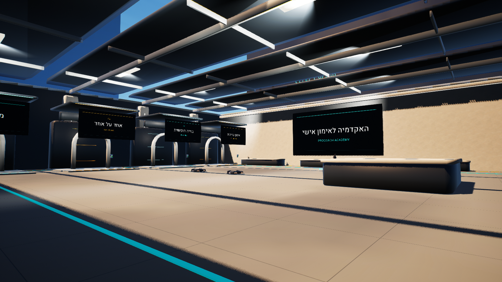

# הכניסות והיררכיית התאורה בלובי — 203

8 בנובמבר 2026. הושלם שינוי עורך מקומי דרך MCP, ללא משחק, העלאה או שליטת מחשב. זה אינו סיום הפרויקט או קבלת W1/W3.

## התוצרים

בצילום עורך חדש הופיע קיר אבן גולמי במרכז אזור הכניסות. זוהתה הפניית Actor מדויקת של `PBWA_S1_Solid_C`, במיקום `[256,-7168,0]`, ללא הורה וללא שכבת נתונים, עם תג הקיר המקורי בלבד. הוא נשמר בארכיון ב־Z=-25000, מוסתר וללא התנגשות, עם שם ארכיוני. המיקום, הסיבוב, הגודל והדגלים המקוריים נשמרו לשחזור. לא נמחק נכס ולא נקבע מתי הקיר נוצר או מי הציב אותו. זו אינה הוכחה שקיר מארכיון קודם חזר.

אזור ההגנה של הלובי כבר מנע בנייה, עריכה וירי בזמן משחק, אך היה מוגדר `Gameplay Only`. הוא עודכן ל־`Always`, הערך שהגרסה המותקנת מפרסמת, כדי לכלול גם את שלבי טרום המשחק. התצורה נקראה שוב ונשמרה. מקור הקיר אינו מוכח, ולכן אין לייחס את הופעתו להגדרת השלב הקודמת. הצבה ידנית של נכסים בעורך אינה משחק ואינה נבחנת באמצעות הגדרת האזור.

שמונת לוחות התאורה הקיימים בתקרה הצטמצמו מ־680×360 ס״מ ל־420×70 ס״מ. מיקומיהם, סיבוביהם ועוביים נשמרו. הכוונה העיצובית היא להפחית את השטח הלבן הגדול שמושך את העין לתקרה, ולתת יותר משקל לשלטי המצבים. זו הערכה חזותית, לא מדידת בהירות או נגישות. כל שמונת שינויי הגודל נקראו חזרה והשמירה הושלמה. מקור מחולל הגאומטריה והפריסה עודכנו לאותן מידות.

## מה נבדק בעורך

נוצרו בדיוק שני צילומים מהמצלמה המפורשת הקיימת, לפני ואחרי. שניהם מעולם Editor, ללא שינוי במצלמת המשתמש או התחברות למשחק. בתמונה שאחרי הקיר אינו במעבר הנראה ולוחות התאורה קטנים יותר. לא בוצעו בדיקת הליכה, הפעלת שער, בדיקת טרום משחק או מדידת FPS.

מסגרת הביקורת הייתה קריאות הפעולות, היררכיה, עקביות ונראות הטקסט. לא נמדדו יחס ניגודיות או איכות RTL אצל לקוח. הדגמים הקטנים של מכשירי המשחק המופיעים בתצוגת Editor אינם הוכחה לנראותם בזמן משחק. אין מכאן קבלת המראה בכל ארבעת האזורים או בגובה הבנייה.

## ראיות ושחזור

- `.local/lobby203-before.{json,png}` ו־`lobby203-after.{json,png}`: צילומי Editor באותה מצלמה.
- `.local/lobby203-obstacle-inspection.json` ו־`lobby203-obstacle-identity.json`: זהות הקיר ותצורת אזור ההגנה. תנאי הכתיבה הראשון עצר לפני שינוי בשל תג; קריאה נוספת אישרה שזהו רק תג הקיר המקורי, ותנאי ההמשך צומצם לתג המדויק. לא הוסר מנגנון גישה של העורך.
- `.local/lobby203-entry-authoring.json`: פרטי השחזור, העברת הקיר, קריאות דגלים/מיקום, הגדרת השלב ושמירה True.
- `.local/lobby203-authoring.json`: שמונה תנוחות מקור ויעד, קריאות חזרה ושמירה True. אין להריץ את המתכון שוב.
- `uefn/legacy-lobby-quarantine.json`, `lobby-safety.json` ו־`environment-finish-layout.json`: תצורת שחזור ועבודה עדכנית; `tools/author_environment_finish.py` תואם למידות החדשות.

[תיעוד Mutator Zone של Epic](https://dev.epicgames.com/documentation/fortnite/using-mutator-zone-devices-in-fortnite-creative) נקרא מחדש. יש להבחין בין התצורה המתועדת לקריאת האפשרויות בפועל בגרסה המותקנת, ובין שתיהן לבין התנהגות שטרם נצפתה במשחק.

המחקר המוגבל של בנייה מקורית נסגר ללא נתיב מאומת חדש, כפי שמתועד בראש NATIVE_BUILD_ACTIVATION_157_HE.md. התיקון כאן מקדם את הלובי; הוא אינו משנה את ארבעת שערי הבנייה או סוגר את פערי הבוט, הנזק, הבעלות והמשבצות. ההיקף המלא R01–R30 / W0–W7 נשאר פעיל וחלקי.
